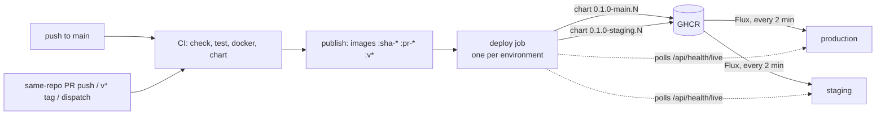

# Deployment

my-home runs on the home Kubernetes cluster (RKE2 on the NUC, Flux GitOps in
[NNTin/lair.nntin.xyz](https://github.com/NNTin/lair.nntin.xyz)). Every green build is deployed automatically:

| Environment | URL                            | Deployed from                                             | Database                                 |
| ----------- | ------------------------------ | --------------------------------------------------------- | ---------------------------------------- |
| production  | https://home.nntin.xyz         | every push to `main`                                      | persistent, backed up daily              |
| staging     | https://home-staging.nntin.xyz | same-repo pull request pushes, `v*` tags, manual dispatch | reset on every deploy, **except photos** |

Staging is one shared environment: the latest deploy replaces whatever ran there before. Both hosts are behind
Authentik single sign-on (`auth.nntin.xyz`); only `GET /api/health/live` is public, so CI can see which commit runs.

## How a deploy happens

1. `publish` pushes the api and web images (tags in [container-images.md](container-images.md#triggers-and-tags)).
2. `deploy` runs in the GitHub environment `production` (from `main`) or `staging` (everything else).
   - It stamps the image digests into `charts/my-home` and pushes chart `0.1.0-main.<run>` or `0.1.0-staging.<run>`
     to `oci://ghcr.io/nntin/charts`.
   - The environment allows one deploy at a time. If a newer build arrives while one is still waiting, the newer
     one replaces it.
3. Flux follows each chart channel and upgrades the release. Before any new pod receives traffic, the chart's
   pre-deploy hook runs:
   - production: `node dist/migrate.js`;
   - staging: `node dist/reset.js`, which drops the `public` and `drizzle` schemas (homes, layouts and their
     migration journal), migrates and seeds the real and the mock home. It never touches the `media` schema:
     **photos and photo requests survive every staging deploy**, whichever branch is deployed
     ([photos.md](photos.md#persistence)).
4. `deploy` waits until `https://<host>/api/health/live` reports the commit. Then GitHub marks the deployment
   successful and the previous deployment of that environment inactive.

Production always runs the immutable images of one commit. The chart pins them by digest, and the api reports the
commit as `commit` in `/api/health/live`.

## What runs on staging

- On a pull request, the timeline shows "deployed to staging" for the commit that runs there. Once another pull
  request or tag takes staging over, the earlier deployment shows as inactive.
- All deployments: the repository's **Environments** page (`staging`, `production`), or
  `gh api repos/NNTin/my-home/deployments?environment=staging --jq '.[0] | {ref, sha, created_at}'`.
- The running commit: `curl -s https://home-staging.nntin.xyz/api/health/live`.

## Deploy something to staging

- **Reset staging to `main`**: `gh workflow run ci.yml -R NNTin/my-home --ref main`.
- **A branch or tag without a pull request**: `gh workflow run ci.yml -R NNTin/my-home --ref <branch-or-tag>`.
- **A pull request from a fork** is built and tested, but never published or deployed. A maintainer who has
  reviewed it can push the branch to this repository and dispatch it (or open a same-repo pull request).

## Roll back production

Production follows the newest `0.1.0-main.*` chart. To roll back, pin it to the chart of an earlier green `main`
run. Find the chart version in the run's `deploy` summary ("Published my-home 0.1.0-main.N"), or list them with
`gh api /users/NNTin/packages/container/charts%2Fmy-home/versions --jq '.[].metadata.container.tags[]'`.

In NNTin/lair.nntin.xyz `clusters/nuc/my-home/production/release.yaml`, replace the `semver`/`semverFilter` lines of
`OCIRepository my-home-release` with `tag: 0.1.0-main.<N>`, then commit and push to `develop`. Flux rolls back within
minutes. While pinned, merges to `main` do not deploy. To resume, restore the two lines. See
[lair's runbook](https://github.com/NNTin/lair.nntin.xyz/blob/develop/docs/my-home/deployment.md) for the exact
commands.

Rollbacks never undo migrations. Keep production migrations **forward-only and backward-compatible** with the
previous api version: add columns and tables, backfill, and drop only in a later release, once no running version
reads them.

## Databases and backups

Production and staging each have their own PostgreSQL and credentials, in separate namespaces; staging pods cannot
reach the production database. Production is dumped daily (`pg_dump`, 14 days kept). Backup and restore steps are
in [lair's runbook](https://github.com/NNTin/lair.nntin.xyz/blob/develop/docs/my-home/deployment.md#backups-and-restore).

### Photos: what the databases must provide

Since photos ([photos.md](photos.md)) the **staging database is no longer throwaway**: its `media` schema holds the
owner's photos, which exist nowhere else until they are copied to production. The databases are provisioned in
NNTin/lair.nntin.xyz; this repository only states what it needs from both of them:

| Requirement    | Production and staging                                                                                       |
| -------------- | ------------------------------------------------------------------------------------------------------------ |
| Storage        | PostgreSQL data on a persistent volume that survives pod restarts and redeploys                              |
| Schema to keep | `media` (tables `photos`, `photo_blobs`, `photo_thumbnails`, `photo_requests`, `schema_migrations`)          |
| Expected size  | about 1 MB per photo; plan for 2,000 photos: **2 GiB of data, at least 5 GiB volume** per database           |
| Backup         | daily `pg_dump` in custom format that includes the `media` schema, 14 days kept (about 2 GiB each when full) |
| Restore        | restoring only the photos must be possible: `pg_restore --schema=media`                                      |
| Database role  | may create the `media` schema (`CREATE` on the database), as it already recreates `public` on staging        |
| Request size   | the ingress in front of the web container accepts request bodies of at least 32 MB (photo uploads)           |

A staging backup may leave out `public` and `drizzle`: they are recreated by every deploy. The api's memory limit
is 512Mi (`charts/my-home/values.yaml`) because it decodes one full-size photo at a time.
