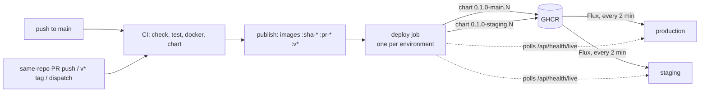

# Deployment

my-home runs on the home Kubernetes cluster (RKE2 on the NUC, Flux GitOps in
[NNTin/lair.nntin.xyz](https://github.com/NNTin/lair.nntin.xyz)). Every green build is deployed automatically:

| Environment | URL                            | Deployed from                                             | Database                                                                                                                                            |
| ----------- | ------------------------------ | --------------------------------------------------------- | --------------------------------------------------------------------------------------------------------------------------------------------------- |
| production  | https://home.nntin.xyz         | every push to `main`                                      | persistent, backed up daily; homes synced from git (`home.json`) on every deploy                                                                    |
| staging     | https://home-staging.nntin.xyz | same-repo pull request pushes, `v*` tags, manual dispatch | `public` reset and homes synced from git (`home.json`, `mock-home.json`) on every deploy; photos, placements, overrides, notes and settings persist |

Staging is one shared environment: the latest deploy replaces whatever ran there before. Both hosts are behind
Authentik single sign-on (`auth.nntin.xyz`); only `GET /api/health/live` is public, so CI can see which commit runs.

## How a deploy happens

1. `publish` pushes the api and web images (tags in [container-images.md](container-images.md#triggers-and-tags)).
2. `deploy` runs in the GitHub environment `production` (from `main`) or `staging` (everything else).
   - It stamps the image digests into `charts/my-home` and pushes chart `0.1.0-main.<run>` or `0.1.0-staging.<run>`
     to `oci://ghcr.io/nntin/charts`.
   - The environment allows one deploy at a time. If a newer build arrives while one is still waiting, the newer
     one replaces it.
3. Flux follows each chart channel and upgrades the release. Before any new pod receives traffic, the chart's
   pre-deploy hook runs `node dist/release.js` on both environments:
   1. it reads and validates every home file it is going to sync; an invalid one fails the job **before anything
      is written**, Helm aborts the upgrade and the old pods keep serving;
   2. staging only (`RESET_PUBLIC=true`, guarded by `ALLOW_DATABASE_RESET=true`): it drops the `public` and
      `drizzle` schemas (homes, layouts and their migration journal);
   3. it migrates `public`, `media` and `userdata`;
   4. it syncs the homes from git (see [Homes come from git](#homes-come-from-git)) and logs one line per home;
   5. it imports the named layouts of a home without placements into its placement set, once per home
      ([furniture.md](furniture.md#the-one-time-import)): `release: home "home": imported layout "Default layout" (7 items)`.

   It never touches the `media` and `userdata` schemas: **photos, photo requests, furniture placements, opening
   overrides, notes, home settings and their history survive every deploy**, whichever branch is deployed
   ([photos.md](photos.md#persistence), [userdata.md](userdata.md#persistence)).

4. `deploy` waits until `https://<host>/api/health/live` reports the commit. Then GitHub marks the deployment
   successful and the previous deployment of that environment inactive.

Production always runs the immutable images of one commit. The chart pins them by digest, and the api reports the
commit as `commit` in `/api/health/live`.

## Homes come from git

`data/homes/*.json` in the deployed commit is the only source of the house structure. **Changing the house = a pull
request to `data/homes`**; edits through `PUT /api/homes/:id` or `POST /api/homes/import` are replaced on the next
deploy (the api says so in a `Warning` header).

- **What is synced:** the chart value `homes.files` (`HOME_FILES`). By default production syncs only `home.json`
  and staging (`database.resetOnDeploy`) `home.json` and `mock-home.json`; an explicit `homes.files` overrides it.
  Without `HOME_FILES`, `dist/release.js` syncs every `data/homes/*.json`, `home.json` first.
- **How:** all files are validated first, then every home is inserted or replaced in **one transaction**
  (`created_at` is kept; a home equal to the stored one is left `unchanged`). The log reads
  `release: home "home" replaced, 0 uses need attention`.
- **Homes not in git** (an agent's import on staging) are left alone, with a warning in the log. Nothing is ever
  deleted.
- **What survives:** everything in `userdata` and `media`: furniture placements, opening overrides (colours,
  sizes), notes, photos and photo requests, and the home settings (`userdata.home_settings`: the magnetic
  declination entered in walk mode, an overlay on git's value with history and undo, [userdata.md](userdata.md)).
- **A use whose opening disappears from git** (an override on a removed window) is never deleted. It shows as
  `needs-attention` ("not in the home model") in where-used, and the release log counts and names it. Its notes and
  photo links stay and resolve as `missing`.
- **Photos are untouched**: a photo whose room disappears shows the room as no longer in the model.
- House-data pull requests change the golden render list of `home.json`: run
  `pnpm --filter @my-home/web exec vitest run -u src/catalog/golden.test.tsx` and commit the updated snapshot with the data change.

## What runs on staging

- On a pull request, the timeline shows "deployed to staging" for the commit that runs there. Once another pull
  request or tag takes staging over, the earlier deployment shows as inactive.
- All deployments: the repository's **Environments** page (`staging`, `production`), or
  `gh api repos/NNTin/my-home/deployments?environment=staging --jq '.[0] | {ref, sha, created_at}'`.
- The running commit: `curl -s https://home-staging.nntin.xyz/api/health/live`.

## Deploy something to staging

- **Reset staging to `main`**: `gh workflow run ci.yml -R NNTin/my-home --ref main`.
- **A branch or tag without a pull request**: `gh workflow run ci.yml -R NNTin/my-home --ref <branch-or-tag>`.
- **A pull request from a fork** is built and tested, but never published or deployed. A maintainer who has
  reviewed it can push the branch to this repository and dispatch it (or open a same-repo pull request).

## Roll back production

Production follows the newest `0.1.0-main.*` chart. To roll back, pin it to the chart of an earlier green `main`
run. Find the chart version in the run's `deploy` summary ("Published my-home 0.1.0-main.N"), or list them with
`gh api /users/NNTin/packages/container/charts%2Fmy-home/versions --jq '.[].metadata.container.tags[]'`.

In NNTin/lair.nntin.xyz `clusters/nuc/my-home/production/release.yaml`, replace the `semver`/`semverFilter` lines of
`OCIRepository my-home-release` with `tag: 0.1.0-main.<N>`, then commit and push to `develop`. Flux rolls back within
minutes. While pinned, merges to `main` do not deploy. To resume, restore the two lines. See
[lair's runbook](https://github.com/NNTin/lair.nntin.xyz/blob/develop/docs/my-home/deployment.md) for the exact
commands.

Rollbacks never undo migrations. Keep production migrations **forward-only and backward-compatible** with the
previous api version: add columns and tables, backfill, and drop only in a later release, once no running version
reads them.

A rollback deploys the older commit's `data/homes` too: its release job syncs those files. A rollback to a release
from **before the release job** (before #41, when production ran only `dist/migrate.js`) keeps the newer home
document, which that release may not parse (its `GET /api/homes/:id` then fails). Re-deploy forward instead.

## Databases and backups

Production and staging each have their own PostgreSQL and credentials, in separate namespaces; staging pods cannot
reach the production database. Production is dumped daily (`pg_dump`, 14 days kept). Backup and restore steps are
in [lair's runbook](https://github.com/NNTin/lair.nntin.xyz/blob/develop/docs/my-home/deployment.md#backups-and-restore).

### Photos: what the databases must provide

Since photos ([photos.md](photos.md)) the **staging database is no longer throwaway**: its `media` schema holds the
owner's photos, which exist nowhere else until they are copied to production. The databases are provisioned in
NNTin/lair.nntin.xyz; this repository only states what it needs from both of them:

| Requirement    | Production and staging                                                                                                                                               |
| -------------- | -------------------------------------------------------------------------------------------------------------------------------------------------------------------- |
| Storage        | PostgreSQL data on a persistent volume that survives pod restarts and redeploys                                                                                      |
| Schema to keep | `media` (tables `photos`, `photo_blobs`, `photo_thumbnails`, `photo_requests`, `photo_subjects`, `schema_migrations`)                                                |
| Schema to keep | `userdata` (tables `placements`, `opening_overrides`, `history`, `issued_ids`, `notes`, `home_settings`, `imports`, `schema_migrations`); must be kept and backed up |
| Expected size  | about 1 MB per photo; plan for 2,000 photos: **2 GiB of data, at least 5 GiB volume** per database                                                                   |
| Backup         | daily `pg_dump` in custom format that includes the `media` and `userdata` schemas, 14 days kept                                                                      |
| Restore        | restoring one schema must be possible: `pg_restore --schema=media`, `pg_restore --schema=userdata`                                                                   |
| Database role  | may create the `media` and `userdata` schemas (`CREATE` on the database), as it recreates `public` on staging                                                        |
| Request size   | the ingress in front of the web container accepts request bodies of at least 32 MB (photo uploads)                                                                   |

`userdata` is small (one row per placement, per overridden opening and per change; a few MB at most). Production's
full dump already includes it; adding it to the staging dump is an infrastructure follow-up of #39 in
NNTin/lair.nntin.xyz, and until then staging's `userdata` is test data that a database loss would take with it.

A staging backup may leave out `public` and `drizzle`: they are recreated by every deploy. Production's `public`
holds only what git restores on every deploy (the homes) plus the layouts. The api's memory limit
is 512Mi (`charts/my-home/values.yaml`) because it decodes one full-size photo at a time.
