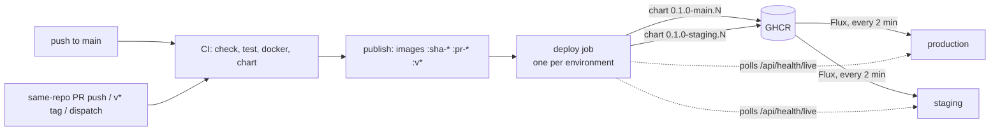

# Deployment

my-home runs on the home Kubernetes cluster (RKE2 on the NUC, Flux GitOps in
[NNTin/lair.nntin.xyz](https://github.com/NNTin/lair.nntin.xyz)). Every green build is deployed automatically:

| Environment | URL                            | Deployed from                                             | Database                                                                                                                                       |
| ----------- | ------------------------------ | --------------------------------------------------------- | ---------------------------------------------------------------------------------------------------------------------------------------------- |
| production  | https://home.nntin.xyz         | every push to `main`                                      | persistent, backed up daily; homes and their seeds synced from git (`home.json`, `home.seed.json`) on every deploy                             |
| staging     | https://home-staging.nntin.xyz | same-repo pull request pushes, `v*` tags, manual dispatch | `public` reset, `home.json` and its seed synced from git on every deploy, the retired `mock-home` purged; photos, settings and history persist |

Staging is one shared environment: the latest deploy replaces whatever ran there before. Both hosts are behind
Authentik single sign-on (`auth.nntin.xyz`); only `GET /api/health/live` is public, so CI can see which commit runs.

## How a deploy happens

1. `publish` pushes the api and web images (tags in [container-images.md](container-images.md#triggers-and-tags)).
2. `deploy` runs in the GitHub environment `production` (from `main`) or `staging` (everything else).
   - It stamps the image digests into `charts/my-home` and pushes chart `0.1.0-main.<run>` or `0.1.0-staging.<run>`
     to `oci://ghcr.io/nntin/charts`.
   - The environment allows one deploy at a time. If a newer build arrives while one is still waiting, the newer
     one replaces it.
3. Flux follows each chart channel and upgrades the release. Before any new pod receives traffic, the chart's
   pre-deploy hook runs `node dist/release.js` on both environments:
   1. it reads and validates every home file it is going to sync and its seed (`<home>.seed.json`, against the
      home and the catalogue); an invalid one fails the job **before anything is written**, Helm aborts the
      upgrade and the old pods keep serving;
   2. staging only (`RESET_PUBLIC=true`, guarded by `ALLOW_DATABASE_RESET=true`): it drops the `public` and
      `drizzle` schemas (homes, layouts and their migration journal);
   3. it migrates `public`, `media` and `userdata`;
   4. it syncs the homes from git (see [Homes come from git](#homes-come-from-git)) and logs one line per home;
   5. it makes each home's placements, opening overrides and notes match its seed (see
      [The seed comes from git](#the-seed-comes-from-git)): `release: home "home" seed unchanged`.

   It never touches the `media` schema and, in `userdata`, only what the seed holds: **photos, photo requests,
   home settings, history and issued ids survive every deploy**, whichever branch is deployed
   ([photos.md](photos.md#persistence), [userdata.md](userdata.md#persistence)); placements, overrides and notes
   are what the deployed commit's seed says.

4. `deploy` waits until `https://<host>/api/health/live` reports the commit. Then GitHub marks the deployment
   successful and the previous deployment of that environment inactive.

Production always runs the immutable images of one commit. The chart pins them by digest, and the api reports the
commit as `commit` in `/api/health/live`.

## Homes come from git

`data/homes/*.json` in the deployed commit is the only source of the house structure. **Changing the house = a pull
request to `data/homes`**; edits through `PUT /api/homes/:id` or `POST /api/homes/import` are replaced on the next
deploy (the api says so in a `Warning` header).

- **What is synced:** the chart value `homes.files` (`HOME_FILES`). By default both environments sync only `home.json`; an explicit `homes.files` overrides it.
  Without `HOME_FILES`, `dist/release.js` syncs every `data/homes/*.json`, `home.json` first.
- **How:** all files are validated first, then every home is inserted or replaced in **one transaction**
  (`created_at` is kept; a home equal to the stored one is left `unchanged`). The log reads
  `release: home "home" replaced, 0 uses need attention`.
- **Homes not in git** (an agent's import on staging) are left alone, with a warning in the log. Nothing is ever
  deleted, except a home named in `PURGE_HOMES` (the chart value `homes.purge`; staging defaults to `mock-home`, the
  retired test home; production to nothing): its stored home and its `userdata` rows (placements, overrides, notes,
  history, settings, imports) go in one transaction, with the row counts in the log, and it refuses a home that is
  in the synced files. Photos and photo requests are never deleted: the log only lists them.
- **What survives:** everything in `media` (photos and photo requests) and the home settings
  (`userdata.home_settings`: the magnetic declination entered in walk mode, an overlay on git's value with history
  and undo, [userdata.md](userdata.md)). Placements, opening overrides and notes follow the seed (next section).
- **A use whose opening disappears from git** (an override on a removed window) is never deleted. It shows as
  `needs-attention` ("not in the home model") in where-used, and the release log counts and names it. Its notes and
  photo links stay and resolve as `missing`.
- **Photos are untouched**: a photo whose room disappears shows the room as no longer in the model.
- House-data pull requests change the golden render list of `home.json`: run
  `pnpm --filter @my-home/web exec vitest run -u src/catalog/golden.test.tsx` and commit the updated snapshot with the data change.

## The seed comes from git

`data/homes/<home>.seed.json` next to each home file (`home.seed.json`) is the source of how the catalogue is
used in the home: the furnished default. **Git is authoritative**, on staging and production alike: every deploy
makes the environment's `userdata` match the deployed commit's seed. **An edit in the app or by an agent is a draft
until it is exported into a pull request; a deploy overwrites unexported edits.**

- **What is in it:** the active placements (id, type, name, level, position, rotation, mounting and elevation
  when not on the floor at 0, basic params; the room follows from the position), the opening overrides (window and door basic params, with the use's type) and the
  notes on the home's uses and on types (id, subject, text, who and when). The schema is `HomeSeed` in
  `packages/shared/src/home-seed.ts`; the file is canonical (sorted by id, fixed key order, params by key), so a
  diff shows only what changed. CI checks it against the catalogue (every type exists and is placeable, params are
  valid basic params) and the home (every level, opening id and note subject exists), and that it is canonical.
- **What is not:** history, issued ids, photos, photo requests and their links, the trash, and the home
  settings. The declination stays a per-environment setting (it is a calibration of one phone's compass, not
  furniture); to make it the house's value, put it into `home.json`'s `building.magneticDeclination` by PR.
- **How:** after the homes, in **one transaction** (`apps/api/src/db/seed-sync.ts`):
  - placements: a missing one is created with the seed's id, a changed one updated, one in the trash restored,
    and an active placement not in the seed moved to the trash (restorable for 30 days, then purged as usual);
  - every seed id is added to `issued_ids`, so the app never hands it out again; new placements continue the
    numbering (`souterrain-tall-cabinet-2`);
  - opening overrides: set to the seed's params; one not in the seed is emptied (the row and its history stay);
  - notes: created with the seed's id, overwritten, or soft-deleted. Type notes are environment-wide: the union of
    the synced seeds' type notes.
  - Every placement and override change is a history row by actor `system` named **`seed`** (`actorName`; an existing actor, so the previous api version reads it), so it shows in the use's history and
    can be undone until the next deploy (notes have no history; the release log names them). The log reads
    `release: home "home" seed applied: placements created 1 (…); moved to the trash 1 (…)`.
- **Idempotent:** an unchanged seed changes nothing and writes no history (`release: home "home" seed unchanged`).
- **Untouched:** photos, photo requests, their links to uses and notes (the ids are stable), history, the home
  settings, other homes. A home without a seed file keeps its `userdata` as it is (a warning in the log).
- **Staging is shared:** it follows the seed of whichever branch was deployed last. A branch from before someone
  else's seed change trashes that change's new placements until a newer branch deploys; nothing is lost (trash
  and history). Rebase before exporting, and export right after placing.

**Changing the furniture = a pull request to the seed.** Place, move or set on staging (the app or `uses.sh`), then
`seed.sh staging export > data/homes/home.seed.json` (skill `my-home-environments`) and open a PR; its staging
deploy applies the same seed, so `seed.sh staging diff` stays empty. The merge deploys it to production.
`GET /api/homes/:homeId/seed` is the export (the file's exact text), `PUT /api/homes/:homeId/seed` an import (as a
deploy would, history by `system` named `seed import by <who>`, a `Warning` header: the next deploy applies git's
seed). A rollback deploys the older commit's seed too (§ Roll back production).

## What runs on staging

- On a pull request, the timeline shows "deployed to staging" for the commit that runs there. Once another pull
  request or tag takes staging over, the earlier deployment shows as inactive.
- All deployments: the repository's **Environments** page (`staging`, `production`), or
  `gh api repos/NNTin/my-home/deployments?environment=staging --jq '.[0] | {ref, sha, created_at}'`.
- The running commit: `curl -s https://home-staging.nntin.xyz/api/health/live`.

## Deploy something to staging

- **Reset staging to `main`**: `gh workflow run ci.yml -R NNTin/my-home --ref main`.
- **A branch or tag without a pull request**: `gh workflow run ci.yml -R NNTin/my-home --ref <branch-or-tag>`.
- **A pull request from a fork** is built and tested, but never published or deployed. A maintainer who has
  reviewed it can push the branch to this repository and dispatch it (or open a same-repo pull request).

## Roll back production

Production follows the newest `0.1.0-main.*` chart. To roll back, pin it to the chart of an earlier green `main`
run. Find the chart version in the run's `deploy` summary ("Published my-home 0.1.0-main.N"), or list them with
`gh api /users/NNTin/packages/container/charts%2Fmy-home/versions --jq '.[].metadata.container.tags[]'`.

In NNTin/lair.nntin.xyz `clusters/nuc/my-home/production/release.yaml`, replace the `semver`/`semverFilter` lines of
`OCIRepository my-home-release` with `tag: 0.1.0-main.<N>`, then commit and push to `develop`. Flux rolls back within
minutes. While pinned, merges to `main` do not deploy. To resume, restore the two lines. See
[lair's runbook](https://github.com/NNTin/lair.nntin.xyz/blob/develop/docs/my-home/deployment.md) for the exact
commands.

Rollbacks never undo migrations. Keep production migrations **forward-only and backward-compatible** with the
previous api version: add columns and tables, backfill, and drop only in a later release, once no running version
reads them.

A rollback deploys the older commit's `data/homes` too: its release job syncs those files. A rollback to a release
from **before the release job** (before #41, when production ran only `dist/migrate.js`) keeps the newer home
document, which that release may not parse (its `GET /api/homes/:id` then fails). Re-deploy forward instead.

A rollback to a release from **before the seed** (before `data/homes/home.seed.json`) has no seed sync: its release
job leaves placements, overrides and notes exactly as the last seeded deploy left them, and they stay that way
(edits there persist again) until a release with the seed deploys and makes them match its seed. The seed's
history rows use the existing actor `system` (named `seed`), so that older api still lists and undoes them. A
rollback to a release **with** the seed applies that older commit's seed.

This release (#56) removed the named-layouts api and the one-time layout import but **keeps `public.layouts`**
and its migrations, unused: the previous release's job still runs that import (it reads the table; the import has
run for every home and is recorded in `userdata.imports`, so it does nothing) and serves the layouts routes. A
rollback to it therefore works unchanged, and placements, overrides, notes, the seed and photos are unaffected. A
later release drops the table.

## Databases and backups

Production and staging each have their own PostgreSQL and credentials, in separate namespaces; staging pods cannot
reach the production database. Production is dumped daily (`pg_dump`, 14 days kept). Backup and restore steps are
in [lair's runbook](https://github.com/NNTin/lair.nntin.xyz/blob/develop/docs/my-home/deployment.md#backups-and-restore).

### Photos: what the databases must provide

Since photos ([photos.md](photos.md)) the **staging database is no longer throwaway**: its `media` schema holds the
owner's photos, which exist nowhere else until they are copied to production. The databases are provisioned in
NNTin/lair.nntin.xyz; this repository only states what it needs from both of them:

| Requirement    | Production and staging                                                                                                                                               |
| -------------- | -------------------------------------------------------------------------------------------------------------------------------------------------------------------- |
| Storage        | PostgreSQL data on a persistent volume that survives pod restarts and redeploys                                                                                      |
| Schema to keep | `media` (tables `photos`, `photo_blobs`, `photo_thumbnails`, `photo_requests`, `photo_subjects`, `schema_migrations`)                                                |
| Schema to keep | `userdata` (tables `placements`, `opening_overrides`, `history`, `issued_ids`, `notes`, `home_settings`, `imports`, `schema_migrations`); must be kept and backed up |
| Expected size  | about 1 MB per photo; plan for 2,000 photos: **2 GiB of data, at least 5 GiB volume** per database                                                                   |
| Backup         | daily `pg_dump` in custom format that includes the `media` and `userdata` schemas, 14 days kept                                                                      |
| Restore        | restoring one schema must be possible: `pg_restore --schema=media`, `pg_restore --schema=userdata`                                                                   |
| Database role  | may create the `media` and `userdata` schemas (`CREATE` on the database), as it recreates `public` on staging                                                        |
| Request size   | the ingress in front of the web container accepts request bodies of at least 32 MB (photo uploads)                                                                   |

`userdata` is small (one row per placement, per overridden opening and per change; a few MB at most). Production's
full dump already includes it; adding it to the staging dump is an infrastructure follow-up of #39 in
NNTin/lair.nntin.xyz, and until then staging's `userdata` is test data that a database loss would take with it.

A staging backup may leave out `public` and `drizzle`: they are recreated by every deploy. Production's `public`
holds only what git restores on every deploy (the homes) plus the deprecated layouts (unused since #56). The api's memory limit
is 512Mi (`charts/my-home/values.yaml`) because it decodes one full-size photo at a time.
