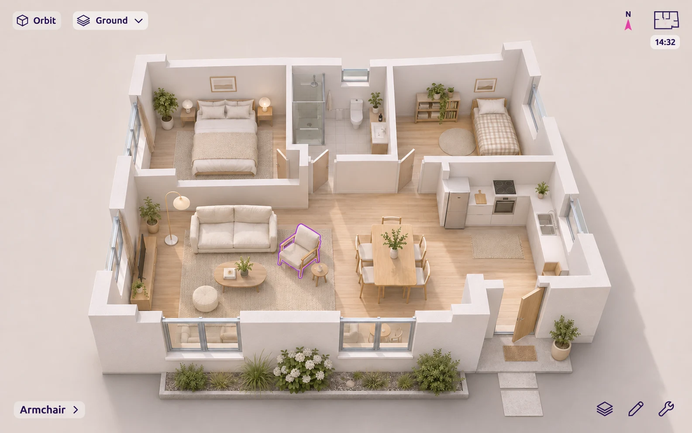
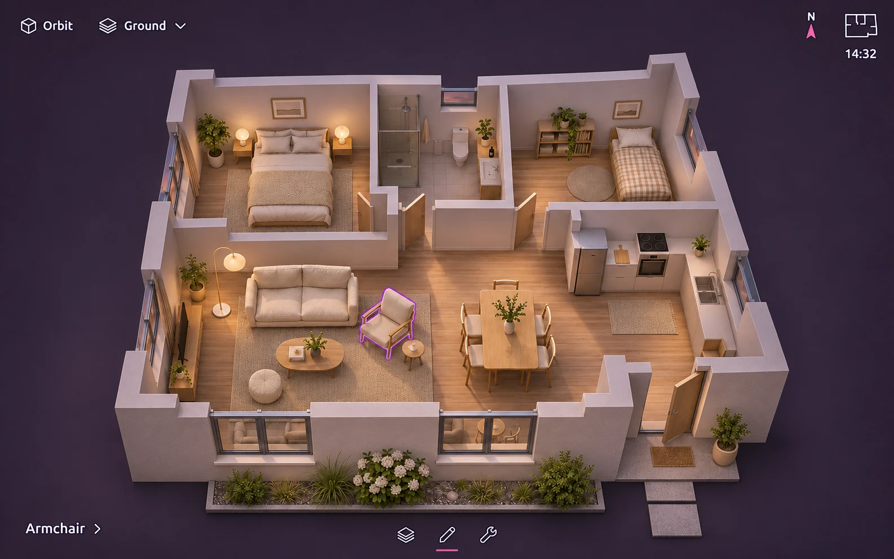
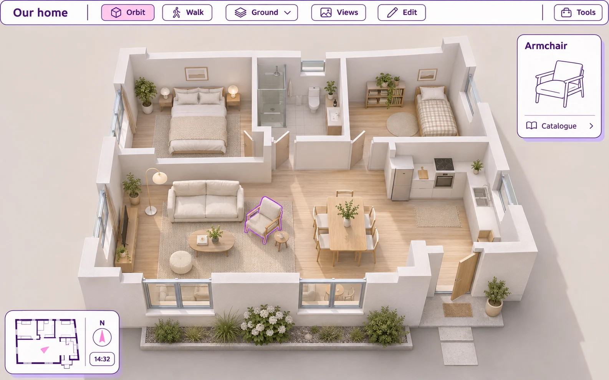
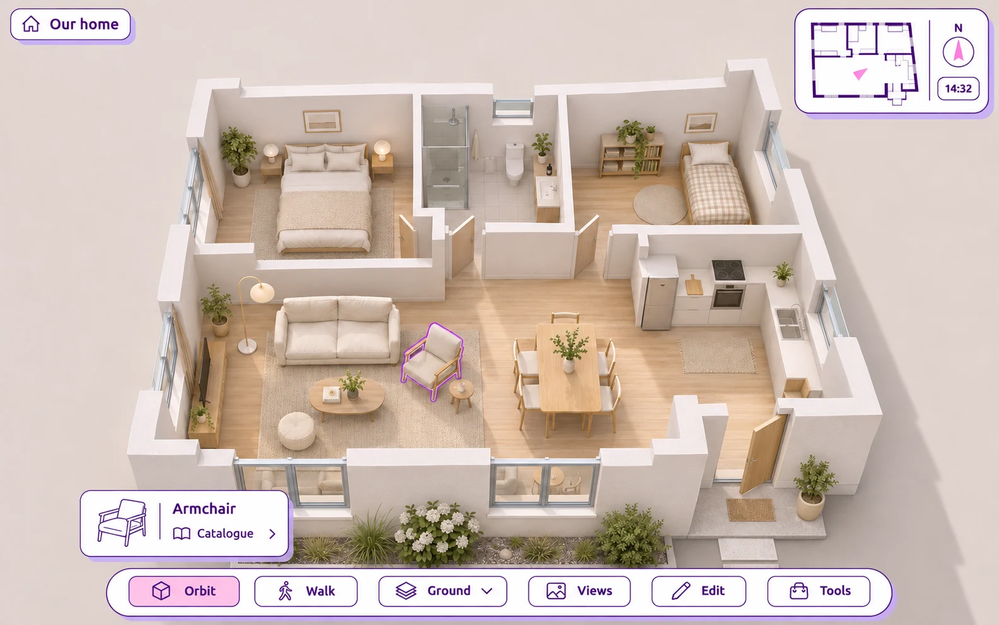

# HUD layout concepts

The current direction is a minimal game HUD. Both new mockups show the same fictional cutaway in Orbit with an armchair selected. The map is collapsed and the scene time is a placeholder. These are desktop studies. See the [visual design](../visual-design.md) for the interaction states and touch layout.

## Corner clusters



Mode and level sit at the top left, orientation at the top right and the action icons at the bottom right. The selected item gets a short label in the opposite corner. Small translucent backings help the text read on a light scene. This is the starting layout for desktop.

## Floating action row



Views, Edit and Tools move to the lower center, with canvas visible between the individual controls. Paper-white icons and an ink outline keep the controls visible on the dark backdrop. This illustrates a contrast treatment and an alternative placement. Either layout can use either contrast treatment. The dusk lighting is a visual study for the planned scene clock.

<details>
<summary>Image generation prompts</summary>

Both use built-in ImageGen. The first edits the earlier edge-bar mock. The second edits the first revision.

### Corner clusters

```text
Use case: ui-mockup. Edit the supplied concept image. Preserve the entirely invented architectural cutaway, materials, pale studio lighting, camera angle, framing, and which armchair is selected. Replace every overlay with a very minimal original game HUD that leaves the view unobstructed. Full-bleed desktop viewer, no browser chrome. Treat the edge layout below as deliberate tiny UI drawn at actual app scale on a 1586×992 display. All controls sit only 22–30 pixels in from the edge. Transparent background everywhere between controls. REMOVE the entire existing white top bar, the boxed right inspector, and the large boxed map. Show no panel, large card, rail, enclosing control group, or continuous bar. The canvas is visible from edge to edge behind the overlays.

New HUD, with as few words and marks as possible:
- Upper left: two small individual controls, a crisp compact “Orbit” mode control and “Ground” with a downward chevron. Existing house render remains visible behind the rest of this corner zone.
- Upper right: a small unboxed compass needle with “N” and a pink north tip. Beside it a tiny floor-plan map icon for opening the map, and a small “14:32” time chip immediately below. Actual compass icon roughly 30 pixels across. No map preview or minimap box.
- Lower right: three equally spaced small icon buttons for Views, Edit and Tools, with a stacked view icon, pencil icon and wrench icon. Roughly 28 pixels of visible icon each and 44 pixels of space per touch target. Button backgrounds clear, no written labels here.
- Lower left: the small one-line selection label “Armchair” with a right chevron. No illustration, no card. Keep the chair's fine violet scene outline.

Look: minimalistic game UI, exact, restrained, sharply legible. The compact typography is a clean boldish system sans serif with extremely thin white keyline where needed for separation from the 3D scene, main ink dark violet #1D1A4A. If a small label needs a backing, use one faint flat translucent white paper chip directly behind that label with the backdrop visibly showing through. Lavender #B8B3FF and pink #FF5FA8 in tiny accent marks only. Sakuga VFX at rest, retain its ink icon style, no effects in this idle frame. Nothing on screen reads as a website navigation bar. Do not add other UI text, people, logos, watermarks, real photographs, place names, locations, coordinates or addresses.
```

### Floating action row

```text
Use case: ui-mockup. Edit the supplied screenshot to demonstrate an alternative original minimal game HUD for this same fictional 3D home viewer, on a dark studio backdrop. The same cutaway, lens, scale, framing, walls, furnishings and fine selected armchair outline remain. Turn the scene subtly to dusk, with a charcoal violet studio background, soft warm indoor lamps and legible interiors. Keep dark materials detailed as in a professional architectural 3D render. The screenshot contains only the 3D viewport and small genuine controls, no browser frame.

Two main overlay changes. First, relocate the Views, Edit and Tools glyphs from lower right into a single small centered bottom action row. Show only three white line icons (view layers, pencil, wrench), spaced on three distinct small 44 px targets with clear space in between, and thin dark keylines to keep their edges distinct. This row together takes no more than 180 image pixels in width. A tiny pink underline shows the currently focused control. There is no surrounding panel or grouping shape, let the canvas show around each icon. Second, keep the small “Armchair” selection label at lower left, the upper-left “Orbit” and “Ground” controls, and the upper-right compass (“N” and a pink tip), map glyph and “14:32” clock. Render these icons and labels in paper white with a precise dark violet keyline on this darker view. Add a small flat translucent ink-colored backing only behind the longest label if absolutely needed. Do not add a full map overlay or extra text. Main goal is to show how the HUD stays legible without blocking the view. Compact size, balanced safe margins, no opaque cards, continuous slabs, blur, gradients in UI, glass, glows, or decorative elements. No animation is visible at rest. No logo, real home photo, people, external map, addresses, places, watermark, or location data.
```

</details>

## Earlier layout studies

<details>
<summary>Edge bar, bottom dock and side rail</summary>

All three show the same invented cutaway in Orbit, with an armchair selected and the optional minimap open. The clock shows a placeholder time. These are desktop layout studies. Phone layouts, exact control density and the final theme values are open.

### A. Edge bar



The controls stay in one predictable row. The fixed inspector gives details a stable place and works well for edits across several selections. A full-width bar frames the scene and uses vertical space.

### B. Bottom dock



The top edge stays clear, and the inspector opens near the controls. This makes the bar easy to reach. The dock and inspector compete with the lower part of the scene, especially when an expanded panel or phone safe area is present.

### C. Side rail


The rail gives the controls consistent positions and leaves both horizontal edges clear. The callout ties the action to its object. It can cover nearby details in a dense room, and the rail uses space on narrow screens.

[Earlier generation prompts](https://github.com/NNTin/my-home/blob/404af38dd23fb4fbb8eef7730aeec8858819f7a7/docs/design/hud-v2/mocks/README.md)

</details>
