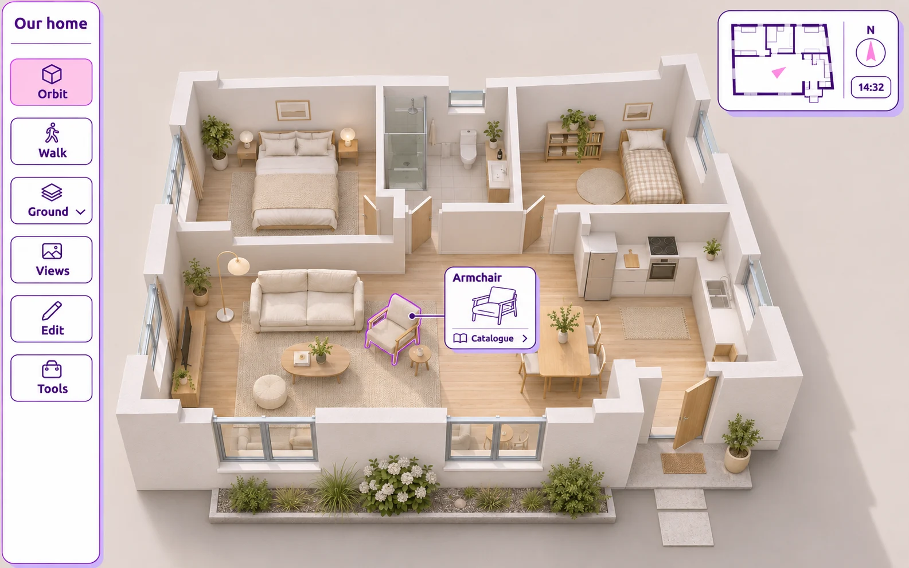

# First HUD layout concepts

All three show the same invented cutaway in Orbit, with an armchair selected and the optional minimap open. The clock shows a placeholder time. These are desktop layout studies. Phone layouts, exact control density and the final theme values are open.

## A. Edge bar


The controls stay in one predictable row. The fixed inspector gives details a stable place and works well for edits across several selections. A full-width bar frames the scene and uses vertical space.

## B. Bottom dock


The top edge stays clear, and the inspector opens near the controls. This makes the bar easy to reach. The dock and inspector compete with the lower part of the scene, especially when an expanded panel or phone safe area is present.

## C. Side rail



The rail gives the controls consistent positions and leaves both horizontal edges clear. The callout ties the action to its object. It can cover nearby details in a dense room, and the rail uses space on narrow screens.

## First decision

Start with A if you want stable positions and a predictable inspector. B is the strongest alternative if you prefer a mostly open upper view. C shows how a small object callout could work with any of the three navigation placements.

<details>
<summary>Image generation prompts</summary>

The first concept used built-in ImageGen. The second and third used the first as a scene reference.

### A

```text
Use case: ui-mockup. Create ONE polished, credible, widescreen 16:10 desktop browser-content screenshot for a working 3D home viewer product design, full bleed UI to the image edges, no mock device, no browser chrome. Across the screen, show a fictional compact one-storey home as a clean orthographic 3D architectural cutaway on a pale warm-gray studio backdrop, roof removed, quietly detailed white plaster, pale oak floor, neutral sofa, tiny kitchen and soft daylight with physically realistic shadows. Camera sees from above, model will sit in the largest region clear of controls. The geometry and floor plan are completely invented. The state is Orbit, ground level, one neutral armchair selected with a slim violet outline in the model. The HUD follows Sakuga VFX paper art direction at rest: white opaque flat paper, small rounded corners, confident violet-ink outline, restrained lavender hard offset shadows, sparing pink north needle and selected-item accent, warm neutral backdrop, clear sans-serif type, clean compact line icons. No gradients in UI, no glow, no particles or motion, no glass, no dark blur. Paper controls are a genuine small on-screen interface proportionally sized against a large model. Show exactly these short strings where used: "Our home", "Orbit", "Walk", "Ground", "Views", "Edit", "Tools", "Armchair", "Catalogue", "14:32", "N". Use a small generic fictional minimap depicting the cutaway's floor plan, one heading arrow, no geographic data. Make text legible and sparse. No extra headings or explanatory text, no logo, no watermark, no people, no photos of a real home, no street views, no street or place names, no address, no real location information or coordinates. Work is used as a static concept image, so provide no design file markup.

Layout direction A, Edge bar. Put the main controls along a slim top bar with Our home at left, Orbit/Walk/Ground/Views/Edit grouped in the left half or center, Tools at far right. Place a modest right-edge Armchair card just below it with a clean sketch thumbnail and a Catalogue link. Stack a clearly visible compact square paper minimap, compass and minute clock on the bottom left. Keep the lower right and the entire center free of UI so the cutaway dominates. This is the one direction with a full-width thin top bar. Show tiny pink selection accents only. Render only this single layout as one actual interface screenshot, with no title for the layout or descriptive overlays.
```

### B

```text
Use case: ui-mockup. Create ONE polished, credible, widescreen 16:10 desktop browser-content screenshot for a working 3D home viewer product design, full bleed UI to the image edges, no mock device, no browser chrome. Across the screen, show a fictional compact one-storey home as a clean orthographic 3D architectural cutaway on a pale warm-gray studio backdrop, roof removed, quietly detailed white plaster, pale oak floor, neutral sofa, tiny kitchen and soft daylight with physically realistic shadows. Camera sees from above, model will sit in the largest region clear of controls. The geometry and floor plan are completely invented. The state is Orbit, ground level, one neutral armchair selected with a slim violet outline in the model. The HUD follows Sakuga VFX paper art direction at rest: white opaque flat paper, small rounded corners, confident violet-ink outline, restrained lavender hard offset shadows, sparing pink north needle and selected-item accent, warm neutral backdrop, clear sans-serif type, clean compact line icons. No gradients in UI, no glow, no particles or motion, no glass, no dark blur. Paper controls are a genuine small on-screen interface proportionally sized against a large model. Show exactly these short strings where used: "Our home", "Orbit", "Walk", "Ground", "Views", "Edit", "Tools", "Armchair", "Catalogue", "14:32", "N". Use a small generic fictional minimap depicting the cutaway's floor plan, one heading arrow, no geographic data. Make text legible and sparse. No extra headings or explanatory text, no logo, no watermark, no people, no photos of a real home, no street views, no street or place names, no address, no real location information or coordinates. Work is used as a static concept image, so provide no design file markup.

Layout direction B, Bottom dock. Make a distinct centered floating pill-like paper dock near the bottom edge with Orbit, Walk, Ground, Views, Edit, Tools in it, each with generous room and a small icon. A small armchair inspector opens immediately above the left half of the dock when the armchair is selected. There is a tiny home chip in the upper left, and a combined compass, minimap and clock group in the upper right. The top edge is otherwise entirely open, and the model surface remains visible above the dock. Make the bottom control dock visually unmistakable. Render only this single layout as one actual interface screenshot, with no title for the layout or descriptive overlays.

The supplied screenshot is the edit target and scene reference. Preserve the fictional house, camera view, model lighting, selected chair, colors, overall framing and icon art as closely as possible. Change the overlay layout as instructed only. Move the inspector up above the left half of the dock and the map to the top right. Clear away the original full-width top bar completely. Shorten the inspector to a small landscape-style label card to maintain scene visibility.
```

### C

```text
Use case: ui-mockup. Create ONE polished, credible, widescreen 16:10 desktop browser-content screenshot for a working 3D home viewer product design, full bleed UI to the image edges, no mock device, no browser chrome. Across the screen, show a fictional compact one-storey home as a clean orthographic 3D architectural cutaway on a pale warm-gray studio backdrop, roof removed, quietly detailed white plaster, pale oak floor, neutral sofa, tiny kitchen and soft daylight with physically realistic shadows. Camera sees from above, model will sit in the largest region clear of controls. The geometry and floor plan are completely invented. The state is Orbit, ground level, one neutral armchair selected with a slim violet outline in the model. The HUD follows Sakuga VFX paper art direction at rest: white opaque flat paper, small rounded corners, confident violet-ink outline, restrained lavender hard offset shadows, sparing pink north needle and selected-item accent, warm neutral backdrop, clear sans-serif type, clean compact line icons. No gradients in UI, no glow, no particles or motion, no glass, no dark blur. Paper controls are a genuine small on-screen interface proportionally sized against a large model. Show exactly these short strings where used: "Our home", "Orbit", "Walk", "Ground", "Views", "Edit", "Tools", "Armchair", "Catalogue", "14:32", "N". Use a small generic fictional minimap depicting the cutaway's floor plan, one heading arrow, no geographic data. Make text legible and sparse. No extra headings or explanatory text, no logo, no watermark, no people, no photos of a real home, no street views, no street or place names, no address, no real location information or coordinates. Work is used as a static concept image, so provide no design file markup.

Layout direction C, Side rail. Show a slim fixed white paper vertical rail at the far left, reading Our home at the top and arranged vertically with Orbit, Walk, Ground, Views, Edit, Tools after it. Reserve a small fixed upper-right orientation stack with compass, minimap and clock. Show a little contextual callout near the selected armchair with Armchair and Catalogue in clean legible typography. Connect it to the chair with a short straight indicator and give it an anchor clear of the model's central area. Leave the lower edge empty. Make the left rail visually unmistakable and avoid any top or bottom toolbar. Render only this single layout as one actual interface screenshot, with no title for the layout or descriptive overlays.

The supplied screenshot is the edit target and scene reference. Preserve the fictional house, camera view, model lighting, selected chair, colors, overall framing and icon art as closely as possible. Change the overlay layout as instructed only. Move the controls to a narrow left rail, the map widget to the top right and the inspector close to the selected chair, keeping it compact, short and to one side of the chair. Clear away the original top bar completely.
```

</details>
