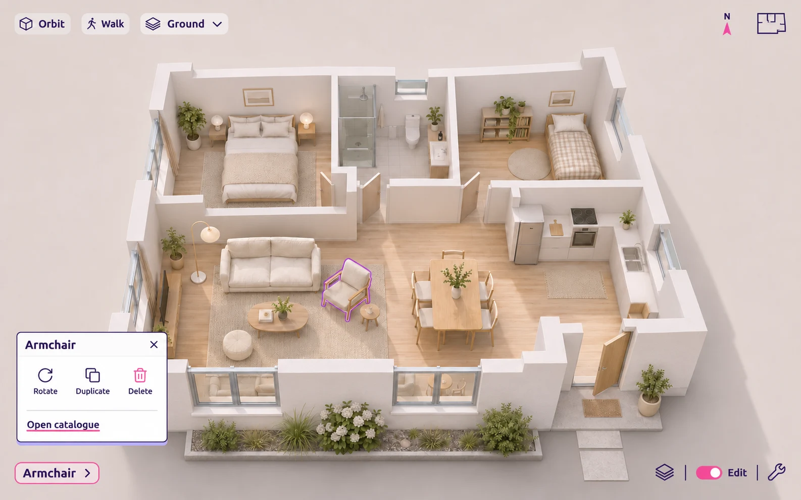
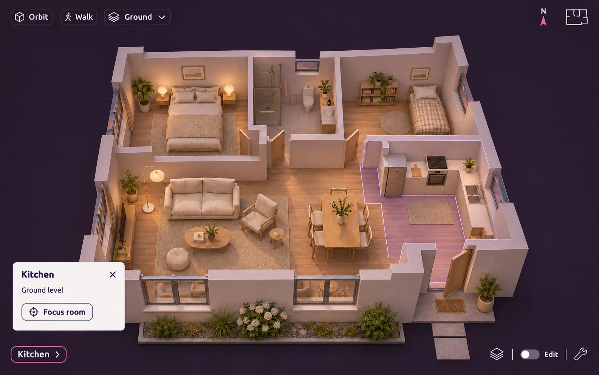
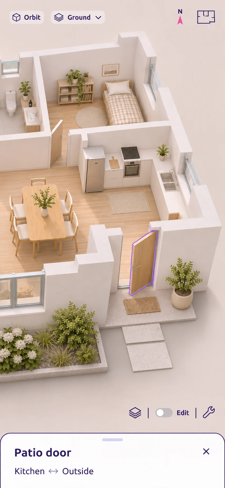

# Contextual HUD concepts

These three concepts show the lighter [corner layout](README.md#corner-clusters) during inspection. They use one fictional house. The level is a single chip and orientation stays compact. The bounds of the selection stay visible while its details are open.

## Desktop furniture inspector



In Edit, the lower-left selection chip opens an inspector directly above it. Rotate, Duplicate, Delete and the catalogue link sit together. The corner action row still shows the painted Edit switch.

## Desktop room inspector



In Orbit, the kitchen shows a subtle floor tint and a short inspector with the level and **Focus room**. Paper-white HUD glyphs carry the resting controls on the dark backdrop. The room's highlight stays visible at the right of the scene.

## Phone door inspector



A shallow touch sheet shows the opening name and connected spaces. The selected door stays visible and the primary actions sit directly above the sheet within reach. The compass, map, mode and level remain at the top.

These are resting frames with a panel open. The proposed layout uses the existing Sakuga controls, inspector and sheet reactions.

<details>
<summary>Image generation prompts</summary>

All three images used built-in ImageGen with the fictional models in the previous concepts as references.

### Furniture

```text
Use case: ui-mockup. Edit the supplied wide 16:10 screenshot of an original, entirely fictional 3D home viewer. Keep exactly the same invented house, furniture, light studio backdrop, camera, materials and armchair selection. This is a new desktop HUD concept at rest with a contextual furniture inspector OPEN in Edit mode. Full-screen canvas, no browser chrome or device border. Keep the light, original game HUD design from the input: small separate Orbit and Ground chevron chips in the upper left, unboxed pink north needle with a small N and a map glyph at upper right. Use a concise unobtrusive Walk action near Orbit if it fits. Lower right has three clear controls, Views glyph, a tiny painted Edit switch visibly on with the short label “Edit”, and a wrench glyph for Tools. No continuous bar. Keep map closed and omit time in this variant.
The lower-left selection chip “Armchair ›” is active. DIRECTLY ABOVE this chip, in the available space near left edge, draw one OPEN compact contextual inspector. It is a believable working app menu, approximately 240 px wide by 177 px high in a 1585 px wide screenshot, inset 28 px from left and 80 px from bottom. The inspector is Sakuga-style crisp pale white paper, 1–2 px dark violet keyline, tiny flat lavender offset shadow, achievable simple UI. It shows header exactly “Armchair” plus a small × close control; a single row of three distinct functional icon buttons with readable small labels “Rotate”, “Duplicate”, “Delete”; and at the bottom a simple “Open catalogue” link. No thumbnail, text block, subtitle, fictional metadata or redundant decoration. Keep the armchair itself clearly readable, with the existing slim violet selection outline. Keep the large canvas and empty margins visible. System sans-serif, paper white, #1D1A4A ink, #B8B3FF shadow, restrained #FF5FA8 accents. Use clear resting glyphs and reliable contrast; surfaces are flat, no UI blur, gradients, glow, glass or particles. This is an idle app screen with one menu open. Avoid people, actual photographs, address, place names, coordinates, real maps, actual home imagery, and watermark.
```

### Room

```text
Use case: ui-mockup. Create a new believable landscape 16:10 desktop screenshot for the original game-style 3D home viewer. Image 1 is the edit target and exact layout and geometry reference. Image 2 is the dark lighting and paper-white HUD-ink reference; ignore that image's lower-center action arrangement. Preserve the fictional house, angle, framing, rooms and furnishings from Image 1. Use dark charcoal-violet studio and gentle interior lamp lighting like Image 2.
Change context from editing an armchair to inspecting the Kitchen in Orbit, no editing active. Remove armchair selection entirely. Draw a restrained thin violet outline with subtle translucent lavender tint on the visible floor area of the kitchen, on the viewer's right where the cabinets, fridge and stove are, in scene perspective, no annotation arrow. The tint preserves the floor texture and covers only that kitchen area, no whole-scene tint. Show one contextual pane at lower left, fully open above an active selection chip “Kitchen ›”. Use a modest 235 px wide, roughly 132 px high pale near-white Sakuga paper panel. It has only the exact title “Kitchen”, close icon × at upper right, small line “Ground level” and a single compact button “Focus room” with a target glyph. No furniture actions, no armchair list, no thumbnail, no surrounding panel, no extra labels.
Keep the light-touch original HUD placement from Image 1: plain upper-left “Orbit”, “Walk” and a single “Ground” chevron control, a small unboxed compass needle “N” and a map glyph at top right, clear Views and Tools glyphs with compact off “Edit” switch at lower right. Paper-white text and glyphs with a fine violet keyline on dark, except the paper panel uses dark violet ink. Preserve pink only for a small accent. Nothing floats in the center except the room selection drawn on its floor. Quiet at rest, no drawn effects. No browser chrome, borders around the whole app, blur, gradients in HUD, glow, logo, watermark, people, real photos, real homes, street or place names, geographic map data or addresses.
```

### Door

```text
Use case: ui-mockup. Generate a believable portrait 390:844 mobile app-content screenshot for an original, minimal game-style 3D home viewer. Use the supplied image only as reference for the invented house design, daylight, materials and HUD system. Make the output a tall portrait screenshot, full bleed, no device mockup, hardware bezel, system status bar or browser chrome. Reframe the fictional cutaway closer with an above-and-inward view on its right/front corner: the light oak kitchen and dining area are above and behind a slim oak exterior door that opens toward a few pale stone pavers. The selected door should be clearly visible near the middle of the portrait canvas, entirely above the sheet, with a thin violet selection edge. Daylight on neutral plaster and light oak, as a high quality visual 3D model with a warm light studio backdrop. The app is in Orbit.
In the top safe area, show just two tiny lightly backed independent “Orbit” and “Ground” with chevrons at left, and a small unboxed pink north needle with “N” and a collapsed floor-map glyph at right. No top bar or continuous backing. Large areas of free canvas, particularly around the door. At the bottom, show the contextual details in ONE small white Sakuga paper bottom sheet, softly rounded top edge, thin dark violet outline, a tiny centered drag handle and NO dimming overlay. The sheet takes only the lower quarter of the portrait. On the first line exactly “Patio door”, with × button aligned right. On the next line exactly “Kitchen ↔ Outside”, showing the space connection. No metadata after that. The sheet has generous 44 px touch-sized controls and simple blank margins, and does not cover the door or its outline. A narrow transparent action row by the thumb area can sit immediately above the sheet on the right with small views, off Edit switch and tools glyphs if there is room; keep it away from the selected door. Keep type crisp, simple and well-sized, dark violet ink #1D1A4A, tiny lavender shadow and sparing pink, white paper only behind the opened sheet or short readable chips. No embellishments, animation, decorative type, logos, UI blur, gradients, rounded phone device frame, person, real image of a house, places, street views, address or coordinates.
```

</details>
