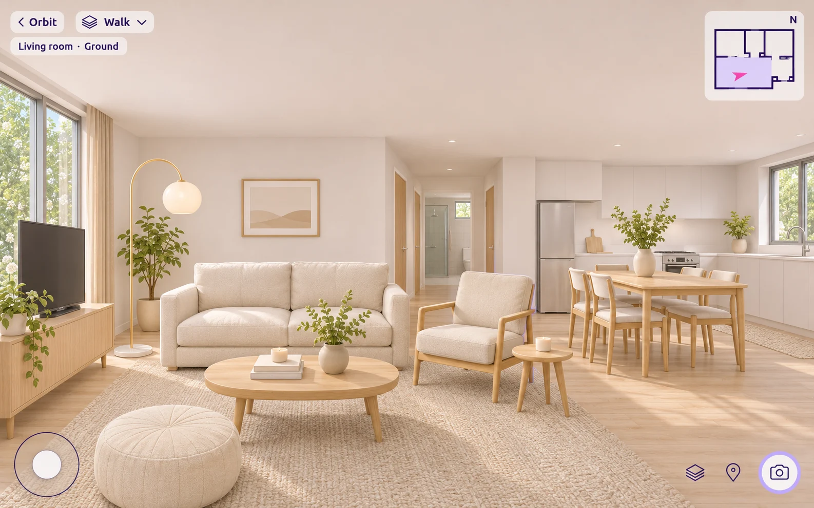
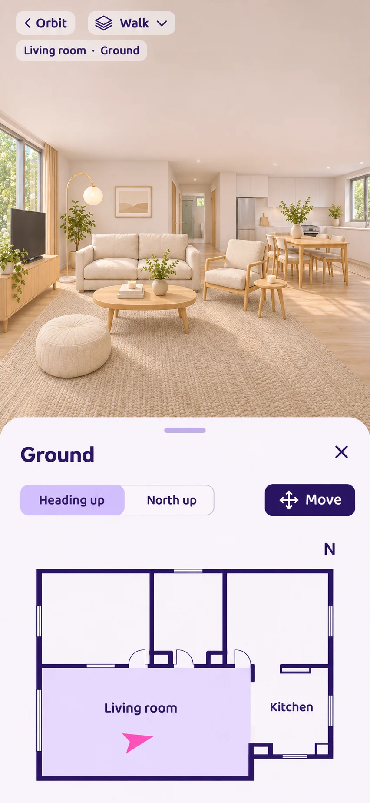
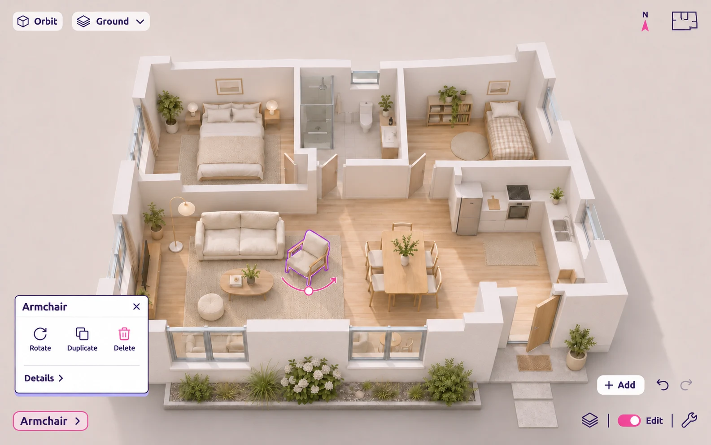
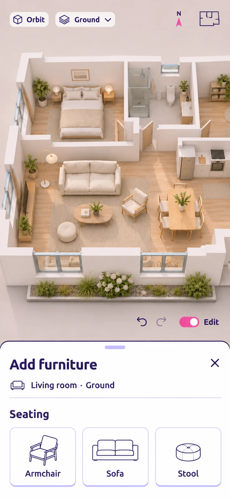

# Walk, minimap, and Edit concepts

Use the same HUD language when the viewer changes mode. Keep the canvas visible, use light corner controls for everyday actions, and open Sakuga paper when a task needs more room. These concepts use the same fictional house as the [corner study](README.md#corner-clusters). They build on the [inventory of current HUDs](../inventory.md).

## Walk on desktop with compact map



- **Upper left.** Make the exit's destination visible with **‹ Orbit**. Keep the room and level in one short readout. The Walk menu can hold manual or sensor settings, gesture help, and calibration where supported.
- **Upper right.** Use the minimap for both position and orientation. In this state it needs a floor outline, a current-room tint, one pink figure arrow, and north. Show the figure's heading through the arrow. Use one modest flat backing over busy rooms.
- **Lower edge.** Leave movement and camera capture where the hand expects them. Give the camera-view switch and Requests labelled targets. Offer tilt when Manual is active and surface a location or sensor warning only when relevant.
- **On phone.** Keep the movement pad and shutter in opposite lower corners when the map is compact. Let the same exit and location group work in first person and overview.

## Walk on phone with expanded map



Expansion gives the same plan more room. Draw door and stair details, meaningful room names, and photo or request markers when the corresponding layer is in use. Keep the arrow, current-room tint, and north marking from the compact map. Use the available sheet area in portrait and a side surface in landscape. Keep the model visible and the exit reachable.

- **Heading up / North up** changes the map orientation only.
- **Move** is an explicit action. Keep the map steady while a destination is being picked and give a clear response if the figure cannot stand there.
- **Close** returns to the compact map. Keep shutter and movement input clear of the expanded surface.

Use the same model geometry in both sizes and change which layers are drawn. The mock maps show the intended hierarchy. Their dimensions and plan details are illustrative. Keep the current Sakuga expand, shrink, and successful-placement reactions.

## Edit on desktop with selection



Treat Edit as a state of Orbit. Keep mode, level and orientation in place. Pressing the painted switch should leave the scene open with **Add**, **Undo**, and **Redo** available. Open the catalogue when Add is pressed.

With a selection, keep the outline and relevant transform handle close to the piece. The inspector offers rotate, duplicate and delete, with Details for the catalogue link, conditions, and slower settings such as mounting, height, or snapping. Keep Undo and Redo reachable after the inspector closes. Status appears when edits are saving or need attention.

## Edit on phone with Add open



Open Add in the existing sheet with the destination room and level visible. The first visible category offers a few clear targets, with the full catalogue reachable by scrolling. After the existing placement action, close the picker and select the new item so its outline and edit actions are immediately available. Closing Add without choosing returns to the view. A selected piece uses the contextual sheet pattern from the desktop concept.

The portrait concepts illustrate open surfaces at rest. Touch placement, undo, Escape and focus return should use the shared HUD patterns. Keep Sakuga's existing switch, button, map and sheet reactions, including the reduced-motion behavior.

<details>
<summary>Image generation prompts</summary>

The four concepts used built-in ImageGen and previously generated fictional scenes as references.

### Walk desktop

```text
Use case: ui-mockup. Generate one full-bleed wide 16:10 desktop app-content screenshot, a first-person Walk HUD for our original 3D home viewer. The image reference shows the previously approved visual styling and a completely fictional house as a cutaway. Use it strictly as a style and fictional building reference. Recreate the same light oak, warm white plaster and invented furnishings as a plausible eye-height view from the living area toward an open passage and kitchen, a calm architectural 3D render, daylight. No cutaway in the main scene, no camera viewpoint associated with any actual house. The model fills the screen, no device frame, browser chrome, watermark, or overlay bars.
An ultra-minimal game HUD, consistent with the previous Orbit HUD. Individual controls floated close to the screen edges, with clear canvas around them. Upper left, two tiny light translucent chips on one line, “‹ Orbit” to exit and “Walk ▾” to choose a camera view. Below in one small line “Living room · Ground”. Top right, one clearly readable 125-by-115 pixel mini-map, thin restrained violet outline and flat translucent paper backing with the background faintly visible. A simplified plan view of this very fictional house, roughly rectangular divided into a few rooms, slim dark purple wall linework, blank pale floor, one fainter lavender fill for the current living room and exactly one small pink position and heading arrow. Small “N” at the top right of the map. Only one orientation widget. Do not add a second compass, large cone, distances, compass ribbon, room-name labels, markers, furniture symbols or outdoor plot lines to the compact map. Keep it genuinely compact.
At lower left put a small, subtle thin-ring joystick with a paper center so pointer movement is available, no strings here. At lower right three compact isolated actions: simple stacked-frame camera-view glyph, an unobtrusive request-pin glyph, and one clear camera shutter button with a small lavender edge accent. Sufficient empty canvas between all corner groups. Dark violet ink #1D1A4A, paper white, lavender #B8B3FF, a small pink #FF5FA8 arrow and accents only. Upright system sans-serif, crisp flat fills and no UI blur. Sakuga VFX resting style, no animation shown in this still. No people, real photos, actual homes, GPS, place or street names, address, coordinates, branding or extra words.
```

### Walk phone

```text
Use case: ui-mockup. Create one tall portrait 390:844 smartphone app-content concept screenshot of the same original home viewer in Walk. Reference image is STYLE, fictional scene and floor plan only. Use the same invented oak-and-white living room with the very same living area, hallway ahead and kitchen to the right, seen straight ahead at eye height; crop naturally to a tall phone. Full screen, no phone hardware, operating system status, web browser bars or device border.
This frame shows the WALK MAP EXPANDED. Clear corner UI from the reference still evident. At upper left use two small clear chips with exact text “‹ Orbit” and “Walk ▾”. Just below, one unobtrusive location label “Living room · Ground”. The rendered house stays undimmed and readable across the upper half. Show no small duplicate map. The expanded map is a single short light paper bottom sheet, from the bottom safe area to around 42 percent of screen height, crisp dark violet outline and a restrained lavender drag handle. No giant dialog, overlay veil, glass or gradients. Keep the exit in the corner visible. Movement and shutter controls are tucked away while the map owns input.
Map sheet contents top to bottom: title “Ground” and an aligned close ×. Small Segmented paper control with “Heading up” and “North up”; a single command labeled “Move” at right, enough space to touch it. A generous drawing of the same little rectangular home plan seen compact in the reference, with an offset at lower right, rooms across the top and large living space bottom left. Render clear thin architectural walls, doors and stair/level detail only here, lightly tint the current room lavender, add exactly one pink direction arrow in the living area, and a small N marker. Two meaningful room labels maximum, “Living room” and “Kitchen”, on the corresponding spaces. Draw larger active map region with generous breathing room. Keep the visual language consistent with the tiny map: white/pale lavender, #1D1A4A ink and pink #FF5FA8 only for the figure direction. A tiny local “Photos” icon or label is optional if roomy; simplicity first. All text in legible upright system sans-serif, all UI plausible and touch-sized. Static resting moment; retain the Sakuga frame style. No people, real houses, real photos, addresses, street or place names, real-world compass coordinates, maps, or watermarks.
```

### Edit desktop

```text
Use case: ui-mockup. Edit the supplied desktop app-content screenshot to illustrate a refined original game-style Edit HUD. The supplied reference is the visual and scene target. Preserve the entirely fictional house cutaway, precise camera framing, selected armchair and light studio setup. Full-bleed 16:10 wide screenshot. The place is entirely invented. No browser or hardware frame.
Show Edit switched on, the Armchair selected, and its inspector open. The top left stays a clean “Orbit” and “Ground ▾” cluster. Upper right remains a small standalone N with pink needle and a tiny floor-overview map glyph, with no open map. Keep clear edges and large canvas; no full-width bars.
At the selected chair in the render, use the existing restrained thin violet outline and one short pink rotation arc at its base, plus a single clear handle. It should look like a transform hint and stay out of the room geometry. At bottom left the active “Armchair ›” chip opens a SINGLE small compact paper inspector directly above it. Header exactly “Armchair” and x. Show three compact clearly named action targets “Rotate”, “Duplicate”, “Delete”; below, only the subtle link “Details ›”. No thumbnail, catalogue grid, fields, status text or long content.
At the lower right preserve the small original action row (Views glyph, short “Edit” switch visibly painted on, Tools wrench). DIRECTLY ABOVE that row, show one short group of only three clear controls: prominently visible “+ Add” paper chip and small restrained undo and redo curved-arrow glyphs. Make Undo legible and Redo visibly disabled; put no full box around the group. This conveys the Edit scope while keeping placement separate from selection. Only the contextual inspector is a paper card.
Upright clean sans-serif, paper white #FFF, near-black violet ink #1D1A4A, small lavender hard shadow #B8B3FF, hot pink #FF5FA8 only for active accent. Flat translucent fills where necessary and no blur or gradients in the HUD. Very mild border and generous negative space, with readable 44 px target rhythm and a minimal game UI at rest. No people, real photos of a home, actual maps, street names, place names, addresses, coordinates, logos, filler or watermark.
```

### Edit phone

```text
Use case: ui-mockup. Create one tall portrait 390:844 smartphone app-content screenshot showing the original 3D home viewer in Edit with the Add furniture picker open. The reference shows the style and fictional house model. Use it as a guide and match its quiet cutaway render of the same entirely invented living room and opening into the kitchen, seen from above and at a portrait-appropriate crop. Daylight, white plaster and oak. Full bleed to the device screen's image edges, no hardware mockup or browser chrome. The visible centre of the scene above the sheet is the unselected living room, leave it crisp and readable. No transform outline is present because the user is browsing objects to add.
At the top left show just “Orbit” and “Ground ▾” clear compact paper chips. At top right show small clear “N” needle and a floor overview glyph. Use wide clear space between them. Toward the lower right, tucked immediately above the sheet, three small separate controls: undo arrow, redo arrow, and a visibly on pink painted “Edit” switch, no shared enclosing box. Keep the scene visible around them.
The bottom 37 percent of the screen is one crisp flat white Sakuga paper sheet with a tiny lavender handle and a slim dark violet top edge, no darkening overlay. Large readable header “Add furniture” and separate × Close aligned right. One quiet row with “Living room · Ground” to identify the destination. Then a very simple short section “Seating” and at most three individually tappable compact catalogue tiles in one row, with small restrained ink thumbnails, named exactly “Armchair”, “Sofa”, “Stool”. Give every tile ample finger space. The sheet is a real task surface and all the remaining view is clear for the scene. No long catalogue menu, no help paragraph, no décor labels. System sans-serif, paper white, #1D1A4A ink with tiny lavender shadows #B8B3FF, pink #FF5FA8 for the Edit switch and minimal accents. Flat rest state, hints of the existing Sakuga controls. No people, device photo, real house, real photography, actual maps, geographical names, streets, addresses, coordinates, logo, fake OS time or watermark.
```

</details>
