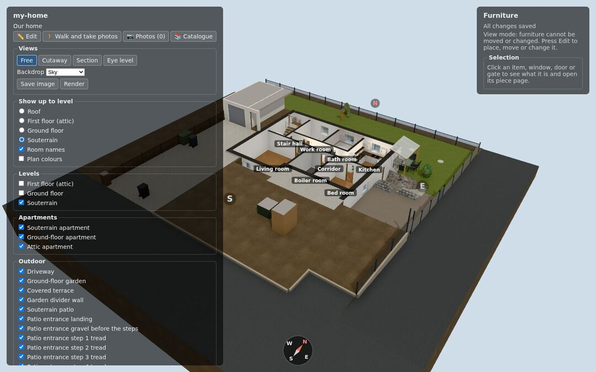
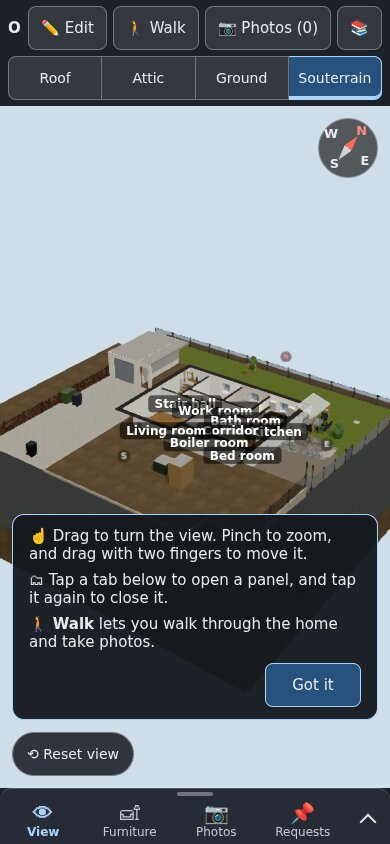
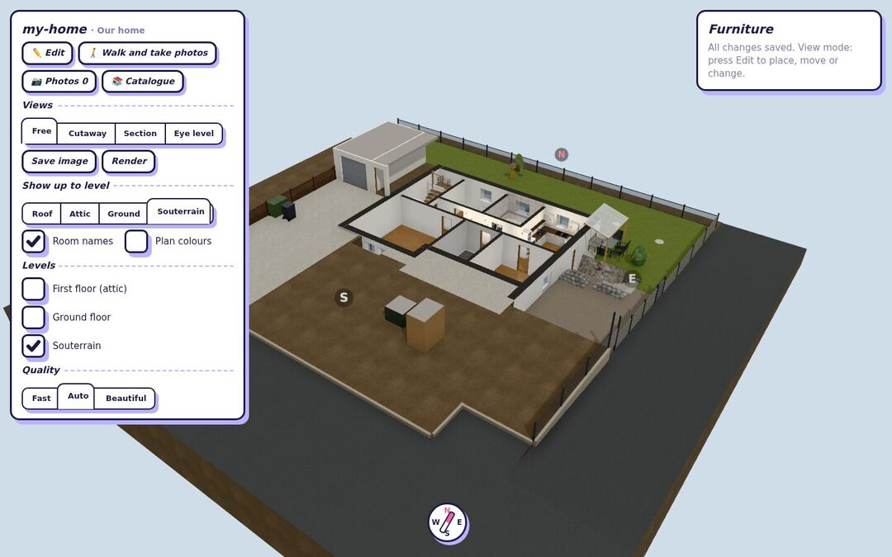
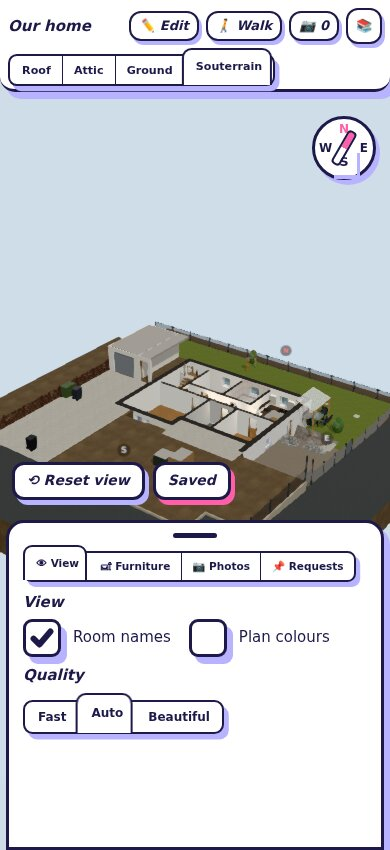
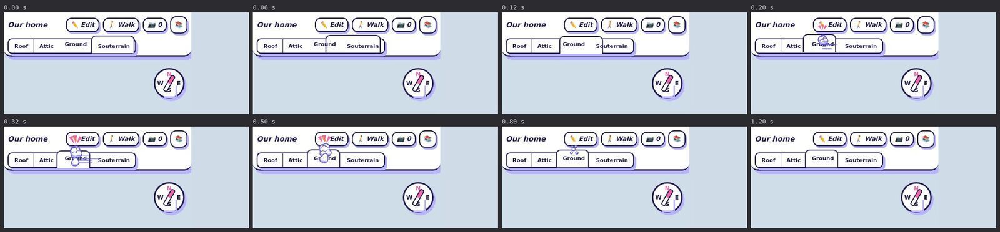
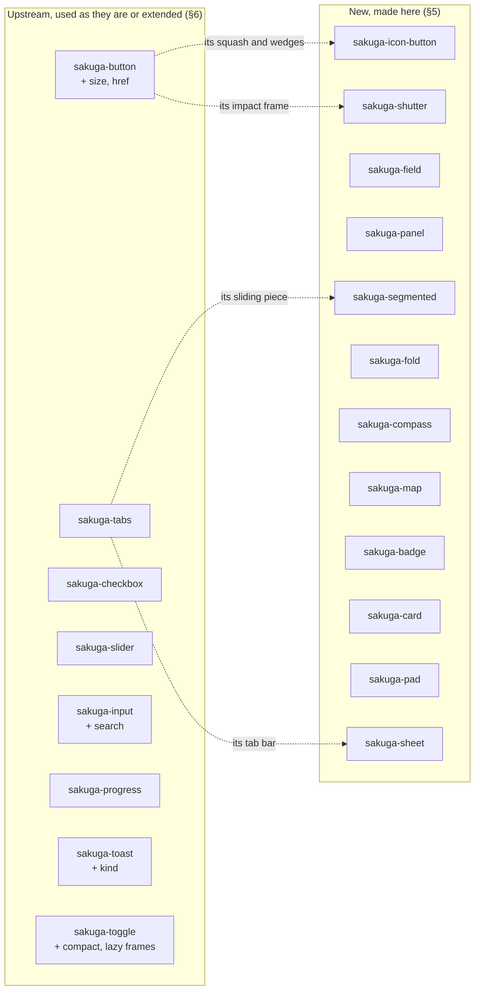
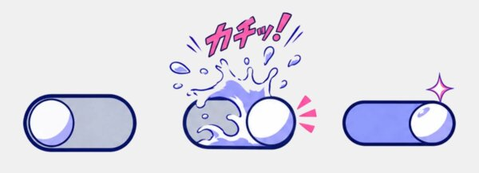
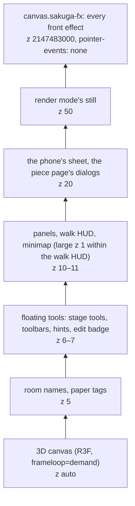
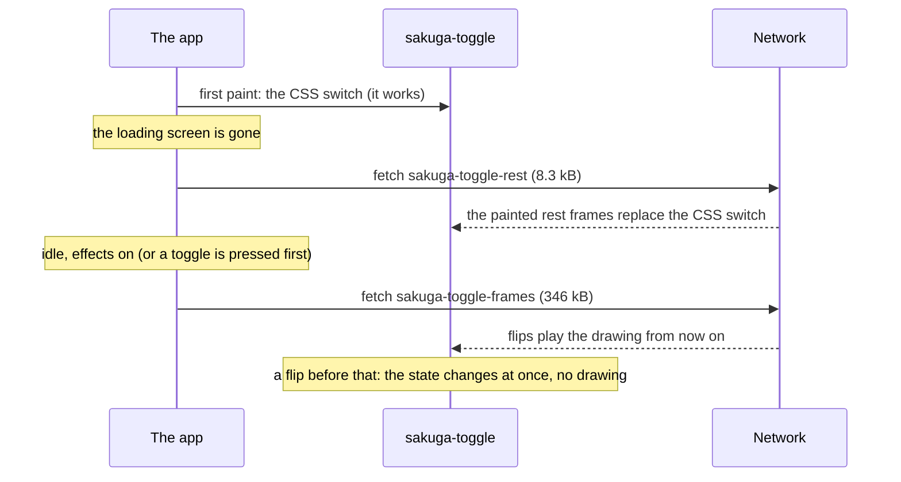
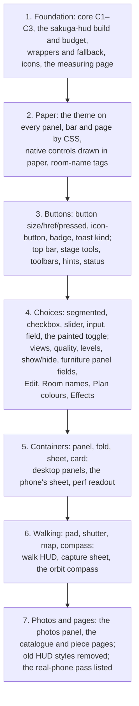

# HUD: design

The design for epic [#165](https://github.com/NNTin/my-home/issues/165): the whole HUD of the app in the Sakuga VFX
style, with `packages/sakuga-vfx` as its source. It is written for [#167](https://github.com/NNTin/my-home/issues/167)
and is what [#168](https://github.com/NNTin/my-home/issues/168) builds, one pull request per family.

This document is a plan, not a description of the code: nothing in it exists yet unless it says "today". Read
`packages/sakuga-vfx/AGENTS.md` first (the package's role, the art style, the core build, a new element frame by
frame); this document does not repeat it.

**Status: ready.** The owner answered the design's questions on #167 (2026-11-26, §13); none are open
([§14](#14-open-questions)).

## Contents

1. [Goals and non-goals](#1-goals-and-non-goals)
2. [Where we start](#2-where-we-start)
3. [The look](#3-the-look)
4. [Inventory and mapping](#4-inventory-and-mapping)
5. [New elements](#5-new-elements)
6. [Changes to upstream's elements and the core](#6-changes-to-upstreams-elements-and-the-core)
7. [Wiring in React](#7-wiring-in-react)
8. [The effects canvas over the 3D view](#8-the-effects-canvas-over-the-3d-view)
9. [Loading and size](#9-loading-and-size)
10. [Phones and accessibility](#10-phones-and-accessibility)
11. [Testing and verification](#11-testing-and-verification)
12. [Rollout for #168](#12-rollout-for-168)
13. [Decisions log](#13-decisions-log)
14. [Open questions](#14-open-questions)

## 1. Goals and non-goals

### Goals

- **Every part of the HUD is a Sakuga element,** existing or new: plain at rest, reacting like an anime cut when
  used (owner, #165: the whole HUD, not only the controls).
- **The Japanese sound-effect words stay** (ドン, カチッ, シュッ, ポン, ズザッ, ゴゴゴゴ; owner, #165).
- **The 3D view loses nothing:** no pointer or touch taken from walking, dragging or orbiting, no extra frame of
  the scene, and no frame time lost on a phone that the measurement in §10.2 does not allow.
- **Every control works by touch and keyboard at desktop width and at 390 px, with a screen reader, and with
  reduced motion.**
- **Size is a number CI checks** (§9.4). Growth is accepted (owner, #165), waste is not.

### Non-goals

| Not in this design                                  | Where it goes                                                                                          |
| --------------------------------------------------- | ------------------------------------------------------------------------------------------------------ |
| The 3D scene, its render, the compass letters in it | The realistic-render epic #106                                                                         |
| The layout of the viewer (what is in which panel)   | Stays as it is today (`docs/mobile.md`); only the elements change. One exception: Edit's place (§5.13) |
| Following upstream automatically                    | Never; by hand, as a reviewed PR (`packages/sakuga-vfx/AGENTS.md`)                                     |
| Effects on scene gestures (dragging a sofa, orbit)  | Never: effects come from HUD controls only (§8.3)                                                      |
| A night look of the scene                           | #18; the HUD is checked against the dark backdrop instead (§3.4)                                       |
| HUD code in this PR                                 | #168. The mock-ups in `docs/design/hud/` were throwaway prototypes                                     |

## 2. Where we start

Measured on `main` at `91b4dca` (2026-11-26), on production and on the package.

### 2.1 The HUD today

Native controls (`<button>`, `<input type=checkbox|radio|range|number|date|color|file>`, `<select>`, `<textarea>`,
`<details>`) on translucent dark panels (`rgb(0 0 0 / 0.6)`, light text) over the 3D view; emoji as icons. The
only Sakuga element is the loading bar (#166), on its own white paper card.

| Today, desktop                                     | Today, phone (390 px)                          |
| -------------------------------------------------- | ---------------------------------------------- |
|  |  |

### 2.2 Facts about the package that shape the design

| Fact                                       | Value                                                                                                                                                                                                                                                                                       |
| ------------------------------------------ | ------------------------------------------------------------------------------------------------------------------------------------------------------------------------------------------------------------------------------------------------------------------------------------------- |
| The core (springs, effects, words, `Base`) | 40.6 kB raw, **16.8 kB gzipped**, of which the six words are 7.6 kB                                                                                                                                                                                                                         |
| An element without its core                | **1.7 to 2.8 kB gzipped** alone; the six the app uses, together: 8.9 kB                                                                                                                                                                                                                     |
| An element file as shipped (core inside)   | 18 to 21 kB gzipped each                                                                                                                                                                                                                                                                    |
| The painted toggle                         | 506 kB raw, **363 kB gzipped** (its 43 frames are base64 WebP and do not compress)                                                                                                                                                                                                          |
| The loading bar, first                     | `progress.js`, 20.8 kB gzipped, budget 25 kB (`bundle-budget.json` `first`, #166)                                                                                                                                                                                                           |
| The clock                                  | One `requestAnimationFrame` loop for all elements. **It never stops while an element is connected:** `Base` adds every connected element's `frame()` to the loop, and the loop sleeps only when no element is connected. At rest a button still writes its transform and `--ok` every frame |
| Sizes                                      | One size per element (15 px type, a 3.2 px line, about 44 px tall). The phone's top bar does not fit four of them (mock-up, §3.3)                                                                                                                                                           |
| Effects canvas                             | `canvas.sakuga-fx`, fixed over the page, `z-index: 2147483000`, `pointer-events: none`, `aria-hidden`; created on the first effect. Back layers: a canvas inside the element, 160 px around it                                                                                              |
| Reduced motion                             | The core draws no effect and never creates its canvas; springs and states still change                                                                                                                                                                                                      |
| The page's own `:root` values win          | `--sk-*` are set inside `:where(:root)`                                                                                                                                                                                                                                                     |

## 3. The look

### 3.1 Paper on the scene

**The HUD is white paper on the scene:** every panel, bar, sheet and floating tool is an opaque white card with the
ink line and the hard lavender shadow, the way the gallery shows the controls. The dark translucent panels go.
The 3D view stays full-bleed under it.

| Desktop, mock-up (throwaway prototype)             | Phone, mock-up (throwaway prototype)           |
| -------------------------------------------------- | ---------------------------------------------- |
|  |  |

The mock-ups are upstream's real tabs and checkboxes over a canvas-only screenshot of production, with the rest
sketched in CSS: they show the theme, not the final elements.

Why paper and not a dark Sakuga palette (the alternative from #166's handoff): the drawn effects are always light
(the palette `P` is not a CSS variable), so a dark HUD would have light effects and light words on dark cards and
dark controls next to them; the art style is "white paper, two tones and a line"; and a paper card with an ink
line reads on every backdrop (§3.4). The owner chose it (#167, answer 1).

### 3.2 The values

The app sets these in its own `:root` (they win over the core's):

| Variable     | Value                                              | Used for                                                         |
| ------------ | -------------------------------------------------- | ---------------------------------------------------------------- |
| `--sk-card`  | `#fff`                                             | Paper: every card, panel and control face                        |
| `--sk-ink`   | `#1d1a4a`                                          | The line and the text                                            |
| `--sk-dim`   | `#8580b0`                                          | Secondary text, notes, disabled                                  |
| `--sk-soft`  | `#b8b3ff`                                          | The hard shadow, dashed rules between groups                     |
| `--sk-pri`   | `#8f8df7`                                          | A filled track, the selected segment's fill                      |
| `--sk-acc`   | `#ff5fa8`                                          | Accents only: focus ring, the check, a badge, a warning's shadow |
| `--sk-r`     | `15px` (compact `11px`)                            | Corner radius                                                    |
| `--sk-bw`    | `3.2px` (compact `2.5px`)                          | Line width                                                       |
| `--sk-sh`    | `6px 7px 0 var(--sk-soft)` (compact `3px 4px 0 …`) | The hard shadow                                                  |
| `--hud-page` | `#fff`                                             | The catalogue and piece pages' background (§3.5)                 |

These are upstream's defaults: the app changes nothing of the palette, it only adds the compact size (§6.1).
Warnings and errors are ink text with a pink shadow and a pink ✕ or ! mark, never pink text (pink is an accent).

**Type** is upstream's: the system stack, labels of buttons 800 italic, body text 500. **Icons** are ink-line
icons in the art style (one line, one flat light tone, one flat shadow tone), inline SVG in the package
(`packages/sakuga-vfx/icons/`, about a dozen: walk, photos, catalogue, edit, view, furniture, requests, reset,
rotate left and right, duplicate, delete, info, more, close, camera, gallery, map). The emoji go. The owner chose it (#167, answer 2).

### 3.3 Two sizes

Upstream has one size. The phone needs a second: **`size="compact"`** (about 34 px tall, 13 px type, the compact
line, radius and shadow of §3.2). The phone's top bar, the sheet's tab bar, the floating toolbars and the walk
HUD use compact; the desktop panels use the regular size. **Effects scale with the element** (§6.2): compact
draws them at 0.7. The frame sheet below is upstream's tabs shrunk with CSS `zoom` in the phone's top bar: the
effects stay full size, the wedges land on "Edit" and a puff covers "Ground" at 0.32 to 0.5 s. That is the
reason for the scale, and for 12 px of clear paper between neighbouring controls in a bar.



A compact control keeps a 44 px hit area (a transparent box inside its shadow root around the visible face),
never a larger host box (§8.2).

### 3.4 Over the rendered house, day and night

- **Opaque paper, never translucent:** no blur and no transparency (the art style forbids gradients and blur,
  and translucent cards over a busy render read worse than opaque ones).
- **The ink line separates the card from any backdrop:** the sky (light blue), "Studio, light" (near white:
  the lavender shadow and the ink line carry it) and "Studio, dark" (white on dark, the strongest). #168 checks
  every family on all three backdrops (`?backdrop=sky|studio-light|studio-dark`) in its before/after shots.
- **The scene's night (#18) changes nothing here:** paper on a dark scene is the "Studio, dark" case.
- **Effects over the scene:** white, lavender and violet over a light sky still read by their violet line; the
  words have an ink edge (`hollow()`) or dotted letters. Nothing to read depends on an effect anyway.
- **The room names** (`scene/RoomLabels.tsx`, HTML over the canvas) become small paper tags (white, a 2 px ink
  line, no shadow) by CSS only: no element and no effects, since they move with the camera every frame.

### 3.5 The pages

The catalogue (`/catalog`) and the piece pages (`/catalog/<kind>/<typeId>`) become white paper pages (`--hud-page`)
with ink text, like the gallery. Their 3D previews keep their own backdrop inside a paper frame.

## 4. Inventory and mapping

Every element the HUD has today, the Sakuga element it becomes, and its reaction as beats: **press**
(anticipation), **hit** (the frame where it happens), **follow-through** (what drifts off), **settle**. "—" means
no beat. The word, if any, lands on the hit. Elements in _italics_ are new (§5) or extended (§6).

States used below: **rest** (plain, nothing drawn), **hover** (desktop only: the shadow grows 1 px, no effect),
**focus** (the pink focus ring of `BASE_CSS`), **pressed/selected/checked**, **disabled** (`--sk-dim` line and
text, no shadow, no effects), **busy** (the label says so, e.g. "Saving…"; no effect while busy).

The beats of upstream's elements are as upstream made them (their READMEs); the tables name them in short.

### 4.1 The top bar (phone, `overlay/TopBar.tsx`)

| Today                       | Becomes                                                           | Press                | Hit                                        | Follow-through                                | Settle               | Word   | States                             |
| --------------------------- | ----------------------------------------------------------------- | -------------------- | ------------------------------------------ | --------------------------------------------- | -------------------- | ------ | ---------------------------------- |
| The bar itself              | A paper strip (CSS on the app's `div`), compact                   | —                    | —                                          | —                                             | —                    | —      | —                                  |
| Home name / home `<select>` | Text; _`sakuga-field`_ around the select when there are two homes | as field             | as field                                   |                                               |                      | カチッ | rest, focus, open                  |
| Edit / Done                 | Moves to the stage tools as the painted toggle (§4.3, §5.13)      | —                    | —                                          | —                                             | —                    | —      | —                                  |
| Walk                        | _`sakuga-button` compact_                                         | squash               | burst behind, speed lines toward the view  | puffs off the corners                         | spring back          | ドン   | rest, disabled while loading       |
| Photos (n) + requests badge | _`sakuga-button` compact_ + _`sakuga-badge`_                      | squash               | three wedges                               | —                                             | spring back          | —      | rest, pressed (sheet shows photos) |
| Catalogue (link)            | _`sakuga-icon-button` compact `href`_                             | squash               | three wedges                               | —                                             | spring back          | —      | rest                               |
| Level switch (radiogroup)   | _`sakuga-segmented` compact_                                      | the segment squashes | the raised piece slides, stretching, lands | wedges above, a puff on the side it came from | overshoot and settle | カチッ | one selected; arrow keys move it   |

### 4.2 Panels and the sheet

| Today                                                     | Becomes                                                                           | Reaction (beats)                                                                                                    | Word                  | States                          |
| --------------------------------------------------------- | --------------------------------------------------------------------------------- | ------------------------------------------------------------------------------------------------------------------- | --------------------- | ------------------------------- |
| Desktop control panel (`ControlPanel.tsx`)                | _`sakuga-panel`_ (regular), scrolls inside                                        | On first show only: it lands (§5.4). No idle, no effect on scroll                                                   | —                     | rest                            |
| Its groups (`fieldset` + legend)                          | Group headings in 800 italic, a dashed `--sk-soft` rule                           | —                                                                                                                   | —                     | —                               |
| Furniture panel (`FurniturePanel.tsx`)                    | _`sakuga-panel`_ right                                                            | as panel; content swaps without effects                                                                             | —                     | rest                            |
| Phone sheet (`Sheet.tsx`): tab bar, snaps                 | _`sakuga-sheet`_ (§5.5): its tabs are `sakuga-segmented`-like with `role=tab`     | tab: as segmented; open/close/snap: the sheet springs to its snap, overshoots, lands with a puff at each top corner | —                     | collapsed, half, full; dragging |
| Sheet size ⤢/⤡, close arrow                               | _`sakuga-icon-button` compact_                                                    | squash, three wedges                                                                                                | —                     | rest                            |
| Phone view panel (`ViewPanel.tsx`)                        | Content of the sheet                                                              | —                                                                                                                   | —                     | —                               |
| "Show / hide…" groups (`details`)                         | _`sakuga-fold`_ (§5.6)                                                            | press: squash of the summary; hit: the chevron flips; follow-through: the body springs open; close: shrinks         | —                     | open, closed                    |
| Show all / Hide all                                       | _`sakuga-button` compact secondary_                                               | upstream's secondary (small squash, three wedges)                                                                   | —                     | disabled when nothing to do     |
| Room names, Plan colours (switches)                       | _`sakuga-toggle`_, the painted switch (§5.13), in a row: label left, switch right | the drawn flip (§5.13)                                                                                              | カチッ (painted)      | on, off, disabled               |
| Each level, apartment, outdoor area, Terrain (checkboxes) | `sakuga-checkbox` (compact on the phone)                                          | upstream: crescents, crystals, the tick draws, glint; untick: a small puff                                          | ズザッ (ticking only) | checked, unchecked, disabled    |
| Effects (new, §10.4)                                      | _`sakuga-toggle`_                                                                 | the drawn flip; switching on plays nothing (effects were off), switching off plays the flip, then effects stop      | カチッ (painted)      | on, off                         |
| Furniture panel: catalogue items                          | _`sakuga-card`_ (§5.9)                                                            | squash, three wedges at the corner                                                                                  | —                     | rest, selected                  |
| Furniture panel: `<select>`s, number input                | _`sakuga-field`_                                                                  | §5.3                                                                                                                | カチッ on a change    | focus, invalid                  |
| Furniture panel: checkboxes                               | `sakuga-checkbox`                                                                 | upstream                                                                                                            | ズザッ                | as above                        |
| Furniture panel: errors, conflict (`role=alert`)          | _`sakuga-badge` `kind="warn"`_ inline                                             | arrives: pops in on a spring, a puff; leaves: shrinks                                                               | —                     | warn                            |

### 4.3 The furniture toolbar and the stage tools

| Today                                                                        | Becomes                                                            | Reaction (beats)                                                                                                 | Word             | States                          |
| ---------------------------------------------------------------------------- | ------------------------------------------------------------------ | ---------------------------------------------------------------------------------------------------------------- | ---------------- | ------------------------------- |
| Item toolbar strip (`FurnitureToolbar.tsx`), name                            | Paper strip, compact                                               | —                                                                                                                | —                | —                               |
| Rotate ⟲ ⟳, raise ▲, lower ▼, duplicate, piece page, more                    | _`sakuga-icon-button` compact_ (piece page with `href`)            | squash, three wedges toward the direction (rotate: a crescent `slash` around the icon)                           | —                | rest, disabled                  |
| Delete                                                                       | _`sakuga-icon-button` compact_                                     | squash; hit: a puff where the icon was                                                                           | —                | rest                            |
| Piece toolbar (`PieceToolbar`): "Open piece page", ✕                         | _`sakuga-button` compact secondary `href`_, _`sakuga-icon-button`_ | as secondary; ✕ as icon button                                                                                   | —                | rest                            |
| Edit mode (from the top bar on the phone; the panel's header on the desktop) | _`sakuga-toggle` compact_ labelled "Edit" (§5.13)                  | the drawn flip: the knob smears across, slams into the end, the splash and the painted カチッ rise over the view | カチッ (painted) | off (view mode), on (edit mode) |
| Reset view (`StageTools.tsx`)                                                | _`sakuga-button` compact secondary_                                | squash, a `slash` crescent around it (the view turns back)                                                       | —                | rest                            |
| Status chip ("Saving…", "Saved", "Offline…", warnings)                       | _`sakuga-badge`_ (`kind="warn"` for problems)                      | arrives: pops in; "Saved": the check draws, a glint (`kira`); leaves by shrinking (today it fades: it must not)  | —                | info, warn, hidden              |
| Edit badge ("✏️ Edit mode")                                                  | _`sakuga-badge`_                                                   | pops in, leaves by shrinking                                                                                     | —                | shown while editing             |
| Toast (`p.toast`, `role=alert`)                                              | `sakuga-toast`, _`kind`_ (§6.3)                                    | upstream: streaks in as a smear, lands in dust; leaves by shrinking                                              | ズザッ           | info, warn                      |

### 4.4 The views and quality controls

| Today                                       | Becomes                                                         | Reaction (beats)                                                                    | Word                      | States                 |
| ------------------------------------------- | --------------------------------------------------------------- | ----------------------------------------------------------------------------------- | ------------------------- | ---------------------- |
| Views: Free, Cutaway, Section, Eye level    | _`sakuga-segmented`_                                            | as the level switch                                                                 | カチッ                    | one selected           |
| Level, Looking, Room, Backdrop (`<select>`) | _`sakuga-field`_                                                | §5.3                                                                                | カチッ on a change        | focus                  |
| "Cut at" (range, metres)                    | `sakuga-slider` (`unit=" m"`, `step=0.05`)                      | upstream: teardrop thumb on a spring, cumulus on a fast drag, a crescent on release | シュッ (fast drags only)  | rest, dragging         |
| Save image                                  | `sakuga-button` secondary, then `done()` when the file is saved | upstream; `done()`: a pink check lands on it with a glint                           | —                         | busy ("Saving…"), done |
| Render (pressed)                            | `sakuga-button` (primary), pressed state                        | upstream primary: impact frame, burst, clouds                                       | ドン                      | rest, pressed          |
| Render still: sample count                  | `sakuga-progress` (samples / target: real progress)             | upstream                                                                            | ゴゴゴゴ, ドン at the end | running, done, stopped |
| Render still: Close, Save                   | `sakuga-button` secondary                                       | upstream                                                                            | —                         |                        |
| Quality: Fast, Auto, Beautiful (radios)     | _`sakuga-segmented`_ on both layouts                            | as the level switch                                                                 | カチッ                    | one selected           |
| Desktop "Show up to level" (radios)         | _`sakuga-segmented`_, the same as the phone's top bar           | as the level switch                                                                 | カチッ                    | one selected           |

### 4.5 Walking (`walk/`)

| Today                                             | Becomes                                                     | Reaction (beats)                                                      | Word                                            | States                           |
| ------------------------------------------------- | ----------------------------------------------------------- | --------------------------------------------------------------------- | ----------------------------------------------- | -------------------------------- |
| Exit                                              | _`sakuga-button` compact secondary_                         | upstream secondary                                                    | —                                               | rest                             |
| Where ("Corridor · Souterrain")                   | _`sakuga-badge`_ (plain)                                    | changes room: the badge squashes once and pops back (no effect drawn) | —                                               | —                                |
| Overview (first/third person)                     | _`sakuga-button` compact_, pressed state                    | squash, three wedges                                                  | —                                               | pressed                          |
| Camera mode: Sensors / Manual                     | _`sakuga-segmented` compact_                                | as the level switch                                                   | カチッ                                          | one selected                     |
| Tilt readout ("◆ 0°")                             | _`sakuga-badge`_ (plain), its text only changes             | —                                                                     | —                                               | —                                |
| Walk compass (accuracy, calibrate)                | _`sakuga-compass`_ (§5.7) with `poor` state                 | as compass; opening calibration: the panel lands                      | カチッ                                          | good, poor, calibrating          |
| Calibrate section, declination number, its source | _`sakuga-panel` compact_, _`sakuga-field`_ (number, select) | as their elements                                                     | カチッ on a change of the source                | —                                |
| Open requests list (toggle + list)                | _`sakuga-fold`_ with _`sakuga-card`_ rows                   | as fold and card                                                      | —                                               | open, closed                     |
| Request here, notices (`role=status`/`alert`)     | _`sakuga-badge`_ (`warn` for alerts)                        | pops in, leaves by shrinking                                          | —                                               | —                                |
| Movement pad (`Joystick.tsx`)                     | _`sakuga-pad`_ (§5.10)                                      | §5.10                                                                 | —                                               | rest, held                       |
| Look up / Look down                               | _`sakuga-icon-button` compact_                              | squash, wedges up or down                                             | —                                               | rest                             |
| Shutter (camera, file input)                      | _`sakuga-shutter`_ (§5.11)                                  | §5.11                                                                 | カチッ                                          | rest, busy                       |
| Gallery (file input with a label)                 | _`sakuga-shutter` `variant="label"`_                        | squash, three wedges                                                  | —                                               | rest                             |
| Keys hint ("W A S D …", desktop)                  | Paper strip, plain text                                     | —                                                                     | —                                               | —                                |
| Minimap, small and large (`Minimap.tsx`)          | _`sakuga-map`_ (§5.8) around the app's SVG                  | §5.8                                                                  | シュッ on enlarging; ポン on placing the figure | small, large, placing            |
| Map: Heading-up / North-up                        | _`sakuga-segmented` compact_                                | as the level switch                                                   | カチッ                                          | one selected                     |
| Map: Photos on the map, Place the figure          | _`sakuga-button` compact_, pressed state                    | squash, three wedges                                                  | —                                               | pressed                          |
| Map: Close                                        | _`sakuga-button` compact_ (primary look, no burst)          | squash, three wedges                                                  | —                                               | rest                             |
| Capture sheet (`CaptureSheet.tsx`)                | _`sakuga-panel` compact_ at the foot                        | lands like the sheet                                                  | —                                               | editing, uploading, saved, error |
| Capture: note                                     | _`sakuga-field`_ around the textarea                        | §5.3                                                                  | —                                               | focus                            |
| Capture: tags                                     | `sakuga-checkbox` compact                                   | upstream                                                              | ズザッ                                          | checked                          |
| Capture: nudges (left, right, turn, look)         | _`sakuga-icon-button` compact_                              | squash, wedges in the direction                                       | —                                               | rest                             |
| Capture: Save                                     | `sakuga-button` primary                                     | upstream primary                                                      | ドン                                            | busy                             |
| Capture: upload                                   | `sakuga-progress` (today, #166)                             | upstream                                                              | ゴゴゴゴ, ドン                                  | running, done                    |
| Capture: New photo, Cancel                        | `sakuga-button` secondary                                   | upstream secondary                                                    | —                                               | rest                             |

### 4.6 The compass, the hints, the photos panel, the `?perf` readout

| Today                                          | Becomes                                                                  | Reaction (beats)                                                             | Word          | States                                |
| ---------------------------------------------- | ------------------------------------------------------------------------ | ---------------------------------------------------------------------------- | ------------- | ------------------------------------- |
| Compass rose, north-up (`compass/Compass.tsx`) | _`sakuga-compass`_ (§5.7)                                                | §5.7                                                                         | カチッ        | rest; turning is state, not an effect |
| Hints (`overlay/Hints.tsx`) and "Got it"       | _`sakuga-panel` compact_ (`role=complementary`), `sakuga-button` primary | lands on first show; "Got it": upstream primary, then the panel shrinks away | ドン (Got it) | shown once                            |
| Photos panel (`PhotosPanel.tsx`)               | _`sakuga-panel`_ (desktop), sheet content (phone)                        | —                                                                            | —             | —                                     |
| Photos / Requests tabs                         | `sakuga-tabs`                                                            | upstream: the raised tab slides and lands with wedges                        | —             | one selected                          |
| Thumbnails                                     | _`sakuga-card`_ holding the image                                        | squash, wedges at the corner                                                 | —             | rest, selected (pink shadow)          |
| Photo detail, overlay settings                 | _`sakuga-panel`_ section                                                 | —                                                                            | —             | —                                     |
| Overlay opacity (range)                        | `sakuga-slider` (`unit="%"`)                                             | upstream                                                                     | シュッ (fast) | —                                     |
| Text, date inputs                              | `sakuga-input` (text), _`sakuga-field`_ (date)                           | upstream dust per key; field                                                 | —             | focus                                 |
| Checkboxes                                     | `sakuga-checkbox`                                                        | upstream                                                                     | ズザッ        | —                                     |
| Buttons (close, trash, restore, request…)      | `sakuga-button` secondary / _`sakuga-icon-button`_                       | upstream secondary                                                           | —             | —                                     |
| Warnings                                       | _`sakuga-badge` `kind="warn"`_                                           | pops in                                                                      | —             | —                                     |
| `?perf` readout (`quality/PerfReadout.tsx`)    | _`sakuga-panel` compact_ with _`sakuga-fold`_                            | as fold                                                                      | —             | folded, open                          |
| Its Copy                                       | `sakuga-button` compact secondary, `done()` when copied                  | upstream; the check replaces the "Copied" timer                              | —             | done                                  |
| Its manual textarea                            | _`sakuga-field`_                                                         | —                                                                            | —             | read-only                             |

### 4.7 The catalogue page and the piece pages

| Today                                        | Becomes                                                       | Reaction (beats)                 | Word               | States       |
| -------------------------------------------- | ------------------------------------------------------------- | -------------------------------- | ------------------ | ------------ |
| Back link ("← my-home")                      | _`sakuga-button` compact secondary `href`_                    | upstream secondary               | —                  | rest         |
| Piece page: Edit (header)                    | _`sakuga-toggle` compact_ on the header's second line (§5.13) | the drawn flip                   | カチッ (painted)   | off, on      |
| Search the catalogue                         | `sakuga-input` `type="search"`                                | upstream                         | —                  | focus        |
| Catalogue cards, finish cards                | _`sakuga-card` `href`_                                        | squash, wedges at the corner     | —                  | rest         |
| Piece page: 3D / Section view switch         | _`sakuga-segmented`_                                          | as the level switch              | カチッ             | one selected |
| Piece page: toggles (dimensions, mounting)   | `sakuga-checkbox`                                             | upstream                         | ズザッ             | —            |
| Playground: ranges                           | `sakuga-slider`                                               | upstream                         | シュッ             | —            |
| Playground: colour, select                   | _`sakuga-field`_                                              | §5.3                             | カチッ on a change | —            |
| Notes: textarea, Add, Edit, Save             | _`sakuga-field`_, `sakuga-button` (Save: primary)             | upstream                         | ドン (Save)        | busy         |
| Photos strip, photo viewer (`role=dialog`)   | _`sakuga-card`_; the viewer a modal _`sakuga-panel`_          | panel lands; leaves by shrinking | —                  | open         |
| Place form: home, level, room selects; Place | _`sakuga-field`_; `sakuga-button` primary `type=submit`       | upstream primary                 | ドン               | busy         |
| History: Undo                                | `sakuga-button` secondary                                     | upstream secondary               | —                  | —            |
| Uses, use editor fields                      | _`sakuga-card`_, _`sakuga-field`_, `sakuga-input`             | as theirs                        | —                  | —            |

### 4.8 Upstream's toggle, and what the app does not use

- **`sakuga-toggle`, the painted switch, is used for four switches** (owner, #167 answer 4): Edit mode, Room
  names, Plan colours and Effects, the settings that stand alone. Lists of show/hide settings (levels,
  apartments, outdoor areas, Terrain, a photo's tags, the piece page's options) stay checkboxes: a column of
  painted switches with a splash each would be too much, and too tall. Its frames load lazily (§5.13, §9.3).
- **`sakuga-rating`** has no use in the app.
- **`sakuga-radio`** has no use: every single choice of a few short values is `sakuga-segmented`, a longer list
  is a select in `sakuga-field`. It stays in `sakuga-hud` only if a family needs it.
- **`sakuga-tooltip`** is upstream's help button ("?") with a hint, not a hover tooltip for other controls, and
  the HUD has no help button today. Icon-only buttons keep `title` and their accessible name; they get no tooltip
  element. It stays in the package for a later help spot.

## 5. New elements

Each is a folder in `packages/sakuga-vfx/` made with the package's workflow (`AGENTS.md` § A new element: the four
decisions, the core markers, `NAMES`, frame sheets at desktop width, 390 px and with reduced motion, `tools/test.mjs`
checks), and gets an entry in the package README's list. The sketches here are the beats and the look; the frame
sheets in #168 decide the details.



### 5.1 `sakuga-icon-button`

- **Control:** a real `<button>` with `aria-label` from `label` (required), an icon slotted or named
  (`icon="rotate-left"` from `icons/`), optional `href` (then an `<a>`), `pressed` (`aria-pressed`), `disabled`.
  Regular 44 px square, compact 34 px (44 px hit area).
- **Look:** a paper square with the ink line, the icon in ink, the hard shadow; pressed: ink fill, card icon.
- **Beats:** press: squash keeping volume (upstream's `squashy`); hit (release): three accent wedges off the
  corner, or in the button's direction when it has one (`dir="up|down|left|right|cw|ccw"`: ▲ throws them up, ⟳ draws
  a crescent around it); follow-through: none; settle: spring back with one overshoot.
- **Word:** none. These come in rows and in repeats (five taps on ▲), where a word each time would be noise.

### 5.2 `sakuga-segmented`

- **Control:** `role="radiogroup"` with `role="radio"` buttons, one tab stop, arrow keys move and wrap, Home and
  End; `value`, `label`, `change` event; options as `<option>` children like `sakuga-tabs`, but **re-read when
  they change** (a home with other levels), unlike upstream's tabs, which read them once.
- **Look:** upstream's tabs (the raised piece, the ink line), filling the width it is given; the selected segment
  is the raised paper piece, the others a flat row. Compact for the phone.
- **Beats:** press: the pressed segment squashes; hit: the raised piece slides to it, stretching with its speed
  (upstream's tabs); follow-through: wedges above the landing, a puff on the side it came from, speed lines;
  settle: overshoot and settle. Set from code: it moves without effects.
- **Word:** カチッ on the landing, small (compact: 0.7).
- **Why not `sakuga-tabs` as it is:** tabs are a `tablist` (wrong for a choice of value), read their options once,
  and do not fill a width.

### 5.3 `sakuga-field`

One element for every native control that has no Sakuga element: `<select>`, `<input type=number|date|color|file>`,
`<textarea>`.

- **Control:** the native control is **slotted, in the light DOM**: React keeps owning it (value, `onChange`),
  forms and the platform pickers (the phone's wheel for a select, the date picker) work as they do, and screen
  readers get the native control. The element draws the frame and a `label`.
- **Look:** upstream's input frame (paper, ink line, hard shadow, 230 px or `--sk-field-width`, `100%` in panels),
  a select's chevron drawn in ink, a colour shown as a swatch with the ink line.
- **Beats:** focus: three wedges off the corner (upstream's input); a change (select, colour, date picked): the
  frame gives (a small squash) and two wedges; typing in a textarea or number: the frame gives a little, no dust
  (the caret of a textarea is not cheap to place); invalid: a pink shadow and a ! mark.
- **Word:** カチッ on a change of a select, colour or date; none for typing.

### 5.4 `sakuga-panel`

- **Control:** a region (`role="region"` with `label`, or `complementary`, or `dialog` with `modal`); a heading
  slot, a body that scrolls inside (`overflow: auto` on an inner box, so its children's back layers are clipped:
  accepted, §8.4), an optional close button (`sakuga-icon-button`).
- **Look:** the paper card (§3.1): regular for the desktop panels, compact for floating ones (hints, perf,
  calibrate, capture).
- **Beats:** appear (only when it comes because of a person's action, never on page load): it lands from 8 px
  above with a squash (wider, lower) and a puff at each lower corner; settle: one overshoot. Leave: it shrinks to
  its anchor and is gone (no fade). Content changes inside it make no effect.
- **Word:** none.

### 5.5 `sakuga-sheet`

The phone's panel (`overlay/Sheet.tsx` today): a tab bar that is always there, one panel that opens above it (or
beside it, held across), dragged between three snaps.

- **Control:** as today: `role=tablist` with `role=tab` buttons, `aria-controls`, a `tabpanel`, the size and
  close buttons, arrow keys on the tabs; a drag on the bar that re-renders nothing while it moves (today's rule:
  the size lives in the DOM during a drag). The tab bar is `sakuga-segmented`'s sliding piece with tab semantics.
- **Look:** a paper card with rounded top corners, the compact tab bar with ink-line icons, a grab line in ink.
- **Beats:** tab: as segmented (no word); open, close and snap: the sheet's size is a spring (`k` 420, `d` 26:
  one overshoot), the release speed of a drag carries into it (a fling overshoots more); hit on landing: a puff at
  each top corner, a short line under the bar; closing: it shrinks to the bar. Dragging: the sheet follows the
  finger exactly, no effects.
- **Word:** none.

```mermaid
stateDiagram-v2
  [*] --> collapsed
  collapsed --> half: tap a tab / the arrow / drag up
  half --> full: tap ⤢ / drag up
  full --> half: tap ⤡ / drag down
  half --> collapsed: tap the open tab / the arrow / drag down
  full --> collapsed: drag down far
  note right of half: each landing: spring overshoot, two puffs
```

### 5.6 `sakuga-fold`

- **Control:** a real `<button aria-expanded>` as the summary, the body below it (`hidden` when closed); `open`
  attribute, `toggle` event. Replaces `<details>` (whose open and close cannot be sprung).
- **Look:** the summary in 800 italic with an ink chevron and a note ("2 of 3 shown") in `--sk-dim`.
- **Beats:** press: the summary squashes; hit: the chevron flips on a spring; follow-through: the body's height
  springs open with one overshoot; close: the body shrinks to the summary. Reduced motion: it opens at once.
- **Word:** none.

### 5.7 `sakuga-compass`

- **Control:** a `<button>` ("Compass: turn the view north-up"). **Its turn is set from outside without React**
  (today `CompassTracker` writes `--rose` on every camera move; it keeps doing that on the element's host): the
  element reads the variable in CSS, never in `frame()`, so turning the camera costs no Sakuga frame.
- **Look:** a paper disc with the ink line and hard shadow, N in pink, E S W in ink, the needle in two flat tones
  (pink north half, white south half) with an ink line. Walk's `poor` accuracy: a dashed ink ring.
- **Beats:** press: the disc squashes; hit (north-up): the needle swings to north on a spring with an overshoot (the
  view turns with it), a `ring` off the disc, two wedges at N; settle: the needle's wobble dies out.
- **Word:** カチッ when the needle lands on north.

### 5.8 `sakuga-map`

The minimap's frame. The map itself stays the app's SVG (`walk/Minimap.tsx`), slotted, restyled in the two tones and
the line by CSS (rooms paper, walls ink, the figure pink with a lavender cone).

- **Control:** small: a `role=button` "Map: tap to enlarge"; large: a `role=dialog` with its head (orientation,
  photos, place, close). As today, a tap on the large map places the figure while "Place" is on.
- **Beats:** enlarge: the frame stretches from its corner toward the middle (stretched thinner while it moves),
  speed lines behind it, lands with a squash and two puffs; shrink: back to the corner, shrinking; place the
  figure: a `ring` and a puff at the spot on the map.
- **Word:** シュッ on enlarging; ポン when the figure is placed.

### 5.9 `sakuga-card`

- **Control:** a link (`href`) or a button holding any slotted content (a thumbnail, a name, a description), with
  `selected` (`aria-current` or `aria-pressed`).
- **Look:** a paper card with the ink line and hard shadow; selected: a pink shadow.
- **Beats:** press: a small squash (0.92); hit: three wedges at the top right corner; settle: spring back.
- **Word:** none (cards come in grids).

### 5.10 `sakuga-pad`

The movement pad (`walk/Joystick.tsx`).

- **Control:** `role="application"` "Movement pad" as today, pointer capture on the pad, the same output (a
  direction and a strength each frame, read by the walk rig). Keyboard walking stays on the page (W A S D).
- **Look:** a paper ring with the ink line, the knob a paper disc with two tones and a line.
- **Beats:** press: the knob squashes under the finger; drag: the knob follows on a stiff spring and stretches
  along the direction with its speed (thinner as it goes); hitting the rim fast: a small dust puff at the rim in
  that direction, at most every 0.4 s; release: the knob springs back to the middle with one overshoot. A slow push
  is quiet. **Its effects are on the pad's own back layer**, not over the view (§8.3).
- **Word:** none.

### 5.11 `sakuga-shutter`

The camera button (a `<label>` around a file input with `capture` today).

- **Control:** the file input stays real (it opens the phone's camera app or the gallery); the element is its
  label, `role` from the input, `busy` while a photo is processed. `variant="label"` is the Gallery button.
- **Look:** a round paper button (64 px) with the ink camera icon, the hard shadow; busy: the icon dims.
- **Beats:** press: a deep squash; hit (release): the impact frame (ink fill for 0.19 s, like the primary button),
  a white `ring` and a burst behind it on its back layer; follow-through: four wedges; settle: spring back.
- **Word:** カチッ (a camera's click).

### 5.12 `sakuga-badge`

The status chip, the counts, the edit badge, "where", the notices.

- **Control:** `role="status"` (or `alert` with `kind="warn"`), text only; `count` for a number badge (an
  accessible name like today's "3 open").
- **Look:** a small paper chip with the ink line; `warn`: a pink shadow and a pink !; a count: a pink disc with
  card text.
- **Beats:** arrive or a count goes up: pops in from 0.4 on a spring with one overshoot, a puff; text change: one
  squash; "done" text (`done` attribute, "Saved"): the check draws, a `kira` glint; leave: shrinks to nothing (no
  fade).
- **Word:** none (the status chip changes often: Saving…, Saved).

### 5.13 `sakuga-toggle` in the app

Upstream's painted switch (43 frames painted from keyframes, played at 30 a second), used for Edit mode, Room
names, Plan colours and Effects (§4.8). Its drawing and its beats stay as painted; what changes is where it
draws, its size and how its frames arrive (§6.1).



- **Control:** upstream's `role="switch"` button with `aria-checked`, Space and Enter, `change`; `label` is its
  accessible name. In the app it always has a visible text label beside it (a row: "Room names" left, the switch
  right), and the label's click flips it.
- **At rest it is the switch alone:** the rest frames (0 and 42) are 108 × 55 px, the button's size; only the
  "on" frame's glint rises 14 px above. The host keeps that much margin (15 px above), no more.
- **The flip is drawn on the effects canvas, not inside the element.** Upstream draws all 43 frames on a canvas
  inside the shadow root that reaches 89 px above the switch; a scrolling panel or the sheet's body would clip
  the splash. In the app, the rest frame stays on the element's own canvas and the frames in between are drawn on
  the page-wide effects canvas at the element's place, then handed back. Nothing clips the splash but the
  viewport.
- **Beats** (painted): press: the knob squashes; hit: the knob smears across with a torn tail and slams into the
  end; follow-through: the splash crown and the painted カチッ!, pink wedges; settle: the track floods, sloshes and
  settles with a glint. Off plays the dash back.
- **Word:** the painted カチッ! inside the frames. It is the toggle's one word; no other word is added.
- **Compact (the phone, and the desktop panel's header):** `size="compact"` scales the whole drawing by 0.6: the
  switch 65 × 32 px (a 44 px hit area), the flip's drawing 90 × 98 px, rising 53 px above the switch. The frames
  are painted at twice the regular size, so 0.6 is still sharp on a phone's 3× screen.
- **Where Edit goes:** a switch at the very top of the screen would have its splash cut off by the screen's edge.
  - _Phone:_ Edit leaves the top bar and becomes the first of the stage tools at the foot of the 3D view
    (`StageTools.tsx`, left of "Reset view"), where the splash rises over the view. The top bar keeps the home,
    Walk, Photos and Catalogue, which also gives it the room it lacks at 390 px (§3.3). With the sheet full (the
    stage tools hidden), the edit badge says that edit mode is on, as today.
  - _Desktop:_ a compact switch on the second line of the control panel's header (the home's name, then "Edit"
    and the switch on the right), at least 58 px below the top of the window.
  - _The piece pages:_ the same, in their sticky header (`PiecePage.tsx`, the third place `EditToggle` is used):
    the name and the kind on the first line, "Edit", the switch and the edit badge on a second line at the right.
  - The three places share one wrapper (`editMode/EditToggle.tsx` renders the toggle); its accessible name stays
    "Edit" with `role="switch"` and `aria-checked`, which the smokes then look for instead of a pressed button.
- **Before the frames are there:** the switch is drawn in CSS (a paper track with the ink line, a white knob,
  the track `--sk-pri` when on), flips at once, and works. The rest frames replace it when they arrive.
- **Reduced motion or Effects off:** it jumps to the end frame (upstream), and the full sheet is never fetched.
- **The states:** off, on, disabled (the switch at half strength, upstream), flipping. Set from code (edit mode
  left by a route change, Effects from storage), it goes straight to the end frame, without the drawing.

## 6. Changes to upstream's elements and the core

All in `packages/sakuga-vfx`, each named in its README and in the package's `AGENTS.md` (§ "Changes made here"),
so a later upstream update carries them over by hand.

### 6.1 Elements

- **`sakuga-button`:** `size="compact"` (§3.3) and `href` (renders an `<a>`, the app's router takes the click,
  §7.4); `pressed` for a toggle button (`aria-pressed`, ink fill). The secondary variant gets no word, as upstream.
- **`sakuga-toast`:** `kind="warn"` (the ! icon, a pink shadow, `role="alert"`), a width that follows its text up
  to 320 px, and two lines before the ellipsis. The app's toasts are warnings today.
- **`sakuga-input`:** `type="search"` passes through (it does already), `size="compact"`.
- **`sakuga-checkbox`, `-slider`, `-tabs`:** `size="compact"`.
- **`sakuga-toggle`** (§5.13): `size="compact"` (the drawing at 0.6); the flip drawn on the effects canvas, the
  rest frame on its own canvas; a margin of 15 px above instead of 89; a CSS switch until the frames arrive; and
  **frames from URLs** instead of the inline sheet: `SakugaToggle.frames = { rest, all }`, set by the app before
  the first toggle is drawn. `tools/build.mjs` writes `toggle/rest.webp` (frames 0 and 42, 8.3 kB) next to
  `toggle/frames.webp`; the inline sheet stays in `toggle.js` for the package's own pages, and the app's build
  strips it as it strips the core (§7.1).

### 6.2 The core

- **C1. The clock sleeps at rest.** An element is _awake_ from a press, a key, a focus change or a state change
  until its springs have settled (`|x − to|` and `|v|` below a threshold) and its effects are gone; only awake
  elements are in the frame loop. With nothing awake the loop stops, as it does today with no element. Today the
  loop never stops while any element is on the page (§2.2): on a phone that is a `requestAnimationFrame` running
  for as long as the app is open. Upstream behaviour at rest does not change (nothing moves at rest).
- **C2. Effects scale with their element:** an element's `--sk-fx-scale` (1 regular, 0.7 compact) multiplies the
  size and travel of the effects it fires, and the size of its word.
- **C3. An app switch for effects:** `SakugaFX.calm` can be set by the page as well as by `prefers-reduced-motion`
  (either turns effects off). The app sets it from the "Effects" setting (§10.4). The owner chose it (#167, answer 6).
- **C4. The core is loaded once by the app's build** (§9.2): a build step, not a change to `core.js`.

A core change changes every element: each of C1 to C3 is checked on every element the app uses, frame by frame
(`AGENTS.md` § The core build).

## 7. Wiring in React

### 7.1 How the elements are loaded

Classic scripts, never modules and never in the main chunk (the package's rule):

```mermaid
sequenceDiagram
  participant H as index.html
  participant P as sakuga-progress-[hash].js (blocking, core inside)
  participant U as sakuga-hud-[hash].js (defer, no core)
  participant M as main chunk (module)
  H->>P: a blocking script in head, before the title
  P-->>H: window.SakugaFX, the loading bar drawn from the first paint
  H->>U: a deferred script, after P, before the module entry
  H->>M: the module entry (deferred too)
  Note over U,M: both download in parallel; deferred scripts run in document order,<br/>so every element is defined before React mounts
  U-->>H: customElements.define for every HUD element
  M-->>H: React renders the HUD with the elements already defined
```

The web build's plugin (`sakugaProgress()` in `apps/web/vite.config.ts` today) grows a second output,
`sakuga-hud-<hash>.js`: every element the app uses, each **with its core block removed** (between the
`// >>> sakuga core` markers; what remains ends in `component(window.SakugaFX)`, which the progress bar's core
has set), concatenated in `NAMES` order, unchanged otherwise. The package's files stay as upstream shapes them;
only the app's build output leaves the core out. The owner chose it (#167, answer 5).

### 7.2 Wrappers

`apps/web/src/hud/` gets one small wrapper per element (`SkButton`, `SkCheckbox`, `SkSegmented`, `SkField`, …),
following `loading/SakugaProgress.tsx`:

- **Static strings are attributes** (`label`, `variant`, `size`, `href`, `kind`).
- **Values are properties set through a ref** (`checked`, `value`, `selected`): React 19 sets known properties on
  custom elements, but the wrappers set them explicitly in an effect, so a value set from code never plays the
  reaction (upstream's rule: "from code: no effects").
- **Events are listened to through the ref** (`change`, `input`, `toggle`, `click`, `sakuga:done`), in an effect,
  and call the wrapper's `onChange(value)`. No React synthetic event names on the custom element.
- **Children are the label** (`<SkButton>Walk</SkButton>`); a `<sakuga-field>` gets its native control as a child.
- **Class names stay on the host** (`className="reset-view"`), so the stylesheet's layout rules and the smokes'
  selectors (`.perf-readout`, `.walk-map-large`) keep working.
- **A wrapper never sets React state per frame.** Reactions are inside the element; React hears only events.

### 7.3 Focus and the keyboard

- Every element has a real focusable control inside (`delegatesFocus` on the shadow root, as upstream), so
  `Tab`, `focus()` and `autoFocus` work on the host. The pink focus ring is the only focus style.
- Groups keep one tab stop and arrow keys (segmented, tabs, the sheet's tabs), as `TopBar.tsx` does today.
- Escape closes what it closes today (the large map, the photo viewer).
- The walk keys (W A S D, Q E) stay on the page and ignore events whose target is inside a HUD element.

### 7.4 Links

`sakuga-button href`, `sakuga-icon-button href` and `sakuga-card href` render a real `<a>` (open in a new tab,
copy the link). The wrapper `SkLink` listens for a plain left click on the host and calls the app's router
(`routing/navigation.tsx`), as the app's `Link` does today.

### 7.5 jsdom, and a script that does not load

- **One fallback, used twice.** `apps/web/src/hud/fallback.ts` defines each tag as a plain element **without a
  shadow root**: the ARIA role and state as attributes on the host (`role="button"`, `aria-pressed`,
  `role="checkbox"`, `aria-checked`, `tabindex`), Space and Enter handled, the same events dispatched. Its accessible
  name comes from the children, so Testing Library's `getByRole('button', { name: 'Walk' })` finds it.
- **In jsdom** `test-setup.ts` installs the fallback: the tests keep querying by role and name, never Sakuga.
- **In a browser** the main chunk installs the fallback for every tag still undefined if `sakuga-hud` failed to
  load (its `onerror`): the HUD then works plain, without reactions. A `<sakuga-field>` needs no fallback (its
  native control is in the light DOM).

## 8. The effects canvas over the 3D view

### 8.1 The stack



The z-indices of the app stay as they are today. The effects canvas stays on top of everything, as upstream has
it: an effect fired by a control in the sheet may fly over the sheet's edge and over the view, which is the style.
Back layers (a burst behind a button) are inside their element and sit under its control.

### 8.2 It never takes a pointer or touch

- `canvas.sakuga-fx` and every `canvas.back` have `pointer-events: none` (upstream; #168 keeps a test of it).
- **A host's box is its visible control.** Room an element keeps for its effects (upstream's toggle and tooltip keep
  margins above) is margin, never padding or a larger box: margins take no pointer. A compact control's 44 px hit
  area is inside its own shadow root, around its face.
- **Floating elements over the stage** (stage tools, toolbars, the pad, the shutter, the map, the compass) are the
  only HUD boxes over the view, as today. #168's mobile smoke checks that a point next to each (8 px outside its
  box) hits `SCENE`, and that an orbit drag across the view still turns the camera with a toolbar showing.
- The pad and the walk's drag-to-look keep their pointer capture; effects never call `preventDefault` or capture.

### 8.3 It never makes the 3D view re-render

- **Separate loops.** The Sakuga clock is its own `requestAnimationFrame`. It never calls R3F's `invalidate()`, and
  the scene never listens to it: the view draws a frame only when something in it changed (frames on demand,
  realistic-render D2).
- **No React state per frame** (§7.2): a reaction cannot re-render the `<Canvas>`'s parent.
- **The compass needle** turns through a CSS variable written by `CompassTracker`, as today; the element reads it
  in CSS (§5.7).
- **Effects fire only from HUD controls,** never from scene gestures (orbiting, dragging furniture, walking). The
  pad's dust is on its own back layer, not on the view.
- **The loop sleeps at rest** (C1), so with nothing being used the page runs no animation frame at all.
- **Save image and render mode** read the 3D canvas only: effects are never in a saved image.
- **Cost while both run:** an effect over the view costs the browser compositing a second canvas; the 3D frame
  itself is unchanged. Whether a phone keeps its frame rate while walking with effects firing is measured on the
  owner's phone (§10.2), not here.

### 8.4 Clipping

Back layers are clipped by a parent with `overflow: hidden` (upstream's limit). The scrolling body of a panel
clips its children's back-layer bursts (a primary button's burst inside the desktop panel): accepted, since the
front effects (clouds, words, wedges) are not clipped. The sheet's bar and the floating tools have no overflow
clip.

## 9. Loading and size

### 9.1 What loads first, and what loads lazily

| When                                                        | What                                                                                   | gzip (est.) |
| ----------------------------------------------------------- | -------------------------------------------------------------------------------------- | ----------- |
| First, blocking (#166)                                      | `sakuga-progress` with the core                                                        | 20.8 kB     |
| First, deferred, in parallel                                | `sakuga-hud`: every other element the app uses, no core; the icons                     | about 40 kB |
| Main chunk                                                  | The wrappers and the fallback (`apps/web/src/hud/`)                                    | about 4 kB  |
| Lazy, once the loading screen is gone                       | `sakuga-toggle-rest`: the toggle's two rest frames (WebP)                              | 8.3 kB      |
| Lazy, on idle after that, or on the first press of a toggle | `sakuga-toggle-frames`: all 43 frames (WebP); never with reduced motion or Effects off | 346 kB      |
| Never                                                       | `sakuga-rating`, `sakuga-radio`, `sakuga-tooltip` (no use, §4.8)                       | —           |

Why one deferred file and no lazy elements: the catalogue page, the piece page and the walk HUD use most of the
same elements as the viewer; splitting 40 kB into lazy groups would save one or two round trips' worth of bytes
on the first view and cost a loading state per group. The estimate: the six upstream elements the app uses
(button, tabs, checkbox, slider, input, toast) without their core are 8.9 kB gzipped together (measured), the
twelve new ones at about 2 kB each (the sheet, the map and the pad are the larger), and the icons about 3 kB:
about 36 kB, 40 kB with the changes of §6.

### 9.2 The core once

Without C4 every element would bring its own core: about 19 kB gzipped each, so about 400 kB for the twenty
elements of §4, of which 16.8 kB is needed once. With C4 the core comes once, inside the progress bar that loads
first anyway, and every other element is its own code only.

### 9.3 The toggle

The owner's answer 4: the painted toggle is used, with its frames loaded lazily, neither in the first load nor
in the main chunk. Its code (about 2 kB without the core and the frames) is in `sakuga-hud`; its pictures are two
WebP files the build emits as hashed assets (`assets/sakuga-toggle-rest-<hash>.webp`,
`assets/sakuga-toggle-frames-<hash>.webp`), whose URLs only are in the main chunk (`hud/toggle.ts` imports them
with `?url` and sets `SakugaToggle.frames`).



- **Why two files:** with reduced motion or Effects off the toggle only ever shows its rest frames, so a phone set
  that way never fetches the 346 kB. And the rest frames come early and small, so the CSS switch is seen only
  while the scene loads.
- **The WebP is not compressed again** (it compresses itself): its size on the wire is its file size.
- **Cached for good** like every hashed asset.

### 9.4 The budget, and `bundle-budget.json` in #168

#168 adds, in the PR that ships `sakuga-hud` (§12, PR 1):

```json
"first": {
  "sakuga-progress": { "maxGzipBytes": 25000, "required": true },
  "sakuga-hud": { "maxGzipBytes": 50000, "required": true }
}
```

```json
"lazy": {
  "sakuga-toggle-rest": { "maxGzipBytes": 12000, "required": true, "ext": ".webp" },
  "sakuga-toggle-frames": { "maxGzipBytes": 360000, "required": true, "ext": ".webp" }
}
```

- **`sakuga-hud`: 50 kB** gzipped (the estimate of 40 kB and a quarter of room for the elements' frame-by-frame
  rounds). `check:bundle` already measures every classic script in `index.html` against `first`.
- **The main chunk** keeps its `maxGrowthGzipBytes` (50 kB over `d4df5df`). On `91b4dca` it is 459.0 kB, +38.4 kB:
  11.6 kB are left, and the wrappers and the fallback are about 4 kB. If a family's PR finds the limit in reach,
  it asks the owner for a new baseline with the numbers, and does not move code out of the main chunk to make
  room.
- **The first load in all** (index.html, the first scripts, the main chunk and its CSS) was 487.3 kB after
  #166; it becomes about 530 kB. `check:bundle` prints it; no budget is set on the sum.
- **The toggle's frames: 12 kB and 360 kB** (8.3 kB and 346 kB today, with room for a re-encode). `check:bundle`
  measures lazy chunks among the `.js` files only today; #168 gives a lazy entry an optional `ext` (default `.js`)
  and checks that no file of an `ext` entry is named in `index.html` (it is not part of the first load) and that
  the main chunk does not contain its bytes (only its URL). Its offline test covers both.
- **A test of the build:** an offline unit test of the plugin checks that each element in `sakuga-hud` has no core
  block (and the toggle no inline frames), that it ends in `component(window.SakugaFX)`, and that `index.html` has the progress script before
  `sakuga-hud` and `sakuga-hud` before the module entry.

## 10. Phones and accessibility

### 10.1 A real-phone check

Upstream has been tried only in headless Chromium; the app's loading bar is the first Sakuga element on the
owner's phone (#166). Each family's PR in #168 lists an owner check on the phone (two minutes: open staging, use
the family's controls once, say what looked wrong), and the last PR lists the whole pass (#168's criteria):

- every family at 390 px held upright and across (the sheet at the side), by touch;
- the words readable at compact size, no effect covering a label;
- walking with the pad and taking a photo, with effects firing, without a stutter the owner notices;
- with reduced motion on (the phone's setting) and with the app's Effects switch off;
- VoiceOver or TalkBack through the top bar and the sheet (§10.3), if the owner uses one.

### 10.2 A measuring page

What only the owner's phone can tell is whether effects over the view cost frames while walking or orbiting. The
page, following `AGENTS.md` (§ Where tests run) and `/?render=measure`: **`/?hud=measure`**, a lazy chunk,
built with #168's first PR (agreed, 2026-11-26):

1. Opens the viewer, waits for the scene, then measures four runs of 5 s each: the camera turning by script
   (orbit) and walking a fixed path, each with no effects and with a burst, a puff and a word fired four times a
   second over the view.
2. Reports, per run: the 3D view's frame times (p50, p95, from the perf governor), the Sakuga clock's frames and
   its time per frame, and whether the Sakuga loop is asleep when nothing is used (C1: zero frames in 2 s of rest).
3. Ends with paste-ready markdown ("Copy the table": the commit, the device, the numbers) and a frame of each
   word at compact size to save. The owner opens it and pastes; it never fakes a number here.

**What it settles:** whether effects stay on over the view while walking (the default), or the walk HUD's effects
are limited to its own back layers. Without the page that question waits for the owner's real-phone pass.

**Measured (the owner's phone, 2026-11-27, #168): a pass.** Samsung Internet 31 on Android 10, 360 × 609 css px at
×3, effects on, on commit `4cf84ac`:

| Run                        | Effects over the view | 3D frame time p50 | p95     | Sakuga time per frame |
| -------------------------- | --------------------- | ----------------- | ------- | --------------------- |
| Orbit (scripted)           | none                  | 16.7 ms           | 18.3 ms | – (0 frames)          |
| Orbit (scripted)           | 20 fired, 4 a second  | 16.7 ms           | 17.4 ms | 1.0 ms                |
| Walk (forward and turning) | none                  | 16.7 ms           | 18.6 ms | – (0 frames)          |
| Walk (forward and turning) | 20 fired, 4 a second  | 16.7 ms           | 18.0 ms | 0.9 ms                |

The view keeps 60 frames a second with and without effects, orbiting and walking; Sakuga costs about 1 ms a frame
while effects play, and **C1 holds on the phone**: 0 Sakuga frames and no frame asked for in each 2 s at rest,
before and after the runs. The words at compact size: "images look fine" (the owner). So **effects stay on over
the view while walking** (the default above); the walk HUD's effects are not limited to their back layers.

### 10.3 Screen readers

- **Every element has a real control** with a role and a name: a `label` attribute, or its text. Icon-only
  elements require `label` (the wrapper's type makes it required).
- **The effects and the words are not read:** the canvases are `aria-hidden`, and nothing to read depends on them.
- **Status stays status:** badges are `role="status"`, warnings `role="alert"`, as today; the toast's message is
  in a status region (upstream).
- **Names stay as today** (the smokes find controls by role and name: `getByRole('button', { name: 'Render' })`);
  a wrapper passes the same name, so the smokes are also the screen-reader regression check.
- A real screen reader is part of the owner's real-phone pass (§10.1).

### 10.4 Reduced motion and the Effects setting

- `prefers-reduced-motion: reduce` turns every effect off (upstream's core) and the app's own springs too: the
  sheet, the panel and the fold jump to their size, the map enlarges at once. States still change at once.
- **An "Effects" switch** (a painted toggle, §5.13) in the View panel on the phone and in the Quality group on
  the desktop (on by default, remembered on the device, like Quality): off is the same as reduced motion (C3).
  For a slow phone, a screen recording or a quiet evening. The owner chose it (#167, answer 6).

### 10.5 Touch

- Hit areas at least 44 px (compact controls inside their shadow root, §3.3).
- No hover-only state: hover adds 1 px of shadow on a desktop and nothing else.
- No sideways scroll at 390 px (upstream's `tools/test.mjs` check, run on the app's pages in #168).

## 11. Testing and verification

As `AGENTS.md` says: CI verifies, the machine writes the change.

| Check                                            | Where                                                                                                           |
| ------------------------------------------------ | --------------------------------------------------------------------------------------------------------------- |
| The core stamped into every element              | `pnpm --filter @my-home/sakuga-vfx test` (`tools/build.mjs --check`), in `check`; new elements in `NAMES`       |
| The app's build of `sakuga-hud` (§9.4)           | A unit test of the plugin, in `check`                                                                           |
| Sizes                                            | `pnpm check:bundle` in `check`, with the `sakuga-hud` entry                                                     |
| The wrappers                                     | jsdom tests with the fallback elements (§7.5)                                                                   |
| A new element's reactions                        | Frame sheets with `look.mjs` (desktop, 390 px, reduced motion), in the PR; one run at a time through `ao-heavy` |
| Touch and keys on the elements                   | `tools/test.mjs` on the package's gallery, with the new elements added                                          |
| The app with real touch, 390 px, roles and names | The `mobile`, `walk` and `catalog` smokes on staging (`staging-checks`)                                         |
| The pointer passes to the view (§8.2)            | A new step in the mobile smoke                                                                                  |
| The view is unchanged                            | `visual-diff` (canvas shots only: the HUD is not in them)                                                       |
| Real phone, screen reader                        | The owner (§10.1)                                                                                               |

The smokes find the scene by `SCENE` and wait for `loadingScreenGone` (#166). A smoke that counts roles counts the
roles inside the elements' shadow roots too (Playwright reaches into open shadow roots).

## 12. Rollout for #168

One PR per family, in this order, one worker at a time (Opus implements, Sonnet reviews). Each PR: before/after
shots of its controls at desktop and 390 px on the three backdrops, frame sheets of every reaction it adds, the
owner's two-minute phone check listed, green staging checks.



| PR  | Family                                | New or changed elements                                                                                                                                                                                          | Size |
| --- | ------------------------------------- | ---------------------------------------------------------------------------------------------------------------------------------------------------------------------------------------------------------------- | ---- |
| 1   | Foundation                            | core C1–C3; `sakuga-hud` build, its test and budget; `hud/` wrappers and fallback; `icons/`; `/?hud=measure`                                                                                                     | M    |
| 2   | Paper                                 | none (CSS: `--sk-*` and the paper look on today's native controls)                                                                                                                                               | S    |
| 3   | Buttons                               | `sakuga-button` (compact, href, pressed), `sakuga-icon-button`, `sakuga-badge`, `sakuga-toast` (kind)                                                                                                            | M    |
| 4   | Choices                               | `sakuga-segmented`, `sakuga-field`, compact checkbox, slider, input; `sakuga-toggle` (compact, lazy frames, the flip on the effects canvas), its two WebP assets and their budget; Edit moves to the stage tools | L    |
| 5   | Containers (built in HUD v2 #200 1/2) | `sakuga-panel`, `sakuga-fold`, `sakuga-sheet`, `sakuga-card`                                                                                                                                                     | L    |
| 6   | Walking (superseded by HUD v2 #202)   | `sakuga-pad`, `sakuga-shutter`, `sakuga-map`, `sakuga-compass`                                                                                                                                                   | L    |
| 7   | Photos, pages (after HUD v2 #206)     | none new; remove the old HUD CSS                                                                                                                                                                                 | M    |

Edit stays the paper button of PR 2 until PR 4 turns it into the toggle and moves it on the phone (§5.13).

**Status (2026-11-27, re-planned by the owner: HUD v2 is high priority).** PRs 1–4 are merged (#186, #188, #196, #197).
PRs 5 (containers) and 6 (walking) are not done separately: HUD v2 ([`hud-v2/`](hud-v2/README.md), epic #198) builds
their elements in its new layout: the shared HUD surface in #200, the inspectors in the sheet in #201, and the
orientation area with the compass, the minimap and the walking controls in #202. PR 7 (the photos panel, the catalogue
and piece pages, removing the old HUD CSS, the real-phone pass) stays in #168 and runs after #206, so the old styles
are removed once.

Why this order: the foundation makes every later element cheap (the core once) and sleeping at rest before there
are many elements on the page; paper second, so production never shows a mix of dark panels and paper controls
between PRs (production deploys every merge); then from the most used controls (the top bar's buttons) to the
least used (the piece pages). Walking comes after the containers because the capture sheet and the calibrate
section are panels.

## 13. Decisions log

### The owner's decisions (#165, 2026-11-25 and 2026-11-26)

- The whole HUD goes Sakuga, not only the controls.
- The Japanese sound-effect words stay.
- The progress bar loads first (done in #166).
- Larger sizes are accepted; keep it optimised.
- Opus implements, Sonnet reviews, one worker at a time.

### The owner's answers to this design's questions (#167, 2026-11-26)

1. **Theme:** paper on the scene (§3.1).
2. **Icons:** ink-line icons instead of the emoji (§3.2).
3. **Words:** as designed (§4, H6).
4. **The painted toggle is used,** with its frames loaded lazily, neither in the first load nor in the main
   chunk; the design decides which switches get it, its compact size and its lazy budget (§5.13, §9.3, §9.4).
5. **The core once** in the app's build (§7.1, §9.2).
6. **An "Effects" switch** (§10.4).
7. **Paper first,** then family by family (§12).

Agreed with the orchestrator (2026-11-26): the measuring page `/?hud=measure` is built in #168's first PR (§10.2).

### Design decisions

| #   | Decision                                                                                              | Why                                                                                              |
| --- | ----------------------------------------------------------------------------------------------------- | ------------------------------------------------------------------------------------------------ |
| H1  | Paper HUD on the scene: opaque white cards, ink line, hard lavender shadow (§3.1)                     | The art style; drawn effects are always light; reads on every backdrop                           |
| H2  | Upstream's `--sk-*` values unchanged; the app adds a compact size (§3.2, §3.3)                        | One look with the gallery; the phone's bars need a smaller control                               |
| H3  | Effects scale with their element (C2)                                                                 | At a compact size upstream's effects cover the neighbours and the label (frame sheet, §3.3)      |
| H4  | Ink-line SVG icons instead of emoji (§3.2)                                                            | Emoji are full colour with gradients; the style is two tones and a line                          |
| H5  | Twelve new elements (§5); `sakuga-field` wraps every native control without one                       | One element for selects, numbers, dates, colours, files and textareas keeps the platform pickers |
| H6  | Words: on confirms and changes of a choice; none on icon buttons, cards, badges, panels, the pad (§4) | Repeated small actions with a word each are noise; the rule is at most one per reaction          |
| H7  | The painted toggle for Edit mode, Room names, Plan colours and Effects; checkboxes for lists (§4.8)   | The owner's answer 4; a column of painted switches would be too much and too tall                |
| H8  | The clock sleeps at rest (C1)                                                                         | Today a connected element keeps a frame loop running for as long as the app is open              |
| H9  | The core loaded once: the app's build strips it from every element but the progress bar (§7.1)        | About 400 kB becomes about 40 kB                                                                 |
| H10 | One deferred `sakuga-hud` script, no lazy element groups (§9.1)                                       | The elements are small once the core is shared, and most pages use most of them                  |
| H11 | Wrappers set values by property and listen by `addEventListener` through a ref (§7.2)                 | A value from code plays no reaction; no reliance on React's custom-element event mapping         |
| H12 | One fallback without shadow roots, for jsdom and for a failed script (§7.5)                           | Tests keep querying by role and name; the HUD still works if the script fails                    |
| H13 | The effects canvas stays on top; the app's z-indices unchanged (§8.1)                                 | Effects flying over panels are the style; nothing to read depends on them                        |
| H14 | Effects only from HUD controls, never from scene gestures (§8.3)                                      | Keeps frames on demand and the scene out of this epic                                            |
| H15 | A host's box is its visible control; room for effects is margin (§8.2)                                | Margins take no pointer, so the view keeps every drag                                            |
| H16 | An "Effects" switch (C3, §10.4)                                                                       | A calm HUD without changing the phone's setting                                                  |
| H17 | Paper first, by CSS, before the families (§12)                                                        | Production deploys each merge; no mix of dark panels and paper controls                          |
| H18 | Budget: `first.sakuga-hud` 50 kB gzipped (§9.4)                                                       | 40 kB estimated, a quarter of room                                                               |
| H19 | A measuring page `/?hud=measure` for the owner's phone (§10.2), agreed                                | Frame cost with effects over the view can only be measured on the phone                          |
| H20 | The toggle's flip drawn on the effects canvas, its rest frame on its own (§5.13)                      | Upstream's in-element canvas reaching 89 px up is clipped by a scrolling panel or the sheet      |
| H21 | Edit moves to the stage tools on the phone, the panel's header on the desktop (§5.13)                 | The splash would be cut off by the top of the screen; the phone's top bar gains room             |
| H22 | Two lazy WebP assets: the rest frames, then all frames only when effects are on (§9.3)                | A phone with effects off never fetches 346 kB; the CSS switch is seen only while loading         |

### Decisions made while building (#168)

The owner asked (2026-11-27) that open points be decided with the most reasonable default and recorded here.

| #   | Decision (PR)                                                                                                                                                                                                                                                                           | Why                                                                                                                                       |
| --- | --------------------------------------------------------------------------------------------------------------------------------------------------------------------------------------------------------------------------------------------------------------------------------------- | ----------------------------------------------------------------------------------------------------------------------------------------- |
| B1  | C1 wakes an element when a spring made in its `setup()` is moved from outside, or an observed attribute changes; time-driven states say `busy()` (PR 1)                                                                                                                                 | Generic: no element had to re-list its springs; the four that do more than springs got a line each                                        |
| B2  | C2 scales an effect about its origin and pulls an origin outside the element's box toward it by the same factor (PR 1)                                                                                                                                                                  | Wedges at a corner stay at the corner; a word above the element sits closer, as §3.3 needs                                                |
| B3  | `/?hud=measure` reloads itself with `&walk=first` for the walk runs; results carry over in `sessionStorage` (PR 1)                                                                                                                                                                      | Walking is the viewer's own state; a reload reaches it without a hook into the viewer                                                     |
| B4  | The measuring page's walk is W and Q held (forward while turning) for 5 s; its 3D frame times are taken in the canvas, not from the governor (PR 1)                                                                                                                                     | A fixed key sequence repeats on every device; the governor keeps no per-run window                                                        |
| B5  | `<sakuga-progress>` gets no plain fallback in `hud/fallback.ts`: its wrapper keeps its own native one (PR 1)                                                                                                                                                                            | One fallback per element, and the existing one is tested                                                                                  |
| B6  | Today's native controls in paper take the compact line, radius and shadow (2.5 px, 11 px, `3px 4px`); panels, the map and the compass the regular (PR 2)                                                                                                                                | The native controls are about 30 px tall: the regular 3.2 px line and 15 px radius swamp them                                             |
| B7  | A native primary button looks like a secondary one at rest; the old blue fill goes (PR 2)                                                                                                                                                                                               | Upstream's primary and secondary are the same paper at rest; the primary differs in its reaction                                          |
| B8  | Pressed buttons and chips (`aria-pressed`, a selected tab, Edit on) are an ink fill with card text; a segmented row's choice is filled `--sk-pri` (PR 2)                                                                                                                                | Upstream's impact frame is the ink fill; §3.2 gives the selected segment the primary tone                                                 |
| B9  | A warning is ink text after a pink "!" (CSS, `content: '!' / ''`, not read out); a warning's box gets a pink shadow (PR 2)                                                                                                                                                              | §3.2: never pink text; the text already says what is wrong                                                                                |
| B10 | Edit mode's frame around the 3D view is pink, the edit badge a paper chip with a pink shadow (PR 2)                                                                                                                                                                                     | Amber is not in the palette; edit mode is the accent's case (a badge, §3.2)                                                               |
| B11 | The minimap's SVG is redrawn in paper with its frame in PR 2 (rooms paper, walls ink, the figure pink, its cone lavender), not in PR 6 (PR 2)                                                                                                                                           | Its light-on-dark fills vanish on a paper frame; §5.8's colours are CSS only                                                              |
| B12 | The phone's sheet has the ink line on its top edge (the left edge held across) and no hard shadow (PR 2)                                                                                                                                                                                | A shadow offset down and right falls off the screen under a sheet at the foot                                                             |
| B13 | The status chip still fades in PR 2; it shrinks instead as `sakuga-badge` in PR 3 (PR 2)                                                                                                                                                                                                | PR 2 changes the look only; the chip's leaving is the badge's reaction                                                                    |
| B14 | The piece page's photo viewer is opaque page paper, not a dark veil (PR 2)                                                                                                                                                                                                              | §3.4: no translucency                                                                                                                     |
| B15 | A desktop panel is at most 34rem wide; a long row of paper buttons wraps (PR 2)                                                                                                                                                                                                         | Staging's "Photos (104) · 6 open" in 800 italic widened the panel over the view's middle, where the mobile smoke's wheel turns the camera |
| B16 | PR 3 makes the phone's top bar, the stage tools, the furniture and piece toolbars, the hints, the status chip, the edit badge and the viewer's warnings Sakuga; the desktop control panel's own buttons follow with their panel (PR 5) and the views and quality controls (PR 4) (PR 3) | §12 names these for PR 3; the panel's buttons live in the panel's family                                                                  |
| B17 | `sakuga-button` gets `label`: a name other than its visible text (PR 3)                                                                                                                                                                                                                 | "Walk" is named "Walk and take photos", as the tests and smokes find it; upstream's button has no way to say so                           |
| B18 | `pressed` as a property writes `pressed="true"` or `"false"`: a toggle that is off keeps `aria-pressed="false"`; no attribute, no toggle (PR 3)                                                                                                                                         | A boolean attribute cannot say "a toggle that is off", and Photos has always said `aria-pressed="false"`                                  |
| B19 | "Got it" closes the hints at once; its front effects (ドン, the clouds) play on over the view, and the panel's shrink-away comes with `sakuga-panel` (PR 3)                                                                                                                             | Timed on Sakuga's clock (34 ms a step) the hints stayed about 9 s on a slow device, and the smoke waits for them to go                    |
| B20 | The viewer's warnings are `sakuga-toast kind="warn"` (`SkNotice`); render mode's "cannot render" on `/?render=measure`, which stays, is a warning badge (PR 3)                                                                                                                          | A toast leaves after a while; that message must stay as long as the page                                                                  |
| B21 | The smokes' 44 px checks hit-test the control: the middle of each edge of the 44 px square around it, kept on the screen, must land on it (`elementFromPoint`), instead of measuring its box (PR 3)                                                                                     | A compact control's 44 px hit area is inside its shadow root (§3.3), which no box shows; a hit test is what a finger meets                |
| B22 | Core C5: `slash()` takes `turn: -1` to sweep the other way; the icon button's `dir="ccw"` uses it (PR 3)                                                                                                                                                                                | "Rotate left" swept clockwise; the default is upstream's arithmetic exactly                                                               |
| B23 | The icon button's Delete is `hit="puff"`; a turn draws its crescent over the button's top corner, outside its face (PR 3)                                                                                                                                                               | §4.3: "a puff where the icon was"; over the face the crescent crossed the icon                                                            |
| B24 | The status badge's `duration` replaces the chip's CSS fade: "Saved" draws its check and shrinks away after 2.5 s; a new status brings it back (PR 3)                                                                                                                                    | §4.3: it must not fade                                                                                                                    |
| B25 | The viewer's warning toast takes no pointer (host and parts), sits over the foot of the view, and in the middle of the screen while walking (PR 3)                                                                                                                                      | Its host keeps its place while hidden (upstream) and lay over the movement pad; it leaves by itself, so its ✕ is not needed (§8.2)        |
| B26 | The furniture toolbar's compact tools stand 12 px apart and its name takes at most 3.5rem: each tool's 44 px hit area is its own, and six tools fit a 360 px phone (PR 3)                                                                                                               | With 6 px a neighbour's hit area took the edge of the next (the hit test of B21); the owner's phone is 360 css px wide                    |
| B27 | In the panels, switches and checkboxes are compact on both layouts (PR 4)                                                                                                                                                                                                               | A row is 44 px either way; regular 38 px boxes made the desktop's long lists (15 outdoor areas) much taller                               |
| B28 | `toggle/rest.webp` (frames 0 and 42, 8.3 kB) is made once with ImageMagick and committed, not by `tools/build.mjs` (PR 4)                                                                                                                                                               | The build has no image tools and no dependencies; the frames never change                                                                 |
| B29 | The toggle's frames are given once `#boot` has gone (a `MutationObserver`), all 43 warmed on `requestIdleCallback` with effects on; a press before they are there jumps to the end and starts their fetch (PR 4)                                                                        | §9.3's order without a hook in the loading code                                                                                           |
| B30 | The Effects switch is in the Quality group on both layouts (that group is in the phone's View panel); switching it off waits 1.5 s on Sakuga's clock so its own flip plays, then sets `SakugaFX.calm`; stored as `my-home.effects` (PR 4)                                               | §10.4: "switching off plays the flip, then effects stop"                                                                                  |
| B31 | `sakuga-segmented` names a choice by its option's `label` attribute when its words are shorter (the levels: "Attic", read "First floor (attic)") (PR 4)                                                                                                                                 | The top bar shows short names; the tests and smokes find the full ones                                                                    |
| B32 | The slider says its value with its unit (`aria-valuetext` "2 m") (PR 4)                                                                                                                                                                                                                 | A range input alone says "2"; the old "Cut at" said "2.00 m"                                                                              |
| B33 | The smokes find the named views as radios (`aria-checked`), Edit as the switch named "Edit" (`aria-checked`; "Done" is the same switch off), the quality's names by `aria-label`, and hit-test the Edit switch's 44 px (PR 4)                                                           | The controls changed role; the checks keep what they check                                                                                |
| B34 | The page's paper rules for native controls skip a control inside a `sakuga-field` (`:not(sakuga-field > *)`) (PR 4)                                                                                                                                                                     | Page CSS wins over `::slotted`: a wrapped select got a second frame                                                                       |
| B35 | On the desktop, Edit has its own line under the home's name, at the right; the panel's action buttons stay as they are until PR 5 (PR 4)                                                                                                                                                | §5.13: the header's second line, 58 px below the window's top                                                                             |

## 14. Open questions

None. The owner's answers are in §13.
