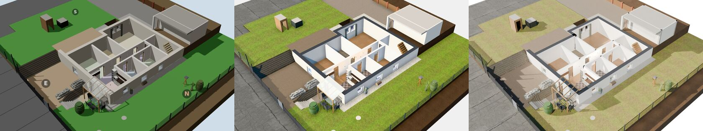
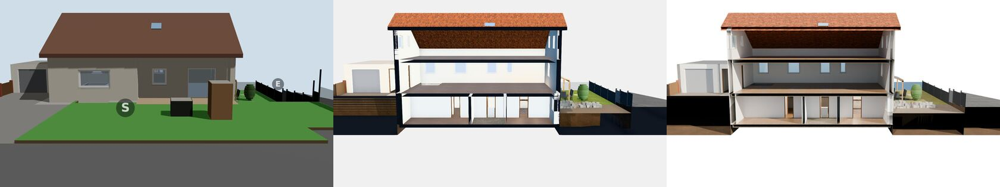
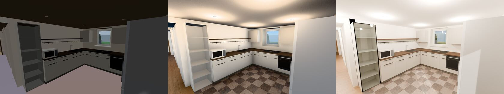
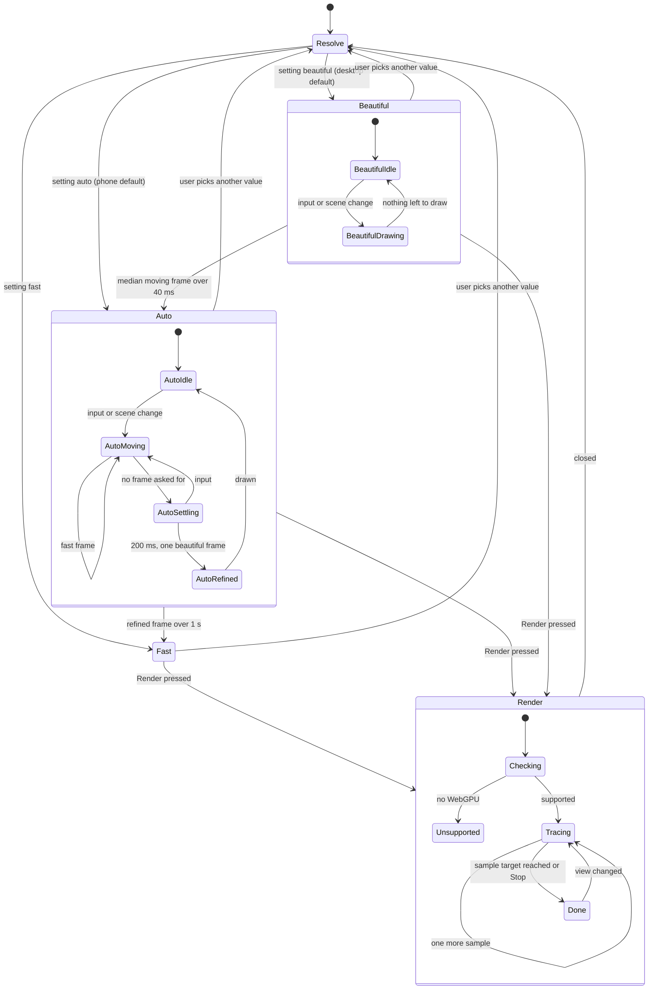
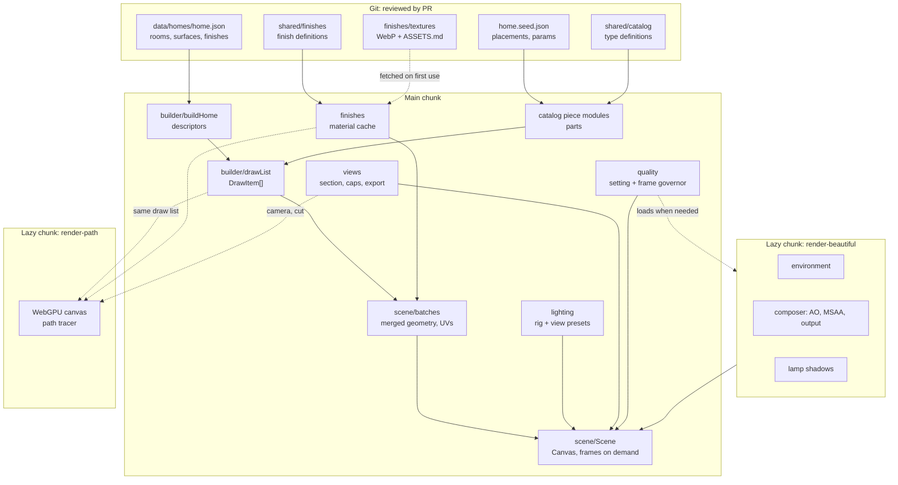
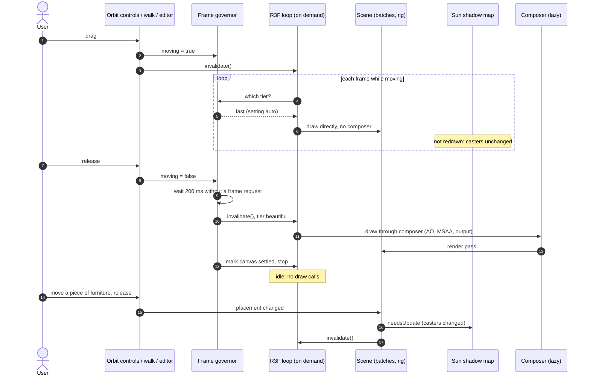
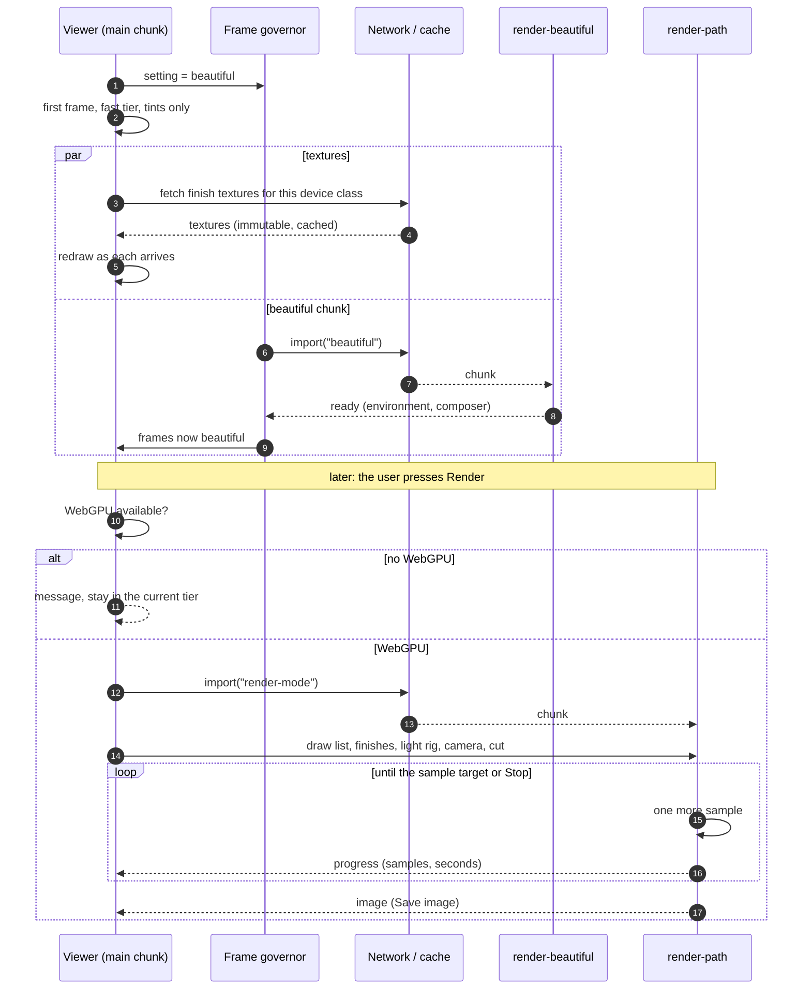
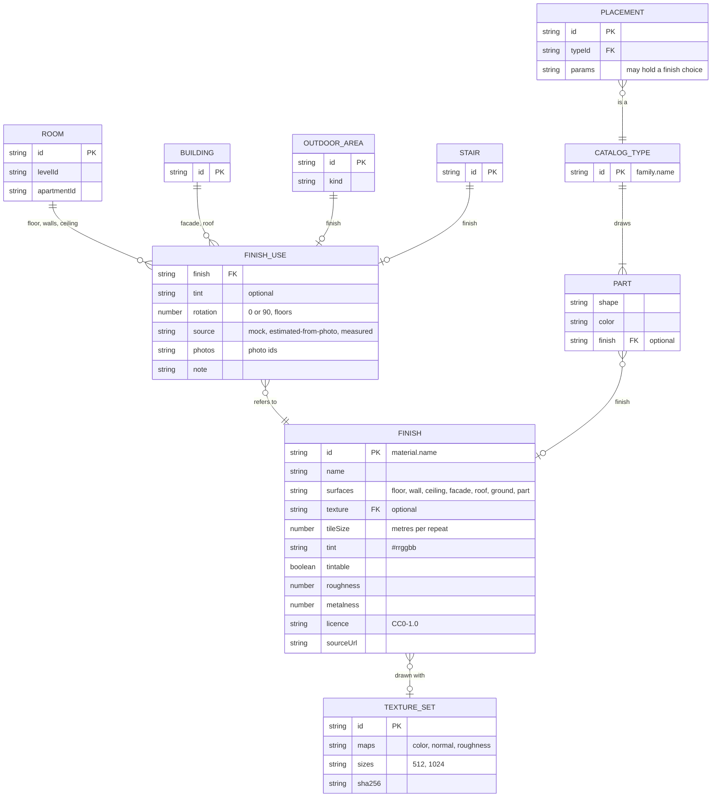
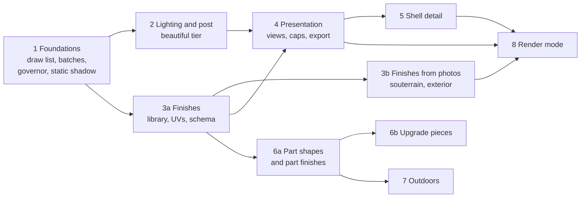

# Realistic render: design

The design for epic [#106](https://github.com/NNTin/my-home/issues/106): a realistic 3D render of the house and
the souterrain apartment, in the existing web app, on desktop and phone. It follows the investigation in
[#107](https://github.com/NNTin/my-home/issues/107) and the owner's answers there, and is written for
[#108](https://github.com/NNTin/my-home/issues/108).

This document is a plan, not a description of the code: nothing in it exists yet unless it says "today". Its
[open questions](#14-open-questions) are all answered, so the implementation sub-issues can be created from
[Rollout](#12-rollout).

## Contents

1. [Goals and non-goals](#1-goals-and-non-goals)
2. [Where we start](#2-where-we-start)
3. [Quality tiers](#3-quality-tiers)
4. [Architecture](#4-architecture)
5. [Materials and finishes](#5-materials-and-finishes)
6. [Lighting and post-processing](#6-lighting-and-post-processing)
7. [Presentation](#7-presentation)
8. [Shell detail, part shapes, outdoors](#8-shell-detail-part-shapes-outdoors)
9. [Render mode](#9-render-mode)
10. [Performance budgets](#10-performance-budgets)
11. [Testing and verification](#11-testing-and-verification)
12. [Rollout](#12-rollout)
13. [Decisions log](#13-decisions-log)
14. [Open questions](#14-open-questions)

## 1. Goals and non-goals

### Goals

- **The house reads as a real place.** Surfaces have materials at true scale, light is soft, lamps light the
  rooms, and objects stand on the floor.
- **Three views are first-class:** an isometric cutaway of the souterrain, a cross-section of the whole house
  with the garden, and eye level inside a room.
- **It stays the same web app** (three.js through React Three Fiber), usable on a phone. A phone never pays for
  what it cannot show.
- **Everything stays reviewable in git:** finishes are catalogue entries, a room's finish is a value in
  `home.json` with provenance, and every asset has a recorded licence.
- **Budgets are numbers that CI checks,** not intentions.

### Non-goals

| Not in this epic                                            | Where it goes                                                                       |
| ----------------------------------------------------------- | ----------------------------------------------------------------------------------- |
| Furnishing the living room, bedroom, work room and bathroom | A later follow-up (owner's answer 9)                                                |
| An evening or night look, time of day                       | [#18](https://github.com/NNTin/my-home/issues/18); this design leaves a seam (§6.5) |
| An offline Blender pipeline                                 | Dropped (owner's answer 11)                                                         |
| A geographic sun (latitude, date)                           | Never: it is location data. The sun here is a studio light (§6.2)                   |
| Real photos on GitHub or in git                             | Never. Photos stay in the photo store, referenced by id                             |
| Textures made from the owner's photos                       | Never: a texture cut from a photo is photo data in git (§5.6)                       |
| Baked lightmaps, light probes                               | Not now: every model or seed change would invalidate the bake (#107)                |
| WebGPU for the main viewer                                  | Not now. Only render mode uses WebGPU, in its own canvas (§9)                       |
| Gaussian splats, AI restyling of renders                    | No (#107)                                                                           |
| Moving, resizing or re-angling anything                     | Never: the exterior, floor plan and room plan are fixed (`AGENTS.md`)               |
| Editing finishes in the app                                 | Not in this epic: finishes change by a PR to `home.json` (§5.5)                     |
| Interiors of the ground floor and attic                     | Out of scope: they appear as neutral shells (§7.5)                                  |

## 2. Where we start

Measured in #107 on `main` at `d4df5df`, for the default view of "Our home":

| Fact                     | Today                                                                           |
| ------------------------ | ------------------------------------------------------------------------------- |
| Meshes                   | 746 (souterrain cutaway) to 981 (whole house): one per wall segment, part, step |
| Draw calls per frame     | 1,264 to 1,857, shadow pass included. Nothing is merged or instanced            |
| Triangles per frame      | 24k to 34k                                                                      |
| Materials                | One colour per surface; no textures; floors coloured by room index              |
| Light                    | One hemisphere light, one sun. Lamps are geometry only                          |
| Shadow                   | One 2048² map (1024² on a phone) over 60 × 60 m: about 3 cm per texel           |
| Frame loop               | Desktop: every frame. Phone: on demand                                          |
| Post-processing          | None. ACES tone mapping (the R3F default)                                       |
| Catalogue                | 35 types, built from boxes and cylinders                                        |
| JavaScript of the viewer | 1.51 MB, 431 kB gzipped                                                         |

Two conclusions shape the design. The viewer is **bound by draw calls, not triangles**, so merging comes before
anything that adds a pass. And #107 had **no GPU**: frame rates on real devices are unknown, so every step that
changes cost ends with a measurement on real hardware (§10.3).

The three fixed views, as #107's spike left them: today's renderer, the real-time prototype, and a path-traced
reference made offline during the investigation. The acceptance criteria in §12 refer to these.

| View               | Today · real-time prototype · path-traced reference                                          |
| ------------------ | -------------------------------------------------------------------------------------------- |
| Isometric cutaway  |                 |
| Cross-section      |  |
| Eye level, kitchen |              |

## 3. Quality tiers

### 3.1 Three tiers

A **tier** is what one frame contains.

|                   | **Fast**                       | **Beautiful**                                          | **Render**                |
| ----------------- | ------------------------------ | ------------------------------------------------------ | ------------------------- |
| Purpose           | Moving on any device           | The look of the app at rest                            | A still image             |
| Geometry          | Merged shell, merged pieces    | Same                                                   | Same draw list, own scene |
| Finishes          | 512 px: colour and relief      | Desktop: 1024 px, plus a roughness map. Phone: as fast | As beautiful              |
| Sun shadow        | One fitted static map          | Same map, wider filter                                 | Traced                    |
| Environment       | Hemisphere light               | Neutral studio environment                             | Same environment, traced  |
| Lamps             | Up to 4, no shadows            | Up to 12; the 4 nearest cast shadows                   | All, traced               |
| Ambient occlusion | No                             | Yes                                                    | Traced                    |
| Anti-aliasing     | Canvas MSAA                    | MSAA on the composer target                            | By accumulation           |
| Tone mapping      | Neutral                        | Neutral                                                | Neutral                   |
| Pixel ratio       | Up to 1.5 (phone), 2 (desktop) | Same caps                                              | 1, at export size         |
| Code              | Main chunk                     | Lazy chunk `render-beautiful`                          | Lazy chunk `render-path`  |

Fast is not "today": it has finishes and merged geometry. Step 1 of the rollout makes fast cheaper than today
before anything is added to it.

### 3.2 The setting

The **quality setting** decides which tier is drawn when. It has three values.

| Setting     | While the view moves | At rest             | Default on |
| ----------- | -------------------- | ------------------- | ---------- |
| `fast`      | Fast                 | Fast                | Nowhere    |
| `auto`      | Fast                 | One beautiful frame | Phones     |
| `beautiful` | Beautiful            | Beautiful           | Desktops   |

- **Phone** means the same condition as the phone layout today (`docs/mobile.md`).
- **Render** is not a setting. It is a button that starts a still of the current view (§9) and returns to the
  setting when closed.
- The setting is resolved in this order: the URL (`?quality=fast|auto|beautiful`), then the value remembered on
  this device (`localStorage`, key `my-home.quality`), then the device default. The URL wins for one visit and
  is not remembered; the View panel's control is.
- The View panel gets a "Quality" control with the three values. On a phone it is labelled "Fast", "Automatic"
  and "Always beautiful".

### 3.3 Refine when still

`auto` is the phone's default, and the reason frames on demand is kept. While a finger moves the view, frames
are fast. When input ends and nothing has asked for a frame for **200 ms**, the viewer draws **one** beautiful
frame at the full pixel-ratio cap and then stops. The idle state still draws nothing.

### 3.4 Stepping down

The viewer protects itself. The frame governor (§4.3) watches frame times:

- In `beautiful`, when the median of 30 consecutive moving frames is above **40 ms**, it behaves as `auto` for
  the rest of the visit.
- In `auto`, when a refined frame takes longer than **1 s**, it behaves as `fast` for the rest of the visit.
- A step down shows one toast ("Showing a faster view on this device") and is not remembered. Choosing a value
  in the View panel clears it.

### 3.5 States



## 4. Architecture

### 4.1 Where the code lives

Paths are under `apps/web/src/` unless they start with `packages/`.

| Part                | Path                                       | Chunk              | Does                                                                 |
| ------------------- | ------------------------------------------ | ------------------ | -------------------------------------------------------------------- |
| Finish definitions  | `packages/shared/src/finishes/`            | (shared)           | Ids, names, tile sizes, licences; used by api, web and CI            |
| Home model          | `packages/shared/src/home-model.ts`        | (shared)           | Gains `finishes` on rooms and exterior surfaces                      |
| Builder             | `builder/buildHome.ts`                     | main               | Unchanged role: descriptors. Gains finish ids, wall faces, UV frames |
| Draw list           | `builder/drawList.ts`                      | main               | Turns descriptors and piece parts into `DrawItem`s (§4.2)            |
| Batching            | `scene/batches.ts`                         | main               | Merges draw items into few geometries, with UVs in metres            |
| Scene               | `scene/Scene.tsx`, `scene/ShellMeshes.tsx` | main               | Canvas, batches, pieces, furniture layer                             |
| Quality             | `quality/`                                 | main               | The setting, its storage, the frame governor                         |
| Light rig           | `lighting/`                                | main               | The rig interface, the fast rig, view presets                        |
| Finishes at runtime | `finishes/`                                | main               | Material cache, texture loading by tier                              |
| Texture files       | `finishes/textures/<set>/`                 | assets (hashed)    | WebP files, fetched when a finish is first drawn                     |
| Beautiful           | `beautiful/`                               | `render-beautiful` | Environment, composer, AO, lamp shadows, roughness maps              |
| Views               | `views/`                                   | main               | Named views, section plane, caps, backdrop, image export             |
| Render mode         | `render-mode/`                             | `render-path`      | Its canvas, WebGPU renderer and path tracer                          |
| Catalogue           | `catalog/`                                 | main               | Unchanged role. `Part` gains shapes and a finish (§8.2)              |



### 4.2 The draw list and batching

Today `HomeMeshes` and `PartsMesh` create one mesh per descriptor and per part. The design puts one layer
between the builder and three.js.

- A **draw item** is one solid with everything needed to draw it: a shape (box, extruded outline, flat
  polygon, cylinder, and later the shapes of §8.2), a world transform, a finish id and tint, shadow flags, the
  **group** it belongs to and, for cut faces, a `cap` flag.
- The **draw list** is the ordered array of draw items of a home with its placements. It is plain data, built
  without three.js, and is what the golden tests record (§11.2).
- **Batching** merges draw items into geometries. One batch holds every item with the same **batch key**.

| What                                                         | Batch key                            | Result                                                     |
| ------------------------------------------------------------ | ------------------------------------ | ---------------------------------------------------------- |
| Shell: walls, slabs, floors, ceilings, stairs, roof          | level, apartment, finish             | One mesh per finish per apartment per level                |
| Outdoors: terrain, areas, fences without gates, outbuildings | outdoor area or structure id, finish | One mesh per finish per area                               |
| A piece: window, door, gate, furniture item                  | piece id, opaque or transparent      | One opaque mesh and at most one transparent mesh per piece |

- **Visibility keeps working without re-merging.** The cutaway hides levels, apartments and outdoor areas;
  each is part of the batch key, so hiding one is hiding its batches. Changing the visibility never rebuilds
  geometry.
- **Tints are vertex colours.** A batch has one material per finish; each item's tint is written into the
  vertex colours, so differently tinted items of the same finish still share a draw call. A piece's parts
  merge the same way: the part colours become vertex colours.
- **UVs are written at merge time,** in metres, by the conventions of §5.4.
- **Picking stays per piece.** Nothing in the shell can be picked today and nothing will be. A piece keeps its
  own group and meshes, so the click handler, the "is it frontmost" ray test and the highlight work as now.
  The highlight clones the piece's material while it glows.
- **Walking is unaffected:** collision is computed from descriptors, not meshes.
- **Furniture being dragged** is its own piece batch, so a drag moves a group and rebuilds nothing.

Expected draw calls for the default view: about 40 shell and outdoor batches plus about 80 pieces at one or two
meshes each, so **150 to 250 per frame** instead of about 1,400. §10 turns that into a budget.

### 4.3 The render loop

**Frames on demand everywhere.** Today a desktop draws every frame. With merged batches, a static shadow map
and a refine step, drawing only on change is simpler and cooler on every device. The phone's code path already
does this, including walk mode's watcher (`WalkRig`), so the desktop adopts it.

The **frame governor** owns the decision of what a frame contains.

- It knows whether the view is **moving**: orbit controls between `start` and `end`, a furniture drag, the walk
  figure changing, a camera animation.
- It picks the tier per frame from the setting (§3.2) and its own step-down state (§3.4).
- It marks the canvas with `data-frame="moving|settled"` and `data-tier="fast|beautiful"` so smokes and
  screenshots wait for a settled frame instead of sleeping.
- It records frame times for the `?perf` readout (§10.3).

**Shadows are static.** The sun's shadow map is drawn only when what casts shadows changed: the model, the
visibility, a placement after a drag ends, the light rig, or the section plane. While furniture is dragged the
map is redrawn each frame of the drag, and never otherwise. The shadow frustum is fitted to the bounds of what
is visible, not to a fixed 60 m square.



### 4.4 Lazy chunks

The main chunk holds everything the fast tier needs. The beautiful tier and render mode are separate chunks
that the main chunk never imports statically.

- `render-beautiful` is requested when the setting is `beautiful` or `auto`, after the first fast frame is on
  screen. Until it arrives the viewer draws fast frames; nothing waits for it.
- `render-path` is requested when "Render" is pressed, after a WebGPU check.
- Textures are files, not code: each is requested when a finish that uses it is first drawn, in the size the
  device's class calls for (§5.3). A finish draws with its tint alone until its texture arrives.
- A chunk or texture that fails to load leaves the viewer in the fast tier with a toast, never blank.



## 5. Materials and finishes

### 5.1 The idea

A **finish** is a named surface material: oak laminate, white wall paint, clay roof tiles. Finishes are
catalogue entries in git, like piece types. A room, an exterior surface or a catalogue part refers to a finish
by id and may tint it. The renderer never invents a material: anything without a finish gets the default for
its kind of surface.

### 5.2 The finish library

Definitions live in `packages/shared/src/finishes/definitions/` and are validated at import, like the type
catalogue. The api and CI read them to check that a home refers only to finishes that exist.

| Field                    | Meaning                                                                                            |
| ------------------------ | -------------------------------------------------------------------------------------------------- |
| `id`                     | `<material>.<name>`, lower case, e.g. `wood.oak-laminate`, `paint.plain`, `tile.light-60`          |
| `name`, `description`    | For the catalogue page and for people choosing                                                     |
| `surfaces`               | Where it may be used: `floor`, `wall`, `ceiling`, `facade`, `roof`, `ground`, `part`               |
| `texture`                | The id of its texture set, or none: a **plain** finish is a colour with roughness and has no files |
| `tileSize`               | Metres covered by one repeat of the texture, measured from the source                              |
| `tint`                   | Its default colour as `#rrggbb`; the texture is multiplied by it                                   |
| `tintable`               | Whether a use may change the tint (paint: yes; clay tiles: no)                                     |
| `roughness`, `metalness` | Numbers; the roughness map, where a set has one, multiplies `roughness`                            |
| `source`                 | For textured finishes: provider, asset id, URL, licence (`CC0-1.0`), date fetched                  |

The library starts with these finishes. Textured ones count against the budget; plain ones are free.

| Kind            | Textured                                                                           | Plain                                                           |
| --------------- | ---------------------------------------------------------------------------------- | --------------------------------------------------------------- |
| Floors          | `wood.oak-laminate`, `tile.light-60`, `concrete.screed`                            | `floor.neutral`                                                 |
| Walls, ceilings | `plaster.fine` (relief only)                                                       | `paint.plain`, `shell.neutral`                                  |
| Exterior        | `render.facade` (relief only), `roof.clay-tile`                                    | `cut.dark`                                                      |
| Ground          | `grass.lawn`, `paving.concrete-slab`, `gravel.fine`, `asphalt.plain`, `soil.plain` |                                                                 |
| Parts           | `wood.veneer`, `fabric.weave`                                                      | `metal.brushed`, `ceramic.white`, `plastic.matt`, `glass.clear` |

That is 12 textured sets. A new finish is its own PR, like a new piece type: the definition, the texture files,
the manifest entry, and a note of which photo ids called for it.

### 5.3 Texture files

- **Source:** CC0 libraries only (Poly Haven, ambientCG). Each file is downloaded once by a script that checks
  the provider's checksum, and is then converted.
- **Format:** WebP. No GPU-compressed format in this epic: it would add a transcoder to the bundle and a
  toolchain to CI, and the memory budget (§10) holds without it at these sizes.
- **Maps and sizes:** every set has `color` and `normal` at **512** and **1024** px. A set may have `roughness`
  at 1024 px. Relief-only sets (plaster, facade render) have no `color` map.
- **Which size is fetched:** phones fetch 512 px in every tier. Desktops fetch 512 px in the fast tier and
  1024 px, with the roughness map, in the beautiful tier.
- **Where:** `apps/web/src/finishes/textures/<set>/<map>-<size>.webp`, imported by URL so Vite gives them
  hashed names under `/assets/`, which nginx already serves as immutable.
- **Manifest:** `apps/web/src/finishes/ASSETS.md`, generated from the definitions, lists every file with its
  source, licence, size and SHA-256. A unit test fails when a file is not listed, a listed file is missing, a
  checksum differs or a budget of §10 is exceeded.
- **In git:** the files are committed to the repository as plain files, not Git LFS. The manifest test caps the
  folder at 16 MB; the twelve sets take about 8 MB.
- **Tooling:** `tools/finishes/fetch.mjs` (download, verify, convert, write the manifest). It runs on a
  developer machine or in an agent session, not in CI; CI only checks the result.

### 5.4 UV conventions

All UVs are in **metres** before the finish's `tileSize` divides them, so one definition tiles correctly on
every surface.

| Surface                | `u` runs                     | `v` runs                     | Origin                                 |
| ---------------------- | ---------------------------- | ---------------------------- | -------------------------------------- |
| Floor, ceiling, ground | along plan x                 | along plan z                 | the plan origin, so neighbours line up |
| Wall face              | along the wall               | up                           | the wall's start, at its floor         |
| Roof plane             | along the eave               | up the slope, true length    | the eave's start                       |
| Catalogue part         | box projection, local x or z | box projection, local y or z | the piece's origin                     |

- A use may turn a floor finish by a quarter turn (`rotation: 90`), for the direction planks run.
- UVs are computed by the batching step from descriptors. Nothing recomputes them at runtime.

### 5.5 Finishes in the home model

`home.json` gains optional fields. A missing field means "the default for this kind of surface", so today's
file stays valid and nothing changes until a room is refined.

A **finish use** is:

```json
{
  "finish": "wood.oak-laminate",
  "tint": "#d9c2a0",
  "rotation": 90,
  "source": "estimated-from-photo",
  "photos": ["<photo id>"],
  "note": "Planks run along the long side of the room"
}
```

- `source` is the existing `DimensionSource`: `mock` for a placeholder, `estimated-from-photo` when chosen
  from photos, `measured` when the owner named the product or colour.
- `photos` are photo ids from the photo store. The existing `note` stays free text.
- `tint` is allowed only where the finish is `tintable`. `rotation` is 0 or 90 and only for floors.

| Where                               | Field                                                  | Default when missing                                                                                                                                                                       |
| ----------------------------------- | ------------------------------------------------------ | ------------------------------------------------------------------------------------------------------------------------------------------------------------------------------------------ |
| A room                              | `finishes.floor`, `finishes.walls`, `finishes.ceiling` | `floor.neutral`, `paint.plain`, `paint.plain`                                                                                                                                              |
| The building                        | `building.finishes.facade`, `.roof`                    | `render.facade`, `roof.clay-tile`                                                                                                                                                          |
| An outdoor area                     | `finish`                                               | By kind: garden → `grass.lawn`, patio and path → `paving.concrete-slab`, driveway → `paving.concrete-slab`, road → `asphalt.plain`, gravel → `gravel.fine`, embankment → `concrete.screed` |
| An outbuilding                      | `finish`                                               | By kind, as today's colours                                                                                                                                                                |
| A stair                             | `finish`                                               | `wood.oak-laminate`                                                                                                                                                                        |
| Terrain in section, cut faces       | (not in the model)                                     | `soil.plain`, `cut.dark`                                                                                                                                                                   |
| Rooms of the ground floor and attic | (not allowed)                                          | `shell.neutral` everywhere (§7.5)                                                                                                                                                          |

- **Wall faces belong to rooms.** A wall has two long faces. Each face takes the `walls` finish of the room it
  borders; the builder finds that room with a point just in front of the face. A face that borders no room is
  an exterior face and takes the facade finish. There is no finish per wall in this epic.
- **Defaults are plain on purpose** indoors: a room nobody has refined looks neutral, not falsely specific.
- **Validation:** the zod schema and the generated JSON Schema gain these fields (`pnpm schema:generate`). The
  api and CI reject an unknown finish id, a finish used on a surface it does not list, and a tint on a finish
  that is not tintable.
- **The pastel room colours** of today become a view option, "Plan colours", for telling rooms apart. It is off
  by default and remembered per device: from step 3a everyone sees finishes.
- **Finishes are edited in git,** by a PR to `home.json`. There is no editing of finishes in the app in this
  epic; it can follow later with the same data model, stored like opening overrides.



### 5.6 How agents choose finishes from photos

This becomes a section of the `my-home-photo-modelling` skill when step 3 of the rollout lands.

1. **Collect** the photos of the room or surface, as for any refinement. Outside, only photos taken from the
   owner's garden, patio or the street.
2. **Choose** the library finish that matches the material. Judge material and pattern, not lighting.
3. **Tint,** where the finish is tintable: take the colour from a lit, unshadowed part of the surface in two
   photos and use a value both agree on.
4. **Record** the finish use with `source: estimated-from-photo` and the photo ids.
5. **Missing finish:** when nothing in the library fits, add one in its own PR from a CC0 source.
6. **Unsure:** ask for a photo (`photo-requests.sh`) instead of guessing.

Two rules hold throughout. **Photos are referenced by id and never uploaded or committed.** And **no texture is
ever made from a photo:** a texture cut from the owner's photo would put the photo into git.

### 5.7 Finishes on catalogue pieces

- A part may name a finish: `material.finish`. Its `color` stays and acts as the tint.
- A type offers a choice of finishes with the existing `choice` parameter, whose option values are finish ids.
  A `basic` choice is stored per use in the seed like a colour today; no change to the seed's format.
- A part without a finish draws as today: its colour, roughness and metalness.

## 6. Lighting and post-processing

### 6.1 The light rig

A **light rig** is plain data that says how a view is lit. Views choose a rig; tiers decide how much of it is
drawn.

| Field         | Meaning                                                             |
| ------------- | ------------------------------------------------------------------- |
| `sun`         | Direction, colour, intensity                                        |
| `environment` | Intensity of the ambient environment                                |
| `interior`    | The factor applied to the environment under a ceiling (default 0.3) |
| `lamps`       | Whether fixtures emit, and their intensity factor                   |
| `backdrop`    | `sky`, `studio-light` or `studio-dark`                              |
| `exposure`    | Tone-mapping exposure                                               |

### 6.2 Sun

- **A studio sun, per view.** Each named view sets the sun where it lights the faces turned to the camera. For
  the free orbit view the sun keeps a fixed direction, as today.
- **No geographic sun.** Nothing in this epic derives a sun position from a place, a date or a time.
- **Shadow:** one map, fitted to what is visible, 2048² on a desktop and 1024² on a phone, drawn only on change
  (§4.3). three r187 removed `PCFSoftShadowMap`; the renderer asks for `PCFShadowMap` explicitly. The beautiful
  tier widens the filter with the light's radius. If step 2 finds that this cannot give a visible penumbra at
  the three fixed views, beautiful uses `VSMShadowMap`; the choice is recorded in that step's PR.

### 6.3 Environment and backdrop

- **Environment:** a neutral studio environment generated in the browser at start (a few lit panels,
  prefiltered once). It costs no download and has no colour cast. #107 used a sky photograph and found that it
  tints shaded walls blue.
- **Indoors:** an environment lights a closed room as if it had no ceiling. Views under a ceiling (eye level,
  first-person walking) multiply it by the rig's `interior` factor and rely on lamps. This is the known limit
  of the real-time tiers; render mode has no such limit.
- **Backdrop:** `sky` is today's flat blue and stays the default of the free view. Named views default to
  `studio-light` (white). `studio-dark` (charcoal) is offered as a backdrop; it is daylight on a dark ground,
  not an evening.
- **Through windows** at eye level the backdrop is a simple vertical gradient.

### 6.4 Fixtures that emit light

- A catalogue type may declare that it **emits light**: a position in its local frame, a colour, an intensity
  in candela and a range. `fixture.downlight` is the first.
- **Caps:** the fast tier lights the 4 emitters nearest the orbit target, without shadows. The beautiful tier
  lights up to 12, and the 4 nearest cast shadows from static maps that are redrawn only on change.
- **No leaking:** an emitter's range ends at the bounds of its room, so an unshadowed lamp does not light the
  far side of a wall.
- **Walk mode's head lamp goes** once the room the figure stands in has an emitter; it stays as the fallback in
  rooms without one.

### 6.5 The seam for #18

Time of day belongs to #18. This design gives it one place to plug in: the light rig is data, chosen by a
function `rigFor(view)`. #18 can supply rigs from a clock (sun direction and colour, lamps on at night, a dark
backdrop) without touching tiers, finishes or the frame loop. Until then every rig is daylight.

### 6.6 Post-processing

The beautiful tier draws through three.js' own `EffectComposer` (the `three/addons` passes), not through the
`postprocessing` package #107's spike used. That package requires three below 0.188 and would block upgrades
of three; the addons ship with three itself.

| Pass              | What                                                                                                                |
| ----------------- | ------------------------------------------------------------------------------------------------------------------- |
| Render pass       | The scene into a multisampled target (4 samples; 0 on a phone's refined frame if the governor measured it too slow) |
| Ambient occlusion | `N8AOPass` from `n8ao` (ISC). Half resolution on phones. No temporal accumulation                                   |
| Output pass       | Neutral tone mapping, exposure from the rig, sRGB                                                                   |

- **Tone mapping is Neutral in every tier** (three's `NeutralToneMapping`), so a finish has the same colour in
  fast and beautiful. Today's ACES goes; that changes every existing frame slightly and is listed in step 2.
- No bloom, depth of field or vignette in this epic.

### 6.7 Determinism

The pixel-exact tooling (`visual-diff.sh`) must keep working.

- Every tier draws the same pixels for the same commit, view and viewport: no temporal accumulation, no
  time-based noise, no animation that does not settle.
- A capture waits for `data-frame="settled"` on the canvas (§4.3) instead of a fixed time.
- A unit of proof is "shot twice, byte-identical", per tier, added to the smoke for each step that touches a
  tier.

## 7. Presentation

### 7.1 Named views

A named view is a camera, a visibility, a light rig, a backdrop and, for a section, a cut. It is reachable by
URL and from the View panel.

| View              | URL                                                  | Camera                                               | Shows                                             |
| ----------------- | ---------------------------------------------------- | ---------------------------------------------------- | ------------------------------------------------- |
| Isometric cutaway | `?view=cutaway&level=<levelId>`                      | Perspective, 20° field of view, from high south-east | One level, cut walls capped                       |
| Cross-section     | `?view=section&look=north\|east\|south\|west&at=<m>` | Perspective, 25°, level with the house's middle      | The whole house and plot, cut by a vertical plane |
| Eye level         | `?view=eye&room=<roomId>&look=<degrees>`             | Perspective, 70°, 1.6 m above the floor              | A room from inside, ceilings on                   |

- The camera stays perspective. A narrow field of view reads as isometric and keeps orbit controls, picking
  and depth-based effects unchanged.
- `look` names the direction the camera looks. `at` is the distance of the cut plane along that direction from
  the building's near face, in metres; the default is the middle. A slider in the View panel moves it.
- A named view hides the compass letters and room labels. Orbiting away from it leaves the view (the URL drops
  the parameter) but keeps the cut and backdrop until "Reset view".
- `?view=` combines with `?quality=` and with the existing `?focus=` and `?walk=`.

### 7.2 Cut caps

- **Cutaway:** the tops of walls of the highest visible level are drawn with `cut.dark` when the level above is
  hidden. The builder marks those faces; no extra geometry.
- **Section:** one clipping plane cuts every material. Cut solids are closed with a **stencil cap**: back faces
  and front faces of all closed solids write the stencil, and one quad on the cut plane is drawn where a solid
  is open. The cap uses `cut.dark` for building parts and `soil.plain` for terrain.
- Stencil caps do not depend on how solids overlap, which is what broke the back-face trick in #107's spike at
  wall openings.
- Every draw item says whether it is a closed solid. Flat polygons (floors, lawns) are cut and need no cap.

### 7.3 Backdrop

`sky`, `studio-light`, `studio-dark` (§6.3), chosen in the View panel and by `?backdrop=`. Beyond the plot the
ground is a neutral plane fading into the backdrop; nothing outside the plot is modelled.

### 7.4 Image export

- "Save image" in the View panel draws the current view once, at twice the canvas size up to 3840 px wide, in
  the beautiful tier, without labels, letters or handles, and downloads a PNG named
  `my-home-<view>-<yyyymmdd-hhmm>.png`.
- In render mode it saves the traced image (§9).
- An exported image is a render of the model. It may be posted on GitHub; it contains no photo and no location.

### 7.5 Upper floors as neutral shells

The ground floor and attic interiors are out of scope. In a section they are drawn as they are modelled
(floors, outer walls, windows) with `shell.neutral`, a muted plain finish, on every inner surface. They get no
finishes in `home.json`, no furniture, no lamps and no photos. The schema rejects `finishes` on their rooms.

## 8. Shell detail, part shapes, outdoors

These come after the tiers, finishes and views, in this order (§12, steps 5 to 7). Each is geometry derived by
the builder or a piece module; none moves a wall, room or roof.

### 8.1 Shell detail

| Detail      | Rule                                                                                         |
| ----------- | -------------------------------------------------------------------------------------------- |
| Wall seams  | Wall faces are emitted per face, not per box segment, so a wall with openings has no seams   |
| Skirting    | 7 cm high, 1.2 cm deep, along every interior wall face of a souterrain room, broken at doors |
| Door frames | Reveals and a threshold from the wall's depth; the frame stays part of the door piece        |
| Stairs      | Treads with a nosing, two stringers, a handrail on the open side                             |
| Roof        | Eaves board, ridge cap, gutters along the eaves                                              |

Dimensions here are defaults of the builder, not measurements; each can become a value in `home.json` later if
a photo shows otherwise.

### 8.2 Catalogue part shapes

`Part.shape` gains three values. Existing modules are untouched.

| Shape        | Parameters                                  | For                                |
| ------------ | ------------------------------------------- | ---------------------------------- |
| `roundedBox` | Size, corner radius                         | Cushions, fronts, appliances       |
| `extrude`    | A closed profile in the part's x/y, a depth | Handles, legs, mouldings, worktops |
| `lathe`      | A profile turned about the part's y axis    | Lamp shades, pots, turned legs     |

- Sections (`sectionOf`) cut the new shapes by their bounding box unless the module gives its own section.
- Dimensions, collisions, footprints and snapping keep using the type's size, not the shape.
- **Budget:** at most 5,000 triangles per piece (§10).
- **Upgrades** start with the types that are placed today (kitchen units, fridge, microwave, shelf, shoe
  cabinet, radiator, downlight, the garden pieces) and continue with the rest of the catalogue.
- **CC0 meshes** (owner's answer 5) are allowed for plants, sanitary ware and decor only, at most 300 kB each
  and 10 MB in total, with a licence manifest. No type in this epic needs one, so the mesh part itself is
  specified and built with the furnishing follow-up, not here.

### 8.3 Outdoors

| Item            | Design                                                                                                      |
| --------------- | ----------------------------------------------------------------------------------------------------------- |
| Slopes          | A sloped area is one smooth surface; the stepped contour bands go                                           |
| Lawn            | `grass.lawn`, plus instanced grass tufts along lawn edges and within 6 m of the camera, beautiful tier only |
| Hedges, trees   | New parametric `garden` types, built from the shapes of §8.2                                                |
| Fences          | Posts and slats or mesh as merged geometry per fence kind                                                   |
| Beyond the plot | A neutral ground plane into the backdrop. No neighbours, no real surroundings                               |

## 9. Render mode

Render mode makes one still of the current view by progressive path tracing. It is the only tier with bounce
light, and the only part of the app that uses WebGPU.

- **Tracer:** `three-gpu-pathtracer`'s WebGPU tracer. Its WebGL tracer, tried in #107, is deprecated by the
  library.
- **Own canvas, own renderer.** Render mode opens over the viewer with its own canvas and a WebGPU renderer.
  The WebGL viewer underneath is paused, not replaced.
- **Same inputs.** It builds its scene from the same draw list, finishes, light rig, camera and cut as the
  frame it replaces, through the same construction functions. It does not share GPU objects with the viewer.
- **Flow:** check for WebGPU; load the chunk; show the rasterised frame; add samples; show a counter and
  elapsed time; stop at the sample target (default 256) or when "Stop" is pressed; "Save image". Changing the
  view restarts it.
- **Unsupported devices** see one sentence ("This browser cannot make path-traced renders") and keep their
  tier. Phones are not offered the button in this epic.
- **The cut** in render mode is a real geometric cut of the draw list, not a clipping plane, so light enters
  the cut rooms.

**Decision gate.** No real GPU was available in #107, so step 8 starts by measuring, on a desktop with a
discrete GPU, the seconds to a clean still for the three fixed views and the chunk's size. The step continues
when every view is clean within 60 s. If it is not, render mode ships with the deprecated WebGL tracer on the
viewer's own renderer instead, and the PR says so. Either way the tier's interface above stays the same.

## 10. Performance budgets

### 10.1 The budgets

"Default view" is the first view of "Our home": the souterrain cutaway.

| Budget                                 | Phone                       | Desktop                                                     |
| -------------------------------------- | --------------------------- | ----------------------------------------------------------- |
| Draw calls, default view, moving frame | ≤ 250                       | ≤ 350                                                       |
| Draw calls, whole house                | ≤ 350                       | ≤ 500                                                       |
| Draw calls while idle                  | 0                           | 0                                                           |
| Triangles, whole house                 | ≤ 150,000                   | ≤ 150,000                                                   |
| Triangles per catalogue piece          | ≤ 5,000                     | ≤ 5,000                                                     |
| Texture files in the repository        | ≤ 16 MB                     | same                                                        |
| Texture download, all finishes         | ≤ 1.5 MB                    | ≤ 6 MB                                                      |
| Texture memory on the GPU              | ≤ 40 MB                     | ≤ 220 MB                                                    |
| Lights with shadows                    | 1 (sun)                     | 5 (sun and 4 lamps)                                         |
| Main chunk growth over `d4df5df`       | ≤ 25 kB gzipped, whole epic | same                                                        |
| `render-beautiful` chunk               | ≤ 150 kB gzipped            | same                                                        |
| `render-path` chunk                    | not offered                 | set at the decision gate (§9); never loaded before "Render" |
| Moving frame, median                   | ≤ 33 ms                     | ≤ 17 ms                                                     |
| Refined frame (`auto`)                 | ≤ 300 ms                    | n/a                                                         |

Texture memory is computed, not measured: width × height × 4 bytes × 1.33 for each texture a device class
loads, summed. Twelve sets at 512 px with two maps come to about 33 MB; at 1024 px with a roughness map,
about 200 MB.

### 10.2 How each is enforced

| Budget                           | Check                                                                                                  | Runs in                |
| -------------------------------- | ------------------------------------------------------------------------------------------------------ | ---------------------- |
| Draw calls                       | A unit test counts batches and piece meshes of `home.json` with its seed, per visibility               | `pnpm test` (CI)       |
| Draw calls, real                 | `mobile-smoke.sh` already counts WebGL draw calls; it gains the thresholds and the idle check per tier | Smokes on staging      |
| Triangles                        | A unit test sums triangles of the merged geometry and of every piece type at its default size          | `pnpm test` (CI)       |
| Texture download, memory         | The manifest test of §5.3 sums file sizes and computes memory per device class                         | `pnpm test` (CI)       |
| Chunk sizes                      | `tools/check-bundle.mjs` reads the build output and compares with `apps/web/bundle-budget.json`        | CI, after `pnpm build` |
| No static import of a lazy chunk | The same script fails if `render-beautiful` or `render-path` code is in the main chunk                 | CI, after `pnpm build` |
| Frame times                      | The `?perf` readout on real devices (§10.3)                                                            | Owner-only check       |

### 10.3 Measuring on real devices

CI and the agents' machine render in software, so frame times mean nothing there. `?perf=1` shows a small
readout over the viewer: tier, draw calls, triangles, textures loaded, median and 95th-percentile frame time
while moving, and the refined frame's time. Steps 1, 2 and 8 end with the owner opening one link on a phone
and one on a desktop and reporting the numbers. The owner has agreed to these
checks and has a desktop with a discrete GPU for step 8. Each of those sub-issues carries an owner-only
checklist of two links. The readout stays in the app as a diagnostic.

## 11. Testing and verification

### 11.1 Unit tests (jsdom, no WebGL)

- Schema: finish uses are accepted and rejected as §5.5 says; today's `home.json` still validates.
- Finishes: every definition is valid; the manifest matches the files; defaults resolve for every surface.
- Builder: wall faces find their room; UV frames follow §5.4; cut faces are marked.
- Batching: items with the same key merge; vertex counts and bounds are conserved; visibility hides whole
  batches; a piece keeps its own meshes.
- Quality: the setting resolves in the order of §3.2; the governor's states follow §3.5 with a fake clock.
- Web tests never load a texture and never need WebGL, as today.

### 11.2 Goldens

Today's golden records are the rendered meshes. Merging changes every one of them without changing a pixel, so
the goldens **move one layer up, to the draw list**: the ordered draw items of the home, of each catalogue type
at its default size, and of the mock home. A PR that changes a design on purpose updates them and says so, as
today. Step 1 converts the goldens and shows, with `visual-diff.sh`, that the pixels did not change.

### 11.3 Smokes and visual diff

- `mobile-smoke.sh`: draw-call thresholds; nothing drawn while idle in every setting; one refined frame after
  input ends in `auto`; the Quality control is reachable and named.
- `walk-smoke.sh`: walking draws fast frames and refines on stop.
- `visual-diff.sh`: the existing views pin `quality=fast`. New views: the three named views in `fast` and in
  `beautiful`, and the phone in `auto` after settling. It waits for the settled frame (§6.7).
- `catalog-smoke.sh`: thumbnails and piece pages draw the new shapes and finishes.

### 11.4 Showing renders in PRs

Renders of the house model may be shown on GitHub; real photos never.

- A PR that changes how the house is drawn shows **before and after** at the three fixed views, and the phone
  view when it affects phones. "Before" is `main` on staging, "after" is the PR on staging, shot with
  `screenshot.sh --canvas`.
- The images go to the `assets/render-shots` branch (the pattern of `assets/render-references`), under
  `pr-<number>/`, as JPEG of at most 300 kB each, and the PR body links them by commit.
- Photos are named by id only. A screenshot that includes a photo (the gallery, "view from here" with an
  overlay) is never posted.

## 12. Rollout

Eight steps, in order. Each becomes one implementation sub-issue of #106 (step 3 and step 6 become two each).
Sizes: **S** about one PR, **M** two or three, **L** a phased series.



### Step 1. Render foundations (M)

**Scope:** the draw list and batching (§4.2); frames on demand on every device and the frame governor with the
quality setting, `?quality=` and the View panel control (§3, §4.3); the static, fitted sun shadow and an
explicit shadow type (§6.2); the `?perf` readout (§10.3); goldens moved to the draw list (§11.2);
`tools/check-bundle.mjs` in CI. The `auto` and `beautiful` settings exist and draw the fast tier until step 2.
No intended change of look.

**Acceptance:**

- Draw calls of the default view are within §10.1, counted by the unit test and by `mobile-smoke.sh`.
- Nothing is drawn while idle, on a phone and on a desktop.
- Picking, `?focus=`, the editor, walking and the catalogue pages behave as before; their smokes pass.
- `visual-diff.sh` against `main` is identical, or differs only at shadow edges, with the diff images in the PR.
- The owner's phone and desktop numbers from `?perf=1` are recorded in the sub-issue.

### Step 2. Lighting and post: the beautiful tier (M)

**Scope:** the light rig and view presets (§6.1, §6.2); the neutral environment and backdrops (§6.3); emitting
fixtures with caps, lamp shadows and room-bounded range (§6.4); the composer with AO, MSAA and the output pass
in the `render-beautiful` chunk (§6.6); Neutral tone mapping in every tier; refine when still and stepping down
(§3.3, §3.4); the determinism checks (§6.7).

**Acceptance:**

- The kitchen at eye level is lit by its downlights and shows contact shading, at least as in the prototype
  image of §2.
- `render-beautiful` is within its budget and absent from the main chunk; the main chunk is within its budget.
- On a phone in `auto`: fast frames while moving, exactly one refined frame after input ends, nothing while
  idle.
- Two shots of the same view are byte-identical in each tier.
- The change of every existing frame from ACES to Neutral is shown before and after in the PR.
- The owner's phone and desktop numbers from `?perf=1` are within §10.1, or the governor's thresholds are
  adjusted in this step and the design is updated.

### Step 3a. Finishes: library, UVs and schema (M)

**Scope:** finish definitions and validation (§5.2); the twelve texture sets, the fetch tool and the manifest
(§5.3); UVs in metres from batching (§5.4); the `finishes` fields in the home model with defaults, the JSON
Schema and the api's validation (§5.5); wall faces by room; "Plan colours" as a view option; finishes on the
catalogue page; `docs/home-model.md` and `AGENTS.md` updated (finishes are appearance and may be refined; the
geometry rules are unchanged).

**Acceptance:**

- With no finishes in `home.json`, every surface draws its default; a tile of 60 cm measures 60 cm in the
  model.
- Texture budgets of §10.1 hold, checked by the manifest test; every file has a source, a licence and a
  checksum.
- An unknown finish id, a finish on the wrong kind of surface and a tint on an untintable finish are rejected
  by the schema and in CI.
- Web tests load no texture.

### Step 3b. Finishes from photos (M)

**Scope:** the finish-from-photos section of the `my-home-photo-modelling` skill (§5.6); finishes for the
souterrain rooms, the facade, the roof and the outdoor areas in `home.json`, each with provenance; new finishes
where the library lacks one; photo requests where photos do not show a surface.

**Acceptance:**

- Every souterrain room has floor, walls and ceiling finishes that cite photo ids, or an open photo request
  that says what is missing.
- The exterior finishes cite photos taken from the garden, patio or street.
- No photo is uploaded or committed, and no texture comes from a photo.

### Step 4. Presentation (M)

**Scope:** named views with their URLs and the View panel entries (§7.1); cutaway caps and stencil caps for the
section (§7.2); backdrops (§7.3); "Save image" (§7.4); upper floors as neutral shells (§7.5); the new
`visual-diff.sh` views (§11.3).

**Acceptance:**

- Each named view opens from a link on a desktop and on a phone, and matches or beats the prototype images of
  §2.
- The section shows no artefacts at wall openings, at any cut position the slider allows.
- "Save image" downloads a PNG of the stated size without labels or handles.
- The default view, the level cutaway and walk mode behave as before.

### Step 5. Shell detail (M)

**Scope:** §8.1.

**Acceptance:**

- No wall seams in the three fixed views.
- Skirting, door reveals, stair stringers and a handrail, eaves and gutters are present and tested as builder
  descriptors.
- Walking and collisions are unchanged; the triangle budget holds.

### Step 6a. Part shapes and part finishes (M)

**Scope:** `roundedBox`, `extrude` and `lathe` (§8.2); `material.finish` and finish choices as parameters
(§5.7); the piece page, sections, thumbnails, goldens and `docs/adding-piece-type.md`.

**Acceptance:**

- Each shape draws, sections and is measured on the piece page; one existing type uses each as proof.
- A finish choice set on staging round-trips through the seed export.
- The triangle budget per piece is checked for every type.

### Step 6b. Upgrade the catalogue pieces (L, phased)

**Scope:** rebuild the types with the new shapes and finishes: first the types placed today, then the rest of
the catalogue, a family per PR.

**Acceptance:**

- Each upgraded type reads as its object at eye level, shown before and after on its piece page.
- Parameters, dimensions, footprints and existing placements are unchanged, so no seed changes are needed.

### Step 7. Outdoors (M)

**Scope:** §8.3.

**Acceptance:**

- The cross-section and the isometric view show a lawn with texture and tufts, hedges or trees where the
  owner's photos show them, and fences with slats.
- Nothing outside the plot is modelled after reality.
- The phone's draw-call budget holds with the fast tier.

### Step 8. Render mode (M)

**Scope:** §9, starting with its decision gate.

**Acceptance:**

- The gate's measurements are recorded in the sub-issue before the feature is built.
- On the owner's desktop the three fixed views converge to a clean still within 60 s and can be saved.
- A browser without WebGPU gets the message and keeps its tier.
- The `render-path` chunk is never requested before "Render" is pressed; the other chunks are unchanged.

### Dropped from #107's proposal

| #107 proposed                            | Now                                                    |
| ---------------------------------------- | ------------------------------------------------------ |
| 7. Furnish the souterrain from photos    | Out of this epic; a later follow-up (owner's answer 9) |
| 10. Offline stills with Blender          | Dropped (owner's answer 11)                            |
| An "evening" preset in the lighting step | #18 (owner's answer 10); §6.5 leaves the seam          |

## 13. Decisions log

### The owner's answers to #107 (2026-11-20)

| #   | Question                                 | Answer                                                                                        |
| --- | ---------------------------------------- | --------------------------------------------------------------------------------------------- |
| 1   | Realism in the app, or excellent stills? | Both, by tiers; real time first, stills last                                                  |
| 2   | May agents choose finishes from photos?  | Yes, recorded in `home.json` as estimated from photo; appearance only, geometry fixed         |
| 3   | Upper floors in the cross-section?       | Neutral, unfurnished shells                                                                   |
| 4   | Studio sun instead of a geographic sun?  | Yes. No geographic sun                                                                        |
| 5   | Third-party CC0 models?                  | Parametric first; CC0 meshes only for plants, sanitary ware and decor, ≤ 300 kB each, ≤ 10 MB |
| 6   | Beautiful by default on a phone?         | No: fast while moving, refined at rest, with a switch                                         |
| 7   | Texture budget?                          | About 6 MB, 1.5 MB on a phone, lazy and cached                                                |
| 8   | Renders of the model on GitHub?          | **Yes**, in issues and PRs. Real photos never                                                 |
| 9   | Furnish the remaining rooms?             | **Out of scope** for this epic; later                                                         |
| 10  | An evening look?                         | **In #18**, not here                                                                          |
| 11  | The offline Blender pipeline?            | **No**                                                                                        |

### The owner's answers to this design's questions (#108, 2026-11-20)

All seven proposed defaults were accepted.

| #   | Question                                                                                  | Decision                                                                                               | In         |
| --- | ----------------------------------------------------------------------------------------- | ------------------------------------------------------------------------------------------------------ | ---------- |
| Q1  | May finishes be edited in the app?                                                        | No: only in `home.json` by PR in this epic. In-app editing can follow later with the same data model   | §5.5       |
| Q2  | Do finishes replace the pastel room colours for everyone?                                 | Yes, in every tier. "Plan colours" is an option, off by default, remembered per device                 | §5.5       |
| Q3  | Is beautiful the desktop default on production, with Neutral tone mapping replacing ACES? | Yes. `fast` stays one click away and the viewer steps down by itself                                   | §3.2, §6.6 |
| Q4  | Texture files in plain git or Git LFS?                                                    | Plain git, capped at 16 MB by the manifest test                                                        | §5.3       |
| Q5  | May render mode require WebGPU?                                                           | Yes: desktop browsers with WebGPU; others get one sentence and keep their tier                         | §9         |
| Q6  | Will the owner measure on real devices, and is a desktop with a discrete GPU available?   | Yes to both: an owner-only checklist of two `?perf=1` links at the end of steps 1, 2 and 8             | §10.3      |
| Q7  | Should the design reserve more than a seam for #18?                                       | No. #18 decides in its own design how a clock drives the light rig and how that fits the location rule | §6.5       |

### Design decisions

| #   | Decision                                                                           | Why                                                                                   |
| --- | ---------------------------------------------------------------------------------- | ------------------------------------------------------------------------------------- |
| D1  | Three tiers, and a setting with three values (`fast`, `auto`, `beautiful`)         | Separates what a frame contains from when it is drawn; `auto` is the phone's answer 6 |
| D2  | Frames on demand on every device                                                   | Needed for refine-when-still; one loop to test instead of two                         |
| D3  | A draw list between the builder and three.js; merge by level, apartment and finish | Cuts draw calls about sixfold and keeps visibility and picking as they are            |
| D4  | Goldens record the draw list, not meshes                                           | Merging changes every mesh and no pixel                                               |
| D5  | A static sun shadow, fitted to what is visible                                     | Halves draw calls per frame and sharpens the map                                      |
| D6  | Finishes are shared catalogue entries; defaults are plain                          | Reviewable in git; an unrefined room does not look falsely specific                   |
| D7  | WebP textures at 512 and 1024 px; no GPU-compressed format                         | Meets the budgets without a transcoder or a new toolchain                             |
| D8  | A wall face takes the finish of the room it borders; no finish per wall            | Covers what photos show at this stage with one rule                                   |
| D9  | A generated neutral environment instead of a sky photograph                        | No download, no blue cast, nothing that suggests a place                              |
| D10 | three's own composer and `n8ao`, not the `postprocessing` package                  | That package pins three below 0.188                                                   |
| D11 | Neutral tone mapping in every tier                                                 | One colour per finish across tiers                                                    |
| D12 | The camera stays perspective; a narrow field of view for the isometric look        | Orbit controls, picking and depth effects stay unchanged                              |
| D13 | Stencil caps for sections                                                          | Independent of overlapping solids, which broke the cheaper trick in #107              |
| D14 | Render mode is WebGPU in its own canvas, behind a measured gate                    | The library's WebGL tracer is deprecated; no GPU was available to measure in #107     |
| D15 | The mesh part for CC0 models is built with the furnishing follow-up                | No type in this epic needs it                                                         |
| D16 | No texture is ever made from an owner's photo                                      | It would put photo data into git                                                      |
| D17 | Renders for PRs go to an `assets/render-shots` branch and are linked by commit     | The CLI cannot attach images; the repo already uses this pattern for the references   |

## 14. Open questions

None.
